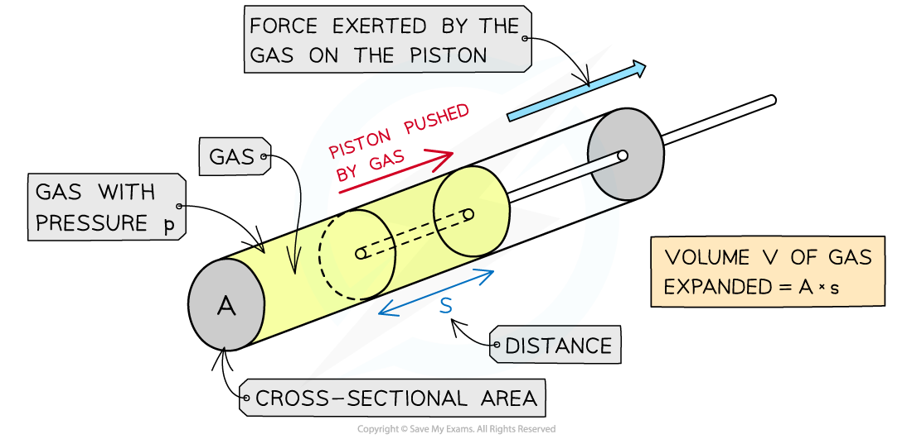
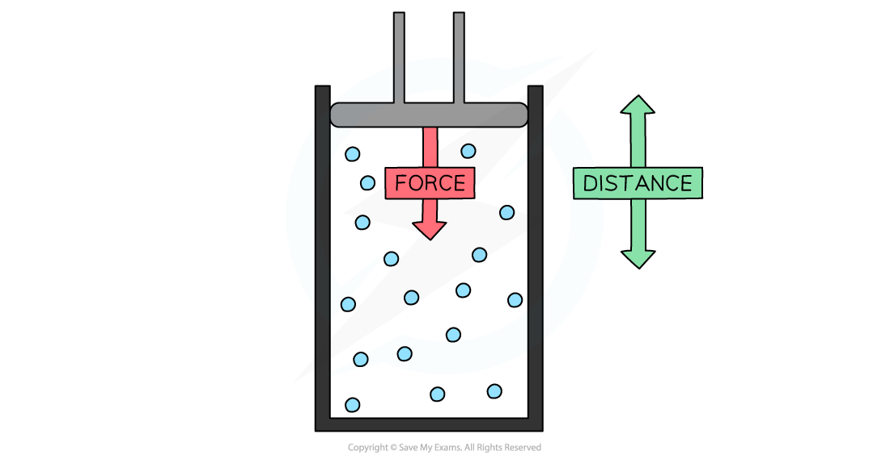
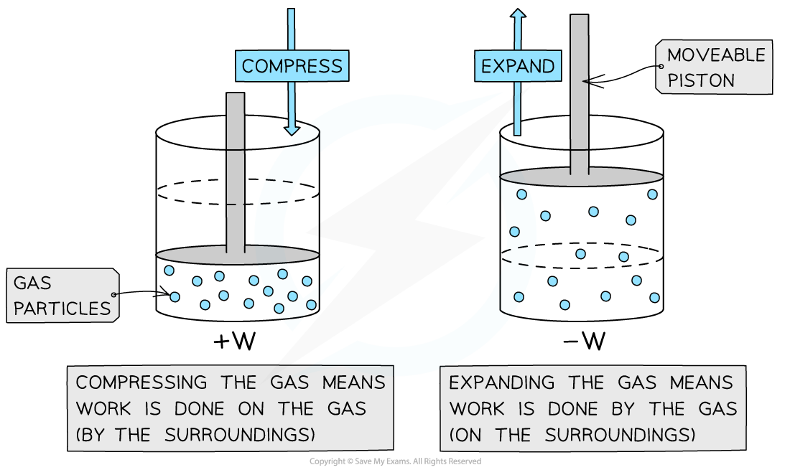

# Work Done by a Gas

## Work Done by a Gas

> **Spec point** — `spcpt_mKx2s9SjbZ7TbmKx`

## Work done by a gas

- When a gas **expands**, it **does work** on its **surroundings** by exerting pressure on the walls of its container
- The **work done** when a **volume** of gas **changes** at constant pressure is defined as:

***W***** = *****p*****Δ*****V***

- Where:

  - *W* = work done (J)
  - *p* = external pressure (Pa)
  - *V* = volume of gas (m3)

### Work done by a gas

- An example of **work done by a gas** is in a steam engine where expanding steam pushes a piston to turn the engine

  - The gas inside the cylinder is enclosed by a moveable piston
  - The force of the gas pushes the piston outwards
- The **work done by** the gas **on the piston** pushes the piston outwards

#### Work done by a gas on a piston

***The gas expansion pushes the piston a distance s***

***  ***

### Work done on a gas

- When **work is done on a gas** its** internal energy is increased** which can also cause an increase in **temperature**
- Work can be done on a gas by **compression**

  - A **force** is used to push a piston by a certain distance
  - This **decreases** the volume of the gas
  - The molecules move around **faster** and therefore have a higher **kinetic energy**
  - This increase in kinetic energy also increases its **temperature**

** **

#### Work done on a gas

***To compress the gas, a force must be used to move the piston a certain distance. This involves doing work.***

### Differences between work done by or on a gas

- When a gas **expands**, work is done **by** the gas (-W)

  - When a gas **expands**, work done W is **negative**

- When the gas is **compressed**, work is done **on** the gas (+W)

  - When a gas is **compressed**, work done W is** positive**

#### Positive and negative work

***Positive or negative work done depends on whether the gas is compressed or expanded***

> **Worked Example**
> When a balloon is inflated, its rubber walls push against the air around it.
> 
> Calculate the work done when the balloon is blown up from 0.015 m3 to 0.030 m3.
> 
> Atmospheric pressure = 1.0 × 105 Pa.
> 
> **Answer: **
> 
> **Step 1:** **Write down the equation for the work done by a gas**
> 
> *W* = *p*Δ*V*
> 
> **Step 2:** **Substitute in values**
> 
> Δ*V* = final volume − initial volume = 0.030 − 0.015 = 0.015 m3
> 
> *W* = (1.0 × 105) × 0.015 = 1500 J

> **Exam Hint**
> The pressure *p* in the work done by a gas equation is not the pressure of the gas but the pressure of the surroundings. This is because when a gas expands, it does work **on** the surroundings.
