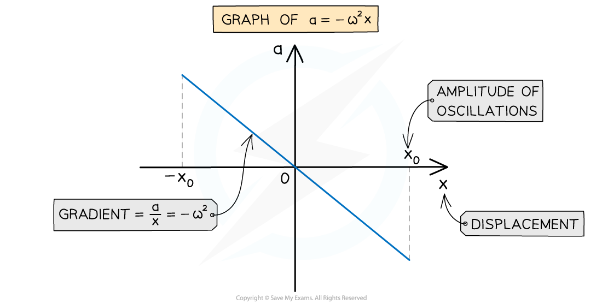
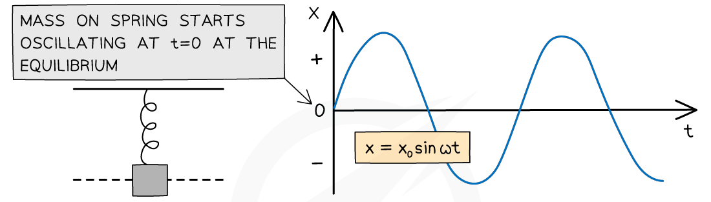

# Calculating Acceleration & Displacement in SHM

## Calculating Acceleration & Displacement of an Oscillator

> **Spec point** — `spcpt_gQh9cctjS4tGH6Bg`

## Calculating acceleration & displacement of an oscillator

### Calculating acceleration

- The acceleration of an object oscillating in *simple harmonic motion* is:

$a=-ω^{2}x$

- Where:

  - *a* = acceleration (m s-2)
  - *⍵* = angular frequency (rad s-1)
  - *x* = displacement (m)
- The equation demonstrates:

  - Acceleration reaches its **maximum** value when the displacement is at a **maximum** i.e. *x* = *x**0* at its *amplitude*
  - The **minus** sign shows that when the object is displaced to the **right**, the direction of the acceleration is to the **left** and vice versa (*a* and *x* are always in opposite directions to each other)

#### The graph representing a = −⍵2x

- The graph of acceleration against displacement is a straight line through the origin and a negative gradient (similar to the line y = − x)

#### The graph of a = −⍵2x

***The acceleration of an object in SHM is directly proportional to the negative displacement***

- Key features of the acceleration-displacement graph:

  - The gradient is equal to − *⍵*2
  - The maximum and minimum displacement *x* values are the amplitudes −*x*0 and +*x*0

### Calculating displacement

- A solution to the SHM acceleration equation is the displacement equation

  - For an object that begins **oscillating from** the **equilibrium position** (*x* = 0 at *t* = 0):

***x***** = *****x*****0****sin(*****⍵t*****)**

- Where:

  - *x* = displacement (m)
  - *x*0 = *amplitude* (m)
  - *t* = time (s)

- This equation can be used to find the **position** of an object in SHM with a particular **angular frequency** and **amplitude** at a specific moment in time
- The displacement will be at its **maximum** when sin(⍵t) equals 1 or −1, when *x *=* x*0

#### The graph of x = x0sin(⍵t)

***This graph shows that at t = 0 then x = 0 and the oscillation of the object is the same as that of a sine curve***

> **Worked Example**
> A mass of 55 g is suspended from a fixed point by means of a spring. The stationary mass is released from the central equilibrium position at *t* = 0 and reaches a maximum displacement of 4.3 cm.
> 
> The mass is observed to perform simple harmonic motion with a period of 0.8 s.
> 
> Calculate the displacement *x* in cm of the mass at time *t* = 0.3 s.
> 
> **Answer:**
> 
> **Step 1: Write down the SHM displacement equation**
> 
> - Since the mass is released at *t* = 0 from its equilibrium position then the displacement is calculated using:
> 
> ***x***** = *****x*****0 ****sin(*****⍵t*****)**
> 
> **Step 2: Calculate angular frequency**
> 
> $ω=\frac{2π}{T}=\frac{2π}{0.8}=7.85\mathrm{rad}s^{-1}$
> 
> - Remember to use the value of the time period given and not any other values of time
> 
> **Step 3: Substitute values into the displacement equation**
> 
> *x* = 4.3 sin (7.85 × 0.3) = 3.044… = 3.0** cm** (2 s.f)
> 
> - Make sure the calculator is in **radians mode**
> - The positive value means the mass is 3.0 cm is on the same side of the equilibrium position to where it started (3.0 cm above it)

> **Exam Hint**
> Since displacement is a vector quantity, remember to keep the minus sign in your solutions if they are negative, you could lose a mark if not!
> 
> Also, remember that your calculator must be in **radians** mode when using the cosine and sine functions. This is because the angular frequency ⍵ is calculated in rad s-1, **not** degrees.
> 
> You often have to convert between time period *T*, frequency *f* and angular frequency ⍵ for many exam questions – so make sure you revise the equations relating to these.
