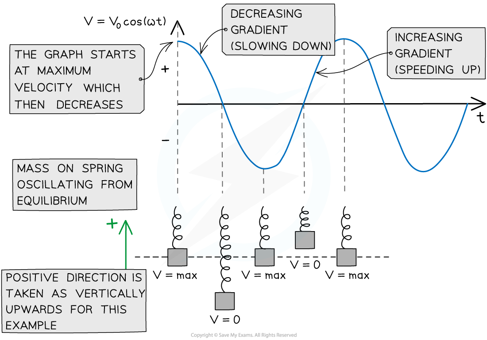

# Calculating Speed in SHM

## Calculating Speed of an Oscillator

> **Spec point** — `spcpt_zb5zR5ZKPrcvKKfw`

## Calculating speed of an oscillator

- The speed of an object in *simple harmonic motion* varies as it oscillates back and forth

  - Its speed is the magnitude of its velocity

### SHM solution equation for speed

- The speed of an oscillator **released from** the **equilibrium position** in SHM is defined by:

***v***** = *****v*****0 ****cos(*****ωt*****)**

- Where:

  - *v* = speed (m s-1)
  - *v*0 = maximum speed (m s-1)
  - *ω* = angular frequency (rad s-1)
  - *t* = time (s)

#### Interpreting the graph v = v0 cos(ωt)

***The variation of the speed of a mass on a spring in SHM over one complete cycle***

- This is a **cosine function** because the object starts oscillating from the equilibrium position (*x* = 0 when *t* = 0)

  - This is shown on the [SHM graphs revision note](https://www.savemyexams.com/a-level/physics/cie/25/revision-notes/17-oscillations/17-1-simple-harmonic-oscillations/shm-graphs/)
- Although the symbol *v* is commonly used to represent velocity, not speed, exam questions focus more on the magnitude of the velocity than its direction in SHM
- The **maximum speed** of an oscillator is the **amplitude**, *v**0* of the **velocity-time graph**

### SHM equation for speed

- The speed *v* changes with the oscillator’s displacement *x* according to the equation:

***v = ±ω***$\sqrt{(x_{0}^{2}-x^{2})}$

- Where:

  - *v* = speed (m s-1)
  - *x*0 = *amplitude* (m)
  - ± = ‘plus or minus’, this value can be positive or negative
  - *ω* = angular frequency (rad s-1)
  - *x* = displacement (m)
- This equation shows that when an oscillator has a greater amplitude *x**0*, it has to travel a greater distance in the same amount of time and hence has greater speed *v*

  - Both speed equations will be given on your data sheet in the exam

### Maximum speed

- An oscillator reaches its greatest speed at the equilibrium position i.e. when its displacement is 0 (*x* = 0)
- At maximum speed the SHM speed equation becomes:

***v*****0**** = *****ωx*****0**

> **Worked Example**
> A simple pendulum oscillates with simple harmonic motion with an amplitude of 15 cm. The frequency of the oscillations is 6.7 Hz.
> 
> Calculate the speed of the pendulum at a position of 12 cm from the equilibrium position.
> 
> **Answer: **
> 
> **Step 1: Write out the known quantities**
> 
> - Amplitude of oscillations, *x*0 = 15 cm = 0.15 m
> - Displacement at which the speed is to be found,** ***x* = 12 cm = 0.12 m
> - Frequency,** ***f* = 6.7 Hz
> 
> **Step 2: Oscillator speed with displacement equation**
> 
> *v = ±ω*$\sqrt{(x_{0}^{2}-x^{2})}$
> 
> Since the speed is being calculated, the ± sign can be removed as direction does not matter in this case
> 
> **Step 3: Write an expression for the angular frequency**
> 
> The equation relating angular frequency and normal frequency:
> 
> *ω* = 2π*f* = 2π× 6.7 = 42.097…
> 
> **Step 4: Substitute in values and calculate**
> 
> $v=(2π\times6.7)\times\sqrt{0.15^{2}-0.12^{2}}$
> 
> *v* = 3.789 = 3.8 m s-1 (2 s.f)

> **Exam Hint**
> You often have to convert between time period *T*, frequency *f* and angular frequency *ω* for many exam questions – so make sure you revise the equations relating to these.
