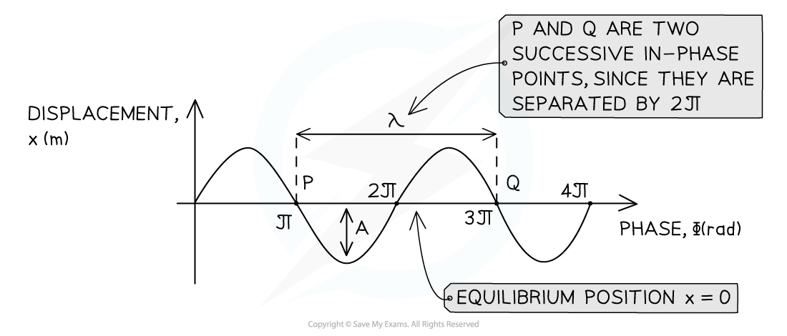

# Describing Oscillations

## Describing Oscillations

> **Spec point** — `spcpt_zsFD4P5xzXtxvCr3`

## Describing oscillations

- An **oscillation** is defined as follows: **The repetitive variation with time *****t***** of the displacement *****x***** of an object about the equilibrium position (*****x***** = 0)  **

**   **

#### Pendulum oscillation on a displacement-time graph

***A pendulum oscillates between A and B. On a displacement-time graph, the oscillating motion of the pendulum is represented by a wave, with an amplitude equal to x******0***

- **Equilibrium position (*****x***** = 0) **is the position when there is no resultant force acting on an object
- **Displacement (*****x*****)** of a wave is the distance of a point on the wave from its equilibrium position

  - It is a vector quantity; it can be positive or negative and it is measured in metres (m)

- **Amplitude (*****x*****0****) **is the **maximum value of the displacement** on either side of the equilibrium position and is known as the **amplitude** of the oscillation

  - Amplitude is measured in metres (m)
- **Wavelength (*****λ*****)** is the **length of one complete oscillation** measured from the same point on two consecutive waves

  - Wavelength is measured in metres (m)

#### Wavelength and amplitude on a displacement-time graph

***Diagram of wavelength and amplitude of a wave***

- **Period (*****T*****)** or time period, is the **time interval **for one complete repetition and it is measured in seconds (s)

  - Simple harmonic oscillations have a **constant period**
  - Time period can be calculated in terms of both frequency and angular frequency by the equations:

$T=\frac{1}{f}$

$T=\frac{2π}{ω}$

- Where:

  - *T *= Time period (s)
  - *f* = frequency (Hz)
  - *ω* = angular frequency (rad s−1)

#### Time period on a displacement-time graph

***Diagram showing the time period of a wave***

- **Frequency** (***f***) is the **number of oscillations per second** measured in hertz (Hz)

  - Hz have the SI units of per second s−1

- **Angular Frequency **(***ω****) *is the **rate of change of angular displacement** with **respect to time**

  - Angular frequency is measured in **rad s****−1**
  - It is given by the equations:

$ω=\frac{2π}{T}$

$ω=2πf$

- Where:

  - *ω *= angular frequency (rad s−1)
  - *T *= time period (s)
  - *f* = frequency (Hz)

### Phase difference

- **Phase** is a useful way to consider wave behaviour
- The phase of a wave can be measured in terms of:

  - Fractions of wavelength
  - Degrees
  - Radians
- One complete oscillation is:

  - 1 wavelength
  - 360°
  - 2π radians

***Wavelength λ and amplitude A of a travelling wave***

- The** phase difference** between two waves is a measure of** how much a point or a wave is in front or behind another**
- This can be found from the **relative position** of the crests or troughs of two different waves of the same frequency

  - When the crests of each wave, or the troughs of each wave are aligned, the waves are **in phase**
  - When the crest of one wave aligns with the trough of another, they are in **antiphase**
- The diagram below shows that

  - the green wave **leads** the purple wave by ¼ λ
  - the purple wave **lags** behind the green wave by ¼ λ

#### A phase difference of 1/4 wavelength

***Two waves ¼ λ out of phase***

- Phase difference can be described as in phase or in anti-phase:

  - **In phase** is **360****o** or 2π radians
  - **In anti-phase** is **180****o** or π radians

> **Worked Example**
> A student sets out to investigate the oscillation of a mass suspended from the free end of a spring. The mass is pulled downwards and then released. The variation with time *t* of the displacement *y* of the mass is shown in the figure below.
> 
> 
> 
> Use the information from the figure to calculate the angular frequency of the oscillations.
> 
> **Answer:**
> 
> **Step 1: Write down the equation for angular frequency**
> 
> $ω=\frac{2π}{T}$
> 
> **Step 2: Calculate the time period T from the graph**
> 
> - The time period is defined as the time taken for **one complete oscillation**
> - This can be read from the graph:
> 
> 
> 
> **T = 2.6 − 0.5 = 2.1 s**
> 
> **Step 3: Substitute into angular frequency equation**
> 
> $ω=\frac{2π}{2.1}=2.9919=3.0\mathrm{rad}s^{-1}$

> **Exam Hint**
> The properties used to describe oscillations are very similar to transverse waves. The key difference is that oscillators do not have a ‘wavelength’ and their direction of travel is only kept within the oscillations themselves rather than travelling a distance in space.
> 
> When labelling the wavelength and time period on a diagram:
> 
> - Make sure that your arrows go from the **very top** of a wave to the very top of the next one
> - If your arrow is too short, you will lose marks
> - The same goes for labelling amplitude, don’t draw an arrow from the bottom to the top of the wave, this will lose you marks too.
