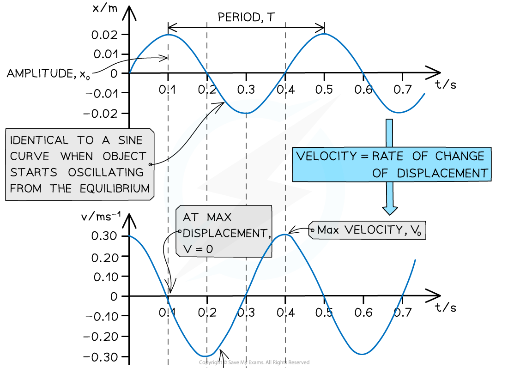
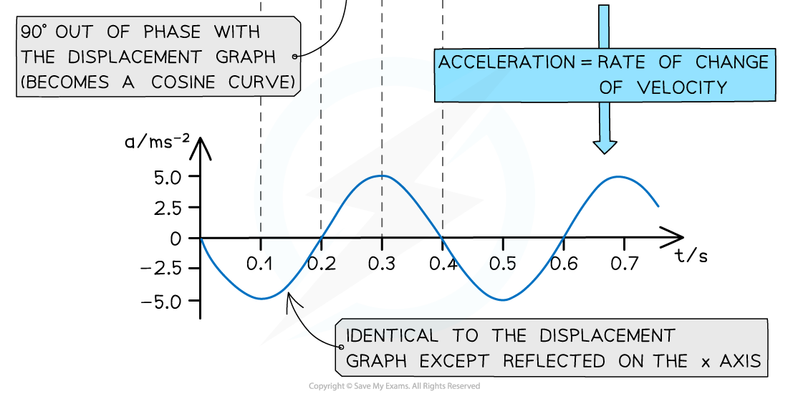

# SHM Graphs

## SHM Graphs

> **Spec point** — `spcpt_Yjt9cQgWXbCySMZR`

## SHM graphs

- The displacement, velocity and acceleration of an object in *simple harmonic motion* can be represented graphically against time
- The graphs of all [undamped](https://www.savemyexams.com/a-level/physics/cie/25/revision-notes/17-oscillations/17-3-damped-and-forced-oscillations-resonance/damping/) SHM oscillations are represented as **periodic functions**

  - This means they can all be described by sine and cosine curves
- You need to know what each graph looks like and how it relates to the other graphs
- Remember that:

  - Velocity is the rate of change of displacement $v=\frac{s}{t}$
  - Acceleration is the rate of change of velocity $a=\frac{\Deltav}{t}$

- When oscillations start from the **equilibrium position** then:

  - The **displacement-time** graph is a** sine curve**
  - The **velocity-time** graph is the **gradient** of the **displacement-time** graph, so a **cosine** graph and 90o out of *phase* with the displacement-time graph
  - The **acceleration-time** graph is the **gradient** of the **velocity-time graph**, so a** negative sine** graph and 90o out of phase with the velocity-time graph
- More information on this can be found in the [IGCSE Maths revision notes](https://www.savemyexams.com/igcse/maths_extended/cie/23/revision-notes/2-algebra-and-graphs/2-18-differentiation/2-18-1-differentiation/) on differentiation and [CIE A level Maths pure 3 revision notes](https://www.savemyexams.com/a-level/maths_pure-3/cie/20/revision-notes/4-differentiation/4-1-further-differentiation/4-1-1-differentiating-other-functions-trig-ln--e-etc/) on differentiating other functions

#### Graphs of displacement, velocity and acceleration against time

***The displacement, velocity and acceleration graphs in SHM are all 90° out of phase with each other***

### Relationship between graphs

- **Key features of the displacement-time graphs:**

  - The *amplitude* of oscillations *A* is the maximum value of *x*
  - The *time period* of oscillations *T* is the time taken for one full wavelength cycle
- **Key features of the velocity-time graphs:**

  - The velocity of an oscillator at any time can be determined from the **gradient of the displacement-time graph:** 
  - An oscillator moves the fastest at its equilibrium position
  - Therefore, the velocity is at its **maximum** when the **displacement is zero (**the amplitude of the graph is *v**max*)

- **Key features of the acceleration-time graph:**

  - The acceleration graph is a reflection of the displacement graph in the x-axis
  - This means when a mass has positive displacement (to the right) the acceleration is in the opposite direction (to the left) and vice versa (from *a* = −*ω**2**x*)
  - The acceleration of an oscillator at any time can be determined from the **gradient of the velocity-time graph:** 
  - The maximum value of the acceleration is when the oscillator is at its **maximum displacement**

> **Worked Example**
> A swing is pulled 5 cm and then released. The variation of the horizontal displacement *x* of the swing with time t is shown on the graph below.
> 
> 
> 
> The swing exhibits simple harmonic motion.
> 
> Use data from the graph to determine at what time the velocity of the swing is first at its maximum.
> 
> **Answer: **
> 
> **Step 1: **The velocity is at its maximum when the displacement *x* = 0
> 
> **Step 2: **Reading value of time when *x* = 0
> 
> **From the graph, this is equal to 0.2 s**

> **Exam Hint**
> These graphs might not look identical to what is in your textbook, depending on where the object starts oscillating from at *t* = 0 (on either side of the equilibrium, or at the equilibrium). However, if there is no damping, they will all always be general sine or cosine curves.
