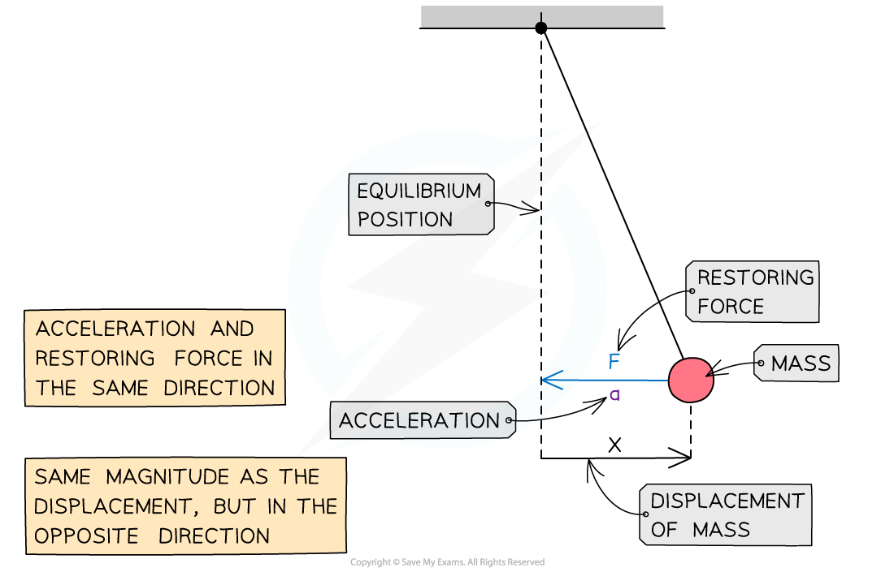
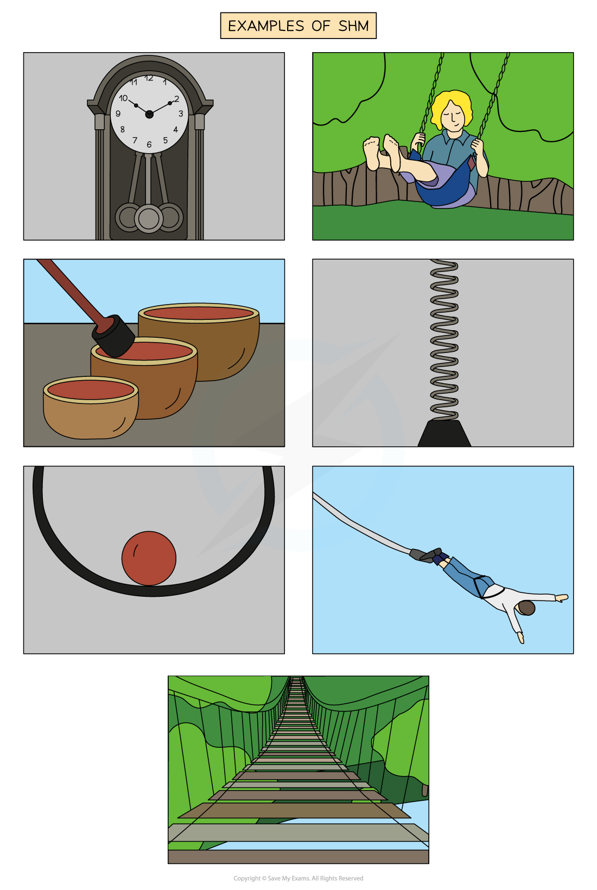
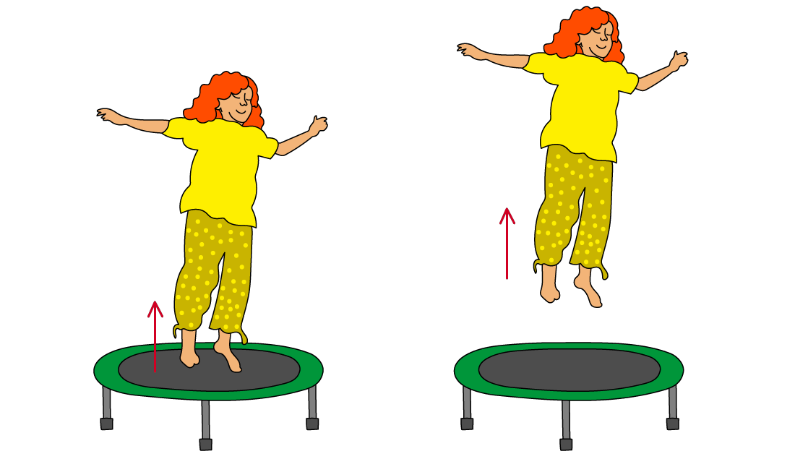

# Simple Harmonic Motion

## Conditions for Simple Harmonic Motion

> **Spec point** — `spcpt_BWnYCHRnDxtzMKYT`

## Conditions for simple harmonic motion

- **Simple harmonic motion (SHM) **is a specific type of oscillation that occurs when **acceleration** is **proportional** to **displacement** from a **fixed point** and in the **opposite direction**

*** ***

- An object is said to perform **simple harmonic oscillations** when all of the following apply:

  - The oscillations are periodic (repeating)
  - There is a central equilibrium point known as the fixed point
  - The object's displacement, velocity and acceleration change continuously
  - There is a** restoring force** always directed towards the fixed point
  - The magnitude of the restoring force is proportional to the displacement
  - The restoring force causes the acceleration

- The **restoring force **and the** acceleration **must always be:

  - Directed towards the equilibrium position, and hence, in the **opposite **direction to the** displacement**
  - Directly **proportional **to the** displacement**

*a* ∝ −*x*

- Where:

  - *a* = acceleration (m s−2)
  - *x* = displacement (m)

#### Restoring force, acceleration and displacement

***Force, acceleration and displacement of a simple pendulum in SHM***

### Examples of simple harmonic motion

- Examples of oscillators that undergo SHM are:

  - The pendulum of a clock
  - A child on a swing
  - The vibrations of a bowl
  - A bungee jumper reaching the bottom of his fall
  - A mass on a spring
  - Guitar strings vibrating
  - A ruler vibrating off the end of a table
  - The electrons in alternating current flowing through a wire
  - The movement of a swing bridge when someone crosses
  - A marble dropped into a bowl

#### Examples of simple harmonic motion

***A pendulum, bungee jumper, swing bridge, vibrations in a prayer bowl, a swing, a ball rolling up and down the sides of a bowl and a spring are all examples of simple harmonic oscillations.***

*** ***

#### An example of not SHM

- A person jumping on a trampoline is not an example of simple harmonic motion because:

  - The **restoring force** on the person is not proportional to their **displacement** from the equilibrium position and always acts down
  - When the person is** not in contact **with the trampoline, the restoring force is equal to their weight, which is constant
  - This **does not change**, even if they jump higher

***The restoring force of the person bouncing is equal to their weight and always acts downwards***
