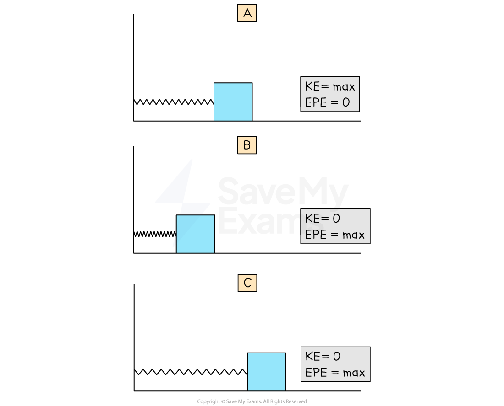
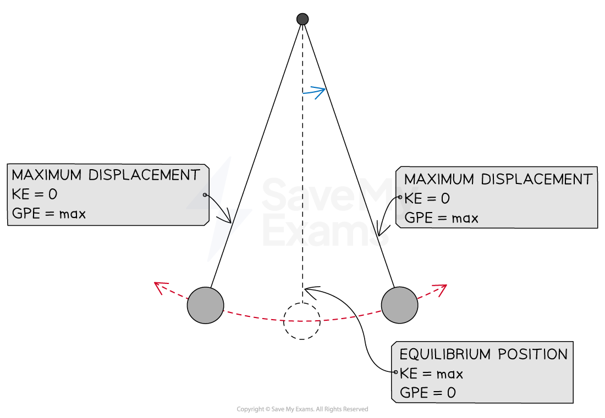
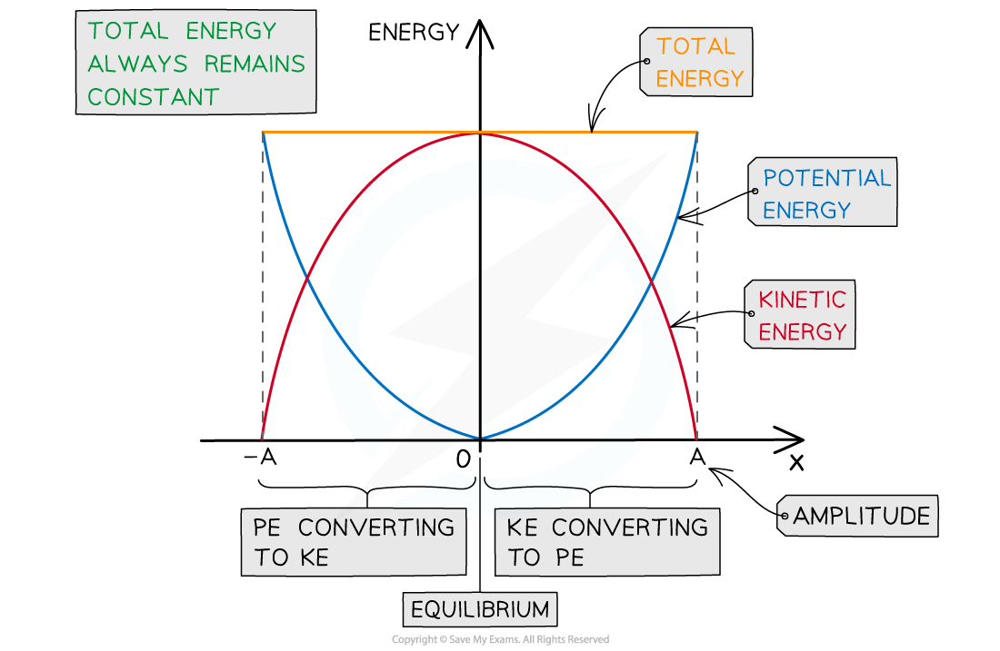

# Energy in SHM

## Kinetic & Potential Energies

> **Spec point** — `spcpt_zpqB8BzTY3ygB8tn`

## Kinetic & potential energies

- Simple harmonic motion also involves an **interchange** between potential and kinetic energy

  - The swinging of a **pendulum** is an interplay between ***gravitational potential energy*** and ***kinetic energy***
  - The** horizontal** oscillation of a** mass on a spring** is an interplay between ***elastic potential energy*** and **kinetic energy**
  - The** vertical** oscillation of a** mass on a spring** is an interplay between ***elastic potential energy***, **gravitational potential energy** and **kinetic energy**

### Energy of a horizontal mass-spring system

- The system has the maximum amount of **elastic potential energy **when the spring is stretched or compressed to its **maximum displacement** from the equilibrium position (amplitude)
- When the **mass is released,** it moves towards the equilibrium position, accelerating as it goes, causing the **kinetic energy** to **increase**
- At the equilibrium position, the velocity of the mass is at its maximum, therefore the **kinetic energy** is at its **maximum** and **elastic potential energy** is at its **minimum**
- Once **past the equilibrium** position the **kinetic energy decreases** and elastic **potential energy** **increases **

#### Energy interchange for horizontal mass-spring system

***In a horizontal mass-spring system the kinetic energy is maximum in the equilibrium position and the elastic potential energy is maximum in the amplitude position***

### Energy of a simple pendulum

- The pendulum has its** maximum** **gravitational potential energy **at the point of **maximum displacement** from the equilibrium position (amplitude)
- When the pendulum is **released**, it moves towards the equilibrium position, **accelerating** as it goes and the **kinetic energy increases**
- As the pendulum swings through the **equilibrium** position, its velocity is at a maximum, and therefore **kinetic energy** is at a **maximum **and **gravitational potential energy** is at a **minimum**
- Once the mass has passed the equilibrium position, **kinetic energy decreases** and **gravitational potential energy increases**

#### Energy interchange for a simple pendulum

***In a simple pendulum, the kinetic energy is maximum in the equilibrium position and the gravitational potential energy is maximum in the amplitude position***

> **Exam Hint**
> You may be expected to draw as well as interpret energy graphs against time or displacement in exam questions. Make sure the sketches of the curves are as even as possible and **use a ruler** to draw straight lines, for example, to represent the total energy.

## Calculating Total Energy of a Simple Harmonic System

> **Spec point** — `spcpt_FxNnzsT6SYB3f754`

## Calculating total energy of a simple harmonic system

### Total energy equation

- The **total energy** of a system undergoing ***simple harmonic motion*** is defined by:

$E=\frac{1}{2}mω^{2}x_{0}^{2}$

- Where:

  - *E* = total energy of a simple harmonic system (J)
  - *m* = mass of the oscillator (kg)
  - *⍵* = angular frequency (rad s-1)
  - *x**0* = amplitude (m)

### Sum of potential and kinetic energies

- The **total energy** in the system remains constant, but the amount of kinetic and potential energy varies throughout the oscillation
- **Total energy **is the** sum **of the** potential **and** kinetic energies:**

***E = E******P****** + E******K***

- Where:

  - *E* = total energy in joules (J)
  - *E**P* = potential energy in joules (J)
  - *E**K* = kinetic energy in joules (J)
- Remember the equations for potential and kinetic energy:

  - [Gravitational potential energy](https://www.savemyexams.com/a-level/physics/cie/25/revision-notes/5-work-energy-and-power/5-2-gravitational-potential-energy-and-kinetic-energy/gravitational-potential-energy/): *E**p* = *mgh*
  - [Elastic potential energy](https://www.savemyexams.com/a-level/physics/cie/25/revision-notes/6-deformation-of-solids/6-2-elastic-and-plastic-behaviour/elastic-potential-energy/), *E**p* = $\frac{1}{2}kx^{2}$
  - [Kinetic energy](https://www.savemyexams.com/a-level/physics/cie/25/revision-notes/5-work-energy-and-power/5-2-gravitational-potential-energy-and-kinetic-energy/kinetic-energy/), *E**k* = $\frac{1}{2}mv^{2}$

#### Energy-displacement graph

- The **kinetic** and **potential energy transfers** go through **two** complete cycles during one ***period*** of oscillation

  - One complete oscillation reaches the maximum displacement **twice** (once on the positive side and once on the negative side of the equilibrium position)
- You need to be familiar with the graph showing the total, potential and kinetic energy transfers in **half an SHM oscillation **(half a cycle)

#### Energy displacement graph for half an oscillation

***Graph showing the potential and kinetic energy against displacement in half a period of an SHM oscillation***

- **The key features of the energy-displacement graph are:**

  - Displacement occurs in both directions, so the graph has both **positive** and **negative** *x* values
  - The potential energy is always maximum at the *amplitude* positions *x* = *A*
  - The potential energy is always at a minimum or zero at the equilibrium position *x* = 0
  
    - This is represented by a **‘U’ shaped curve**
  - The kinetic energy is the opposite:
  - Kinetic energy is at a minimum or zero at the amplitude positions *x* = *A*
  - Kinetic energy is at a maximum at the equilibrium position *x* = 0
  
    - This is represented by an **‘n’ shaped curve**
  - The total energy is represented by a **horizontal straight line** above the curves

> **Worked Example**
> A ball of mass 23 g is held between two fixed points A and B by two stretch helical springs, as shown in the figure below.
> 
> 
> 
> The ball oscillates along the line AB with simple harmonic motion of frequency 4.8 Hz and amplitude 1.5 cm.
> 
> Calculate the total energy of the oscillations.
> 
> **Answer:  **
> 
> **Step 1: Write down all known quantities**
> 
> - Mass,* m* = 23 g = 23 × 10–3 kg
> - Amplitude, *x**0* = 1.5 cm = 0.015 m
> - Frequency, *f* = 4.8 Hz
> 
> **Step 2:** **Write down the equation for the total energy of SHM oscillations:   **
> 
> $E=\frac{1}{2}mω^{2}x_{0}^{2}$
> 
> **Step 3: Write an expression for the angular frequency**
> 
> $ω=2πf=2π\times4.8$** **
> 
> **Step 4: Substitute values into the energy equation   **
> 
> $E=\frac{1}{2}\times(23\times10^{-3})\times(2π\times4.8)^{2}\times(0.015)^{2}$
> 
> $E=2.354\times10^{-3}=2.4\mathrm{mJ}(2s.f.)$
