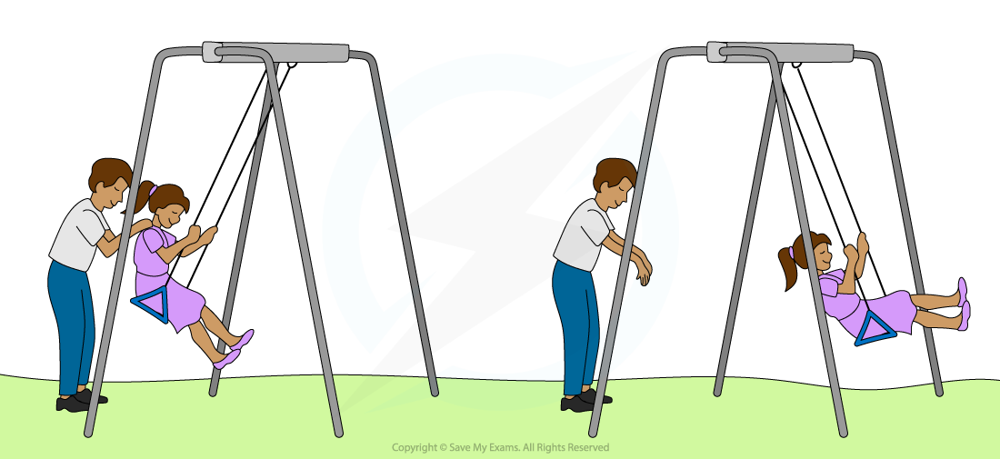

# Resonance

## Resonance

> **Spec point** — `spcpt_HfrwJZxgCypFNsSt`

## Resonance

- **Resonance** involves a **maximum amplitude** of oscillation that occurs when an oscillating system is **forced** to oscillate at its **natural frequency**

  - All oscillating systems have a **natural frequency (*****f******0*****)**, the frequency at which the system is allowed to oscillate freely
  - The **driving frequency (*****f*****)** is the frequency of the forced oscillations

- When the **driving frequency** **approaches** the **natural frequency** of an oscillator, the system **gains** more **energy** from the driving force

  - Eventually, when they are equal, the **oscillator vibrates** with its **maximum amplitude**, this is **resonance**

- For example, when a child is **pushed** on a **swing**:

  - The swing and child have a **fixed natural frequency**
  - A small **push** after each cycle creates the **driving frequency** increasing the amplitude of the oscillations so the child **swings higher**
  - **Resonance** occurs when the driving frequency is **equal** to the natural frequency
  - When the driving frequency does not quite match the natural frequency, the amplitude will increase but not to the same extent as when resonance is achieved
- At resonance, energy is transferred from the driver to the oscillating system in the most **efficient way**

  - Therefore, at resonance, the system transfers the maximum kinetic energy possible

#### A child pushed on a swing

***The person pushing the swing supplies an applied force to the system at the driving frequency until the child oscillates at the maximum frequency, the natural frequency ***
