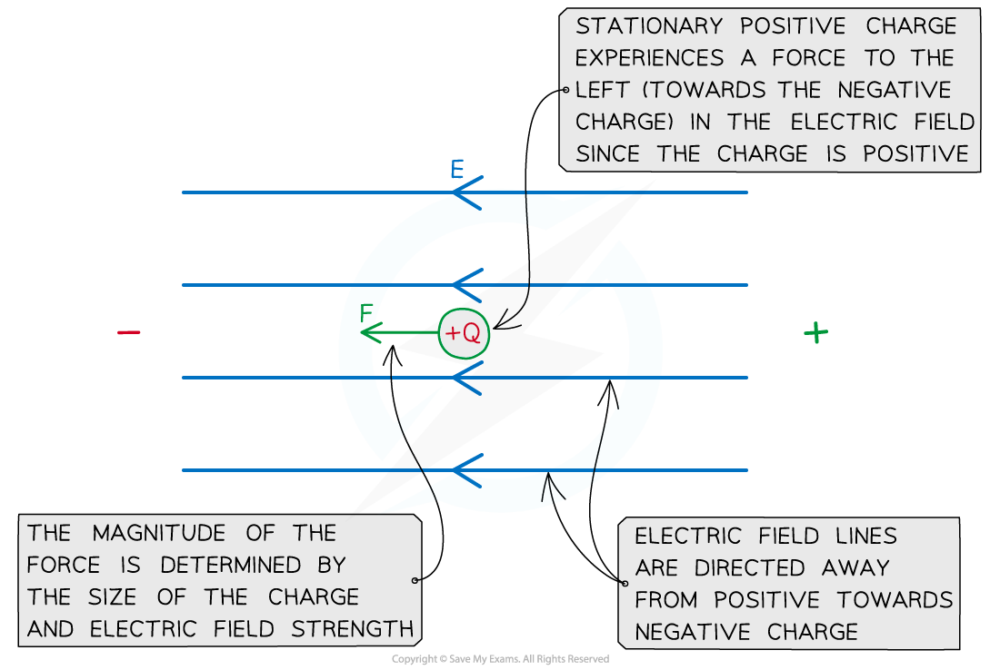

# Electric Fields & Forces on Charges

## Electric Field Definition

> **Spec point** — `spcpt_cG9fpCw7nQs7k7ng`

## Electric field definition

- An **electric field** is a region of space in which an electric charge experiences a force
- The** **electric field at a point is defined as: **The force per unit positive charge**
- It is important to use a** positive** *test charge* in this definition, as this determines the direction of the electric field
- Using this convention, an electric field is always directed:

  - **away **from a positive charge
  - **towards **a negative charge

## Forces on Charges

> **Spec point** — `spcpt_5fvtmXYS5pZjk9RK`

## Forces on charges

### Electric field strength

- The** **electric field strength at a point is defined as: **The force per unit charge experienced by a small stationary positive test charge placed at that point**
- The magnitude of field strength can be calculated using the equation:

$E=\frac{F}{q}$

- Where:

  - *E* = electric field strength (N C−1)
  - *F* = electric force on the charge (N)
  - *q* = magnitude of the charge (C)

- Electric field strength is a **vector** quantity

  - Its direction is defined in terms of the direction a small positive *test charge* would move if placed in the field

### Electric force

- Using the equation for field strength, the force on a charge in an electric field is given by:

$F=qE$

- Where:

  - *F* = force on the charge (N)
  - *q* = magnitude of the charge (C)
  - *E* = electric field strength (N C-1)

- Like electric field strength, the direction of the force on a charge is also defined in terms of a positive test charge
- For example, in an electric field of strength $E$:

  - a positive charge $+q$ experiences a force $Eq$ in the direction of the field
  - a negative charge $-q$ experiences a force $Eq$ in the **opposite **direction

#### Force on a positive charge

***A positive charge Q in an electric field of strength E experiences a force F in the direction of the field***

> **Worked Example**
> A stationary electron is in an electric field of field strength 5000 N C-1.
> 
> Calculate the magnitude of the force that acts on the electron and state the direction it acts in relation to the electric field.
> 
> **Answer: **
> 
> **Step 1: Write out the equation for the force on a charged particle**
> 
> $F=qE$
> 
> **Step 2: Substitute in values**
> 
> *F* = (1.60 × 10-19) × 5000 = 8.0 × 10-16 N
> 
> **Step 3: State the direction of the force**
> 
> - Since the charge is negative, the force is **directed against the electric field lines**
