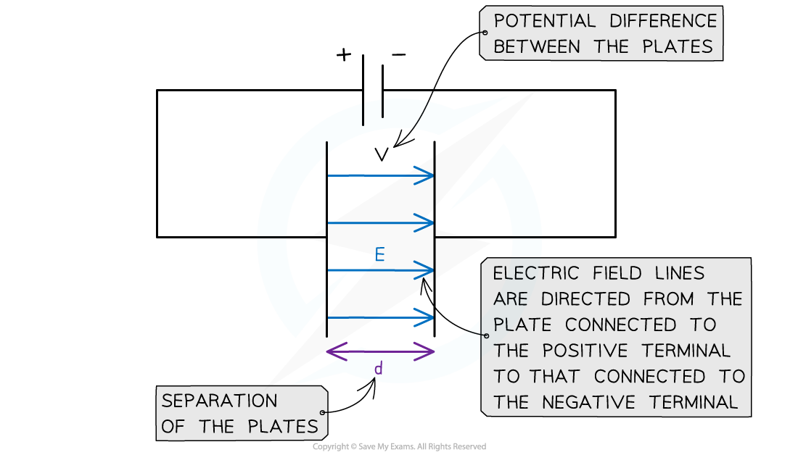
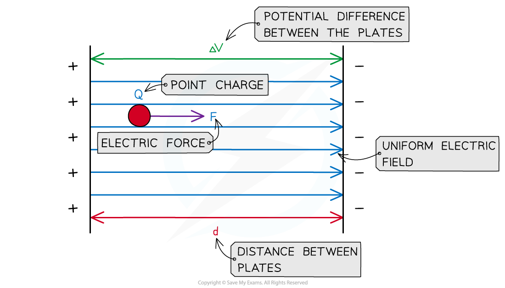

# Electric Field Between Parallel Plates

## Electric Field Strength

> **Spec point** — `spcpt_QVBvnhWRWG9jzCpp`

## Electric field between parallel plates

- When two points in an electric field are at different potentials, there is a **potential difference** between them

  - To move a charge across that potential difference, **work** needs to be done on the charge
  - Two charged parallel plates with a potential difference of *V* between them create a uniform electric field

- The magnitude of the **uniform electric field strength** between two charged parallel plates is defined by the equation:

$E=\frac{\DeltaV}{\Deltad}$

- Where:

  - *E* = *electric field strength* (V m−1)
  - Δ*V* = potential difference between the plates (V)
  - Δ*d* = distance between the plates (m)

- **Note:** both units for electric field strength, V m−1 and N C−1, are **equivalent **
- The equation shows:

  - the greater the **potential difference** between the plates, the **stronger** the field
  - the greater the **separation** between the plates, the **weaker** the field

- This equation cannot be used to find the electric field strength around a *point charge*

  - This is because the field around a point charge is radial

- The electric field between two plates is directed:

  - from the **positive plate** (i.e. the one connected to the positive terminal)
  - to the **negative plate **(i.e. the one connected to the negative terminal)

#### Uniform electric field between two parallel plates

***The electric field strength between two charged parallel plates is the ratio of the potential difference and distance between the plates***

### Derivation of electric field strength between two parallel plates

- When a charge *q* moves from one plate to the other, the work done on the charge by the field is

$W=Fd$

- Where:

  - *W* = work done on charge (J)
  - *F* = force on the charge (N)
  - *d* = distance between plates (m)
- The work done in moving a charge *q* through a potential difference *V *between parallel plates is given by:

$W=qV$

- Equating the two expressions:

$Fd=qV$

- The electric field strength between the plates is therefore given by:

$E=\frac{F}{q}=\frac{V}{d}$

***The work done on a charge in an electric field depends on the force and the distance between the plates***

> **Worked Example**
> Two parallel metal plates separated by 3.5 cm have a potential difference of 7.9 kV between them.
> 
> Calculate the electric force acting on a stationary point charge of 2.6 × 10−15 C when placed between the plates.
> 
> **Answer:**
> 
> **Step 1: List the known quantities**
> 
> - Potential difference between plates, *V* = 7.9 kV = 7900 V
> - Distance between plates, *d* = 3.5 cm = 0.035 m
> - Charge, *q* = 2.6 × 10−15 C
> 
> **Step 2: Equate the equations for electric field strength **
> 
> E field between parallel plates:  $E=\frac{V}{d}$
> 
> E field on a point charge:  $E=\frac{F}{q}$
> 
> $E=\frac{F}{q}=\frac{V}{d}$
> 
> **Step 3: Rearrange the expression for electric force F**
> 
> $F=\frac{qV}{d}$
> 
> **Step 4: Substitute values to calculate the force on the point charge**
> 
> $F = \frac{( 2.6 \times 10^{- 15} ) \times 7900}{0.035} = 5.9 \times 10^{- 10}$ N (2 s.f.)

> **Exam Hint**
> Remember the equation for electric field strength with *V* and *d* is only valid for **parallel plates**, and **not **for point charges
> 
> However, when a point charge moves between two parallel plates, the two equations for electric field strength can be equated:
> 
> $E=\frac{F}{Q}=\frac{V}{d}$
> 
> Top tip: if one of the parallel plates is **earthed**, it has a voltage of **0 V**
