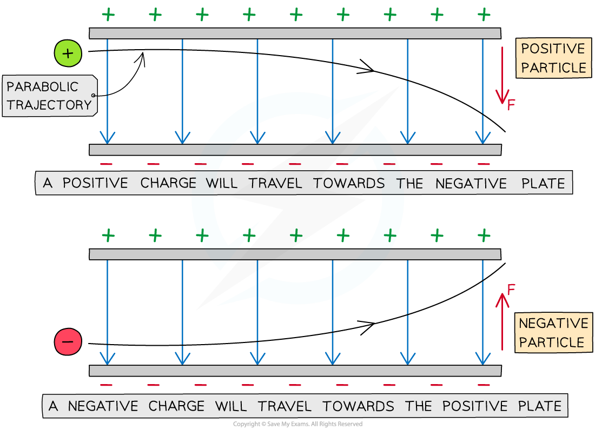

# Motion of Charged Particles

## Motion of Charged Particles

> **Spec point** — `spcpt_MzzjDbpVYHY2dp3M`

## Motion of charged particles

- A **charged** particle in a **uniform **electric field will experience a **force** on it that will cause it to **move**

  - If the charge is **stationary**, it will move **parallel** to the field lines (along or against the field lines depending on its charge)
  - If the charge is in **motion** (perpendicular to the field lines), it will experience a constant force and travel in a **parabolic trajectory**

***The parabolic path of charged particles in a uniform electric field***

- The direction of the parabola will depend on the charge of the particle

  - A **positive** charge will be deflected towards the **negative** plate
  - A **negative** charge will be deflected towards the **positive** plate

- The force on the particle is the same at all points and is always in the same direction

  - **Note:** an uncharged particle, such as a neutron experiences **no** force in an electric field and will therefore travel **straight** **through** the plates undeflected

- The amount of deflection depends on the following properties of the particles:

  - **Mass** – the **greater** the mass, the **smaller** the deflection and vice versa
  - **Charge** – the **greater** the magnitude of the charge of the particle, the **greater** the deflection and vice versa
  - **Speed **– the **greater** the speed of the particle, the **smaller** the deflection and vice versa

> **Worked Example**
> A single proton travelling with a constant horizontal velocity enters a uniform electric field between two parallel charged plates.
> 
> The diagram shows the path taken by the proton.
> 
> 
> 
> Draw the path taken by a boron nucleus that enters the electric field at the same point and with the same velocity as the proton.
> 
> Atomic number of boron = 5
> 
> Mass number of boron = 11
> 
> **Answer:**
> 
> **Step 1: Compare the charge of the boron nucleus to the proton**
> 
> - Boron has 5 protons, meaning it has a charge 5 × greater than the proton
> - The force on boron will therefore be 5 × greater than on the proton
> - This is because electric force *F* is proportional to the charge *Q*
> 
> $F=EQ$
> 
> **Step 2: Compare the mass of the boron nucleus to the proton**
> 
> - The boron nucleus has a mass of 11 nucleons meaning its mass is 11 × greater than the proton
> - The boron nucleus will therefore be **less** deflected than the proton
> 
> **Step 3: Draw the trajectory of the boron nucleus**
> 
> - Since the mass comparison is much greater than the charge comparison, the boron nucleus will be **much less deflected** than the proton
> - The nucleus is positively charged since the neutrons in the nucleus have no charge
> 
>   - Therefore, the shape of the path will be the same as the proton
> 
> 

> **Exam Hint**
> Remember** less** deflection (e.g. from a higher mass particle) means the particle hits the plate **later** and the path has a smaller **curve**. Think of it as the particle being heavier so it is harder to steer it towards the plate.
