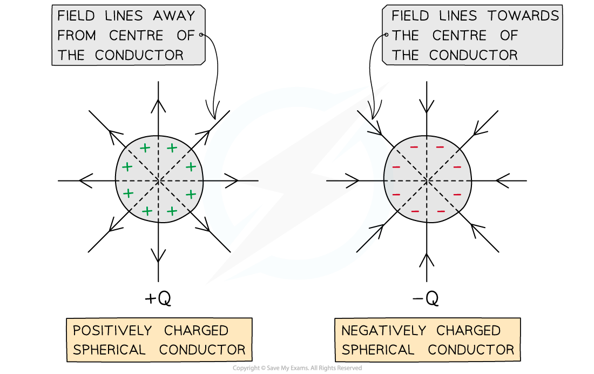

# Electric Force Between Two Point Charges

## Point Charge Approximation 

> **Spec point** — `spcpt_PGjWbCN2cwDpnyCr`

## Point charge approximation

- When calculating the force between two charges, air is treated as a **vacuum**

  - This is why the permittivity of **free** space ε0 is used

- For a point outside a spherical conductor, the charge of the sphere may be considered to be a **point charge** at its centre

  - A **uniform** spherical conductor is one where its charge is **distributed evenly**

- The electric field lines around a spherical conductor are therefore **identical** to those around a point charge

  - An example of a spherical conductor is a **charged sphere**

- The field lines are **radial **and their direction depends on the charge of the sphere

  - If the spherical conductor is **positively** charged, the field lines are directed **away** from the centre of the sphere
  - If the spherical conductor is **negatively** charged, the field lines are directed **towards** the centre of the sphere

***Electric field lines around a uniform spherical conductor are identical to those on a point charge***

> **Exam Hint**
> You might have noticed that the electric fields share many similarities to the gravitational fields. The main difference being the gravitational force is always attractive, whilst electrostatic forces can be attractive or repulsive.
> 
> You should make a list of all the similarities and differences you can find, as this could come up in an exam question.

## Coulomb's Law

> **Spec point** — `spcpt_5R6DfW7yPhBwDvDY`

## Coulomb's law

- All charged particles generate an electric field

  - This field exerts a force on charged particles which are nearby

- The electric force between two charges is defined by Coulomb’s law, which states that: **The force between two point charges is directly proportional to the product of the charges and inversely proportional to the square of the distance between them**
- This electric force can be calculated using the expression:

$F=\frac{Q_{1}Q_{2}}{4πε_{0}r^{2}}$

- Where:

  - *F* = electric force between two charges (N)
  - *Q**1*, *Q**2* = magnitudes of the charges (C)
  - *r* = distance between the centres of the two charges (m)
  - *ε*0 = *permittivity of free space*

#### Electrostatic attraction between two charges

***The attractive electric force F******E****** between two point charges +Q and −Q with a separation of r is defined by Coulomb’s law***

- The constant *ε**0* is the **permittivity of free space**

  - *ε**0* = 8.85 × 10–12 C2 N–1 m–2 and refers to charges in a vacuum
  - The value of the permittivity of air is taken to be the same as *ε**0*
  - All other materials have a higher permittivity *ε > ε**0*
  - *ε* is a measure of the resistance offered by a material in creating an electric field within it

- Sometimes Coulomb's law may be written as

$F=k\frac{Q_{1}Q_{2}}{r^{2}}$

- Where $k=\frac{1}{4πε_{0}}$ is the Coulomb constant
- The value of *k* depends on the material between the charges

  - In a **vacuum**, *k* = 8.99 × 109 N m2 C–2

### Repulsive & attractive forces

- Unlike the gravitational force between two masses which is only attractive, electric forces can be:

  - **attractive** (the charges move closer together)
  - **repulsive** (the charges move further apart)

***Opposite charges attract, like charges repel***

- Between two charges of the **same type**:

  - The product *Q**1**Q**2* is positive, so the electrostatic force is positive
  - A positive force means the charges experience **repulsion**

- For two **opposite charges**:

  - The product *Q**1**Q**2* is negative, so the electrostatic force is negative
  - A negative force means the charges experience **attraction**

> **Worked Example**
> An alpha particle is placed 2.0 mm from a gold nucleus in a vacuum.
> 
> Taking them as point charges, calculate the magnitude of the electric force acting between the nuclei.
> 
> - Proton number of helium = 2
> - Proton number of gold = 79
> 
> **Answer:**
> 
> **Step 1: Write down the known quantities**
> 
> - Separation between charges, *r* = 2.0 mm = 2.0 × 10–3 m
> - Elementary charge, *e* = 1.60 × 10–19 C (from the data booklet)
> - Permittivity of free space, *ε**0* = 8.85 × 10–12 F m–2 (from the data booklet)
> 
> **Step 2: Calculate the charges of the alpha particle and gold nucleus **
> 
> - An alpha particle (helium nucleus) has 2 protons, hence it has a charge of:
> 
> *Q**1* = 2*e* = 2 × (1.60 × 10–19)
> 
> - A gold nucleus has 79 protons, hence it has a charge of:
> 
> *Q**2* = 79*e* = 79 × (1.60 × 10–19)
> 
> **Step 3: Write down Coulomb's law**
> 
> $F=\frac{Q_{1}Q_{2}}{4πε_{0}r^{2}}$
> 
> **Step 4: Substitute the values and calculate the magnitude of the electric force**
> 
> $F = \frac{2 \times 79 \times ( 1.60 \times 10^{- 19} )^{2}}{4 \mathrm{\pi } \times ( 8.85 \times 10^{- 12} ) \times ( 2.0 \times 10^{- 3} )^{2}} = 9.1 \times 10^{- 21}$ N (2 s.f.)

> **Exam Hint**
> You do not need to memorise the value of the permittivity of free space *ε**0*, nor the Coulomb constant 1/4π*ε**0*, as these are both given on the data sheet.
> 
> Unless specified in the question, you should assume that charges are located in a vacuum.
> 
> You should note that Coulomb's law can only be applied to charged spheres whose size is much smaller than their separation. Only in this case, the point charge approximation is valid. You must remember that the separation *r* must be taken from the centres of the spheres.
> 
> You cannot use Coulomb's law to calculate the force between charges distributed on irregularly shaped objects.
