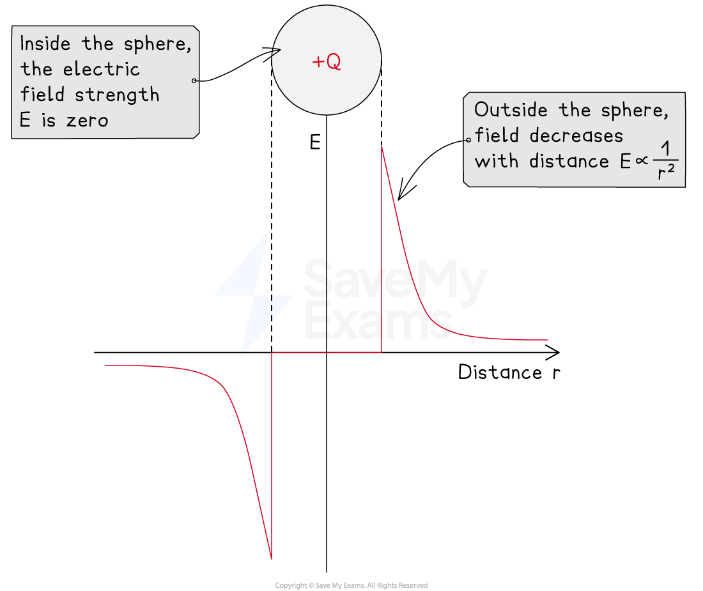
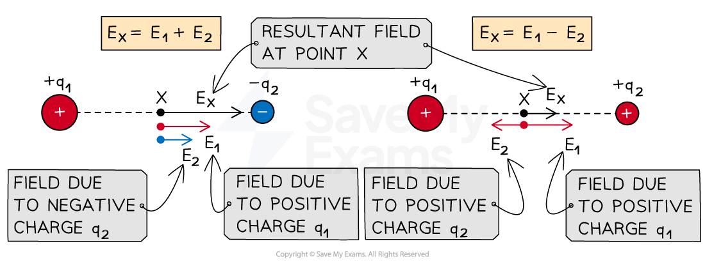
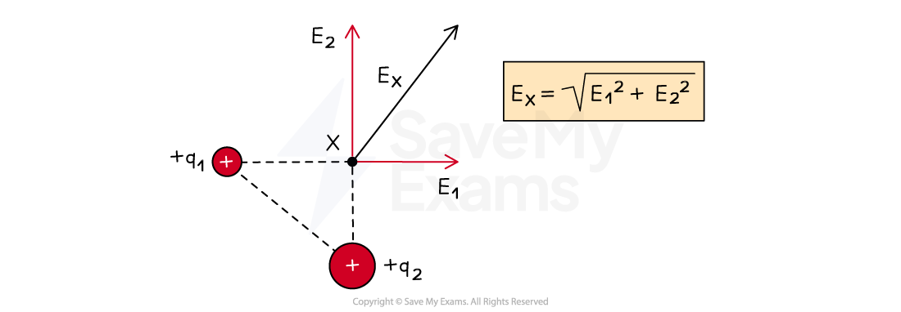

# Electric Field Strength of a Point Charge

## Electric Field of a Point Charge

> **Spec point** — `spcpt_ccXrJFsq3nk5JCTf`

## Electric field of a point charge

- The strength of an electric field due to a point charge decreases with the square of the distance

  - This is an *inverse square law*, similar to Coulomb's law

- Using Coulomb's law and the electric field strength equation this can be written as:

$E=\frac{F}{q}=\frac{Q}{4πε_{0}r^{2}}$

- Where:

  - *Q* = the point charge producing the radial electric field (C)
  - *r* = distance from the centre of the charge (m)
  - *ε*0 = *permittivity of free space* (F m−1)
- Here, *q* represents the magnitude of a small positive test charge

- This equation shows that in a radial electric field, the electric field strength *E*:

  - is **not constant**
  - follows an *inverse square law* with distance *r*

- This equation is analogous to the *gravitational field strength* around a point mass

#### Graph of field strength against distance for a positive charge

***Electric field strength is zero inside a charged sphere and decreases with distance outside the sphere according to an inverse square law***

### Combining electric fields

- Both electric force and field strength are **vector **quantities

  - If the charge is negative, the E field strength is negative and points **towards** the centre of the charge
  - If the charge is positive, the E field strength is positive and points **away** from the centre of the charge

- Therefore, to find the electric force or field strength at a point due to multiple charges, each field can be combined by vector addition

#### Vector addition of electric field along the same line

***For charges along the same line, the resultant field is the vector addition of the field due to both charges at a particular point***

- For a point on the same line as two charges *q*1 and *q*2, with field strengths *E*1 and *E*2 respectively, the **magnitude **of the resultant field will be:

  - The sum of the fields, *E*1 + *E*2, if they are both in the **same **direction
  - The difference between the fields, *E*1 − *E*2, if they are in **opposite **directions

- The **direction **of the resultant field depends on:

  - The types of charge (positive or negative)
  - The magnitude of the charges

- For a point which makes a right-angled triangle with the charges, the resultant field can be determined using Pythagoras theorem

#### Vector addition of electric field components

***For charges which make a right-angle triangle with point X, the resultant field is the vector addition of the field due to both charges using Pythagoras theorem***

> **Worked Example**
> A metal sphere of diameter 15 cm is negatively charged. The electric field strength at the surface of the sphere is 1.5 × 105 V m−1.
> 
> Determine the total surface charge of the sphere.
> 
> **Answer:**
> 
> **Step 1: List the known quantities**
> 
> - Electric field strength, *E* = 1.5 × 105 V m−1
> - Radius of sphere, *r* = 15 / 2 = 7.5 cm = 7.5 × 10−2 m
> - Permittivity of free space, ε0 = 8.85 × 10−12 F m−1
> 
> **Step 2: Write down the equation for electric field strength**
> 
> $E=\frac{Q}{4πε_{0}r^{2}}$
> 
> **Step 3: Rearrange for charge Q**
> 
> - Recall that, for an external observer, a charged sphere can be considered as a point charge
> - The field strength at the surface of the sphere is equal to the field strength 15 cm away from a point charge with the same total charge as the sphere
> 
> $Q=4πε_{0}Er^{2}$
> 
> **Step 4: Substitute in the values and calculate:**
> 
> *Q* = (4π × 8.85 × 10−12) × (1.5 × 105) × (7.5 × 10−2)2 = 9.38 × 10−8 C
> 
> - The particle has a charge of 9.4 × 10−8 C or **94 nC**

> **Exam Hint**
> When combining electric fields from multiple charges, remember that the point (e.g. point X in the examples above) represents a positive test charge, so the direction of the electric force or field will correspond to the signs of the charges; the direction of the force or field points **away **from a **positive **charge and **towards **a **negative **charge.
