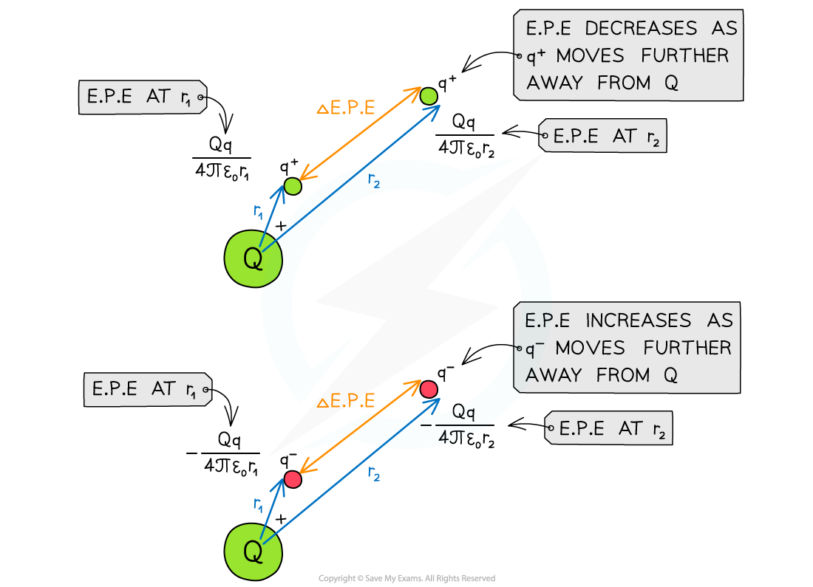
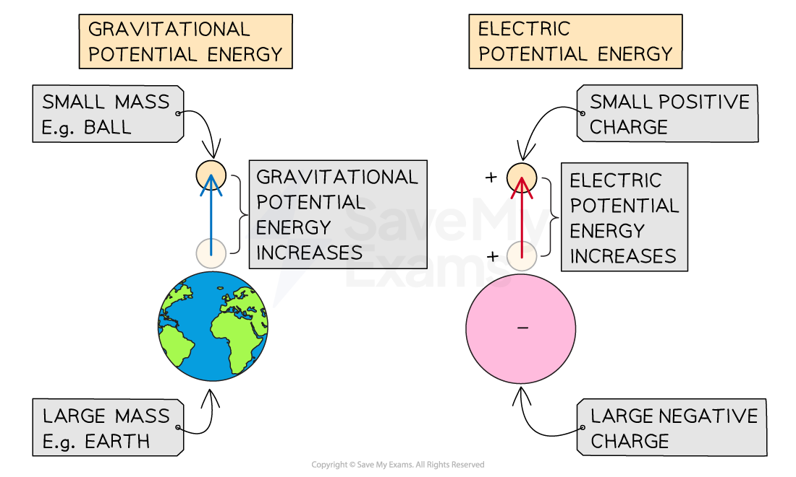

# Electric Potential Energy

## Electric Potential Energy of Two Point Charges

> **Spec point** — `spcpt_S4FK7XVM6TdX4TfS`

## Electric potential energy of two point charges

- When a charge moves through an electric field, work is done
- The work done in moving a charge *q* is given by:

$\DeltaW=q\DeltaV$

- Where:

  - Δ*W* = work done (J)
  - *q* = magnitude of charge moving in the field (C)
  - Δ*V* *= *potential difference between two points (J C−1)

- Work is done when

  - a **positive **charge in an electric field moves **against** the field lines
  - a **negative **charge moves **with** the field lines

### Electrical potential difference

- Two points at different distances from a charge will have different electric potentials

  - This is because the electric potential increases with distance from a negative charge and decreases with distance from a positive charge

- Therefore, there will be an **electric potential difference** between the two points equal to:

$\DeltaV=V_{f}-V_{i}$

- Where:

  - *V**f* = final electric potential (J C−1)
  - *V**i* = initial electric potential (J C−1)

- The potential difference due to a point charge can be written:

`increment V space equals space fraction numerator Q over denominator 4 straight pi epsilon subscript 0 end fraction open parentheses 1 over r subscript f space minus space 1 over r subscript i close parentheses`

- Where

  - *Q* = magnitude of point charge producing the potential
  - *ε*0 = *permittivity of free space* (F m−1)
  - *r*f = final distance from charge Q (m)
  - *r*i = initial distance from charge Q (m)

### Electric potential energy

- The electric potential energy of two point charges is given by:

$E_{p}=\frac{Q_{1}Q_{2}}{4πε_{0}r}$

- Where:

  - *E*p = electric potential energy (J)
  - *Q*1, *Q*2 = magnitudes of the charges (C)
  - *r* = distance between the centres of the two charges (m)

- Similar to electric potential, values of electric potential energy depend on the signs of *Q*1 and *Q*2

  - By definition, potential *V* = 0 at infinity, therefore *E*p = 0 at infinity

- Like electric potential, the value of electric potential energy can be **positive **or **negative**

### Change in electric potential energy

- There is a **change in electric potential energy **when one charge moves away from another

  - This is because work must be done **on** the field to bring similar charges together or to separate opposite charges
  - Conversely, work is done **by **the field to separate similar charges or to bring opposite charges together

- When a charge *q* moves away from a charge *Q*, the change in electric potential energy is equal to:

`increment E subscript p space equals space q increment V space equals space fraction numerator Q q over denominator 4 straight pi epsilon subscript 0 end fraction open parentheses 1 over r subscript 2 space minus space 1 over r subscript 1 close parentheses`

- Where:

  - *Q* = charge that is producing the electric field (C)
  - *q* = charge that is moving in the electric field (C)
  - *r**1** = *initial distance of *q* from the centre of *Q* (m)
  - *r**2* = final distance of *q* from the centre of *Q *(m)

#### Electric potential energy for moving charges

***Work is done when moving a point charge away from another charge***

- The change in electric potential energy between two charges is analogous to the **change in gravitational potential energy** between two masses

#### Comparing gravitational and electric potential energy

***When a small mass is lifted on Earth, there is an increase in gravitational potential energy. This is similar to the increase in electric potential energy when a negative charge moves away from a positive charge***

> **Worked Example**
> An α-particle `He presubscript 2 presuperscript 4` is moving directly towards a stationary gold nucleus `Au presubscript 79 presuperscript 197`.
> 
> At a distance of 4.7 × 10−15 m the α-particle momentarily comes to rest.
> 
> Calculate the electric potential energy of the particles at this instant.
> 
> **Answer: **
> 
> **Step 1: Write down the known quantities**
> 
> - Distance, *r* = 4.7 × 10−15 m
> - Elementary charge, *e* = 1.60 × 10−19 C
> - Coulomb constant, *k *= 8.99 × 109 N m2 C−2
> 
> **Step 2: Determine the magnitudes of the charges**
> 
> - An alpha particle (helium nucleus) contains 2 protons
> 
>   - Charge of alpha particle, *q*1 = 2e
> - The gold nucleus contains 79 protons
> 
>   - So, charge of gold nucleus, *q*2 = 79e
> 
> **Step 3: Write down the equation for electric potential energy**
> 
> $E_{p}=k\frac{q_{1}q_{2}}{r}$
> 
> **Step 4: Substitute values into the equation**
> 
> `E subscript straight p space equals space open parentheses 8.99 cross times 10 to the power of 9 close parentheses cross times fraction numerator 2 cross times 79 cross times stretchy left parenthesis 1.60 cross times 10 to the power of negative 19 end exponent stretchy right parenthesis squared over denominator stretchy left parenthesis 4.7 cross times 10 to the power of negative 15 end exponent stretchy right parenthesis end fraction space equals space 7.7 cross times 10 to the power of negative 12 end exponent` J (2 s.f.)

> **Exam Hint**
> This topic has a lot of concepts and language that can be easy to mix up, as well as many equations and graphs to learn. Take careful notes on this topic and learn the correct equations for each quantity, for example, when calculating electric potential energy, make sure you **do not **square the distance!
> 
> A good way to revise these is to find a way of organising the knowledge in a way that resonates with you, here is an example of one possible way to do this:
> 
> 
