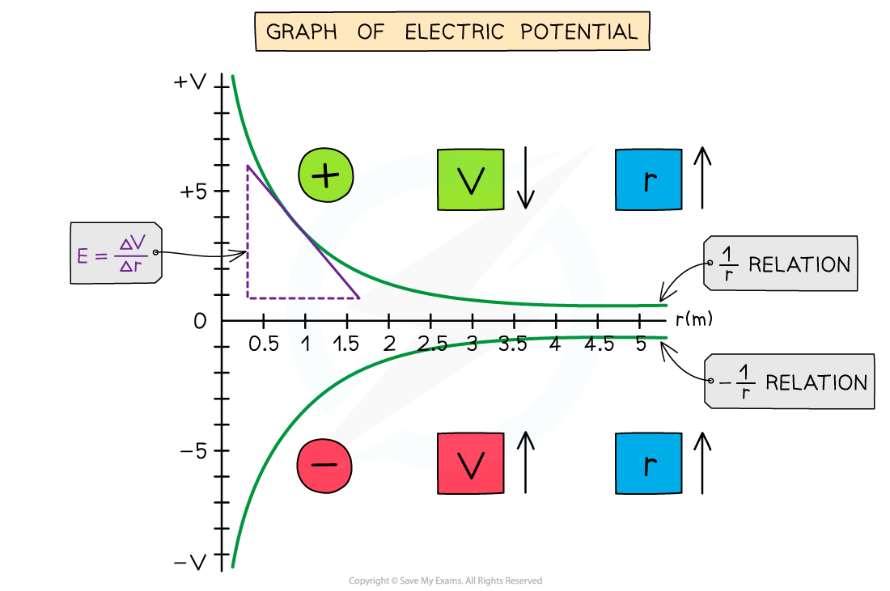
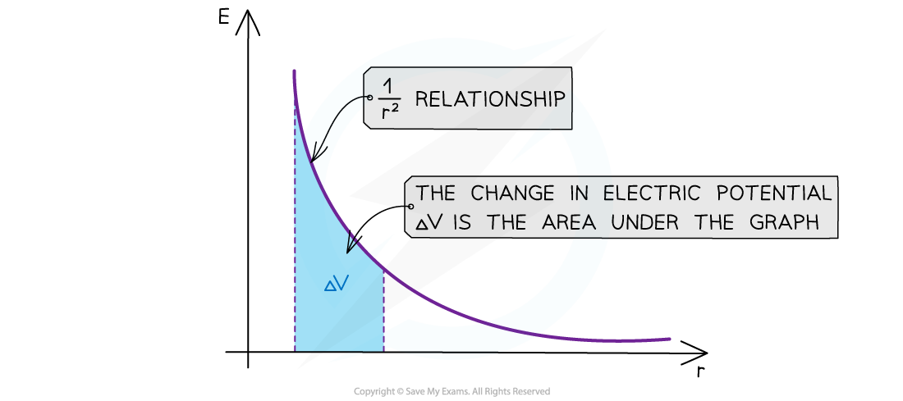

# Electric Potential Gradient

## Potential Gradient

> **Spec point** — `spcpt_yRCxfsfjtzWXnqn5`

## Potential gradient

- An electric field can be described in terms of the variation of *electric potential* at different points in the field

  - This is known as the **potential gradient**

- The potential gradient of an electric field is defined as:

**The rate of change of electric potential with respect to displacement in the direction of the field**

- A graph of potential *V* against distance *r* can be drawn for a positive or negative charge *Q*
- This is a graphical representation of the equation:

$V=\frac{Q}{4πε_{0}r}$

- The electric field strength at a point is equivalent to the **negative **electric potential gradient at that point
- This can be written mathematically as:

$E=-\frac{\DeltaV}{\Deltar}$

- Where:

  - *E* = electric field strength (V m−1)
  - Δ*V* = potential difference between two points (V)
  - Δ*r* = displacement in the direction of the field (m)

- Hence, $\frac{\DeltaV}{\Deltar}$ = electric potential gradient, i.e. the change in potential with distance
- The negative sign is included to indicate that the **potential gradient** acts in the **opposite direction** to the field strength and electric force
- Therefore, as the **distance **from the point charge increases:

  - the magnitude of field strength and force **decreases**
  - potential gradient **decreases**

#### Graph of electric potential and distance

***The electric potential around a positive charge decreases with distance, and increases with distance around a negative charge***

- **The key features of this graph are:**

  - All values of potential are negative for a negative charge
  - All values of potential are positive for a positive charge
  - As *r* increases, *V* against *r* follows a 1/*r* relation for a positive charge and a -1/*r* relation for a negative charge
  - The **gradient** of the graph at any particular point is equal to the field strength *E* at that point
  - The curve is shallower than the corresponding *E*-*r* graph

### Determining potential difference from a field-distance graph

- The potential difference due to a charge can also be determined from the area under a field-distance graph
- A graph of field strength *E* against distance *r* can be drawn for a positive or negative charge *Q*
- This is a graphical representation of the equation:

$E=\frac{Q}{4πε_{0}r^{2}}$

- The **area **under the *E*-*r* graph between two points is equal to the potential difference Δ*V* between those points

#### Graph of electric field strength and distance

***The electric field strength E has a 1/r******2****** relationship, and the area under the graph represents change in electric potential***

- **The key features of this graph are**:

  - All values of field strength are negative for a negative charge
  - All values of field strength are positive for a positive charge
  - As *r* increases, *E* against *r* follows a 1/*r**2* relation (*inverse square law*)
  - The **area** under this graph is the change in electric potential Δ*V*
  - The curve is steeper than the corresponding *V*-*r* graph

> **Exam Hint**
> One way to remember whether the electric potential increases or decreases with respect to the distance from the charge is by the direction of the electric field lines. The potential always **decreases** in the **same** direction as the field lines and vice versa.
