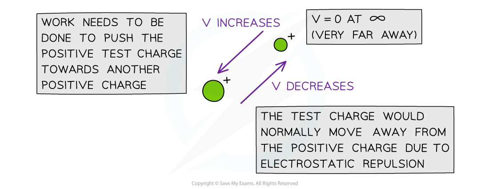
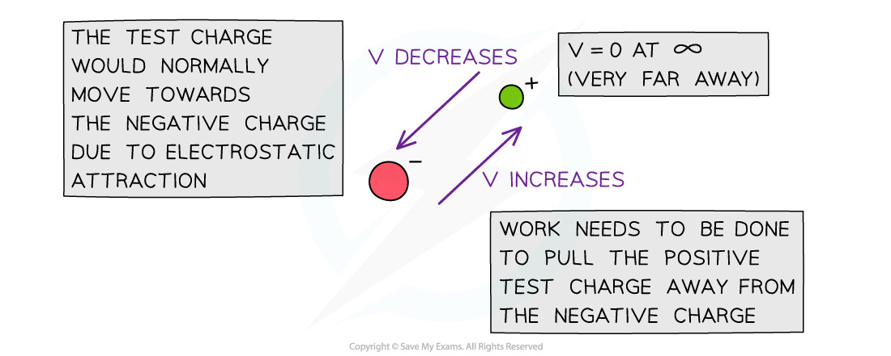
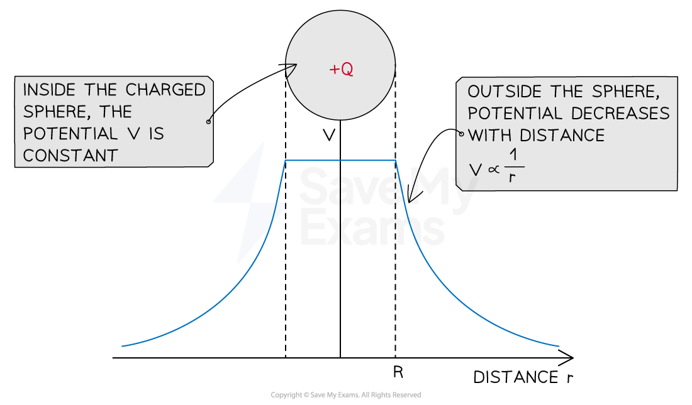
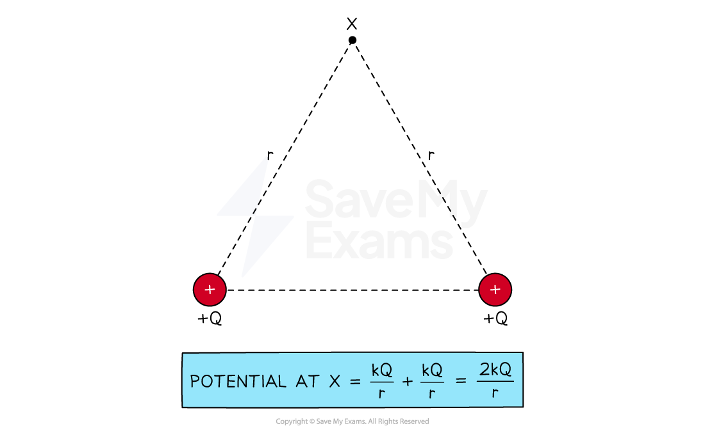

# Electric Potential

## Electric Potential

> **Spec point** — `spcpt_X2B2Hm8HKGbv5KT5`

## Electric potential

- The electric potential at a point is defined as:

**The work done per unit charge in taking a small positive test charge from infinity to a defined point**

- Electric potential is measured in J C−1 or V
- It is a **scalar** quantity but has a positive or negative sign to indicate the sign of the charge

  - In a similar way to gravitational potential, electric potential also has a value of **zero **at **infinity**

- The electric potential at a point depends on:

  - the magnitude of the point **charge**
  - the **distance** between the charge and the point

### Electric potential for a positive charge

- Around an isolated **positive **charge, electric potential:

  - has a **positive **value
  - **increases **when a test charge moves closer
  - **decreases **when a test charge moves away

***For a positive charge, the electric potential decreases in the direction a positive test charge would move in due to the electrostatic repulsion***

### Electric potential for a negative charge

- Around an isolated **negative **charge, electric potential:

  - has a **negative **value
  - **decreases **when a test charge moves closer
  - **increases** when a test charge moves away

***For a negative charge, the electric potential decreases in the direction a positive test charge would move in due to the electrostatic attraction***

> **Exam Hint**
> One way to remember whether the electric potential increases or decreases with respect to the distance from the charge is by the direction of the electric field lines. The potential always **decreases **in the **same **direction as the field lines and vice versa.

## Electric Potential Due to a Point Charge

> **Spec point** — `spcpt_WrvVPS8bRtzV6B27`

## Electric potential due to a point charge

- The electric potential due to a point charge can be calculated using:

$V=\frac{Q}{4πε_{0}r}$

- Where:

  - *V* = *electric potential* (V)
  - *Q* = magnitude of the charge producing the potential (C)
  - *r* = distance from the centre of the point charge (m)
  - ε0 = *permittivity of free space* (F m−1)

- For a positive (+) charge:

  - potential* *$V$ **increases** as the separation $r$ **decreases**
  - energy must be supplied to a positive test charge to overcome the repulsive force

- For a negative (−) charge:

  - potential* *$V$ **increases** as the separation $r$ **increases**
  - energy is released as a positive test charge moves in the direction of the attraction force

- The electric potential has an inversely proportional relationship with distance
- Unlike *gravitational potential* which is always negative, the sign of the charge corresponds to the sign of the electric potential

- **Note:** this equation also applies to a conducting sphere. The charge on the sphere is treated as if it is concentrated at the centre of the sphere, i.e. like a point charge

#### Graph of potential against distance for a positive charge

***Electric potential is constant inside a charged sphere and decreases with distance outside the sphere***

### Combining electric potentials

- To find the potential at a point caused by multiple charges, each potential can be combined by addition
- For example, the combined potential of two point charges at a point is:

$V=\frac{Q_{1}}{4πε_{0}r_{1}}+\frac{Q_{2}}{4πε_{0}r_{2}}$

- Where:

  - *Q*1, *Q*2 = magnitude of the charges (C)
  - *r*1, *r*2 = distance between each charge and the point (m)

#### How to calculate total electric potential

***Point X makes an equilateral triangle of length r with two equal positive charges Q. The combined potential of both charges at X is double the potential due to one of the charges***

> **Worked Example**
> A Van de Graaff generator has a spherical dome of radius 15 cm. It is charged up to a potential of 240 kV.
> 
> Calculate
> 
> (a) the charge stored on the dome
> 
> (b) the potential at a distance of 30 cm from the dome's surface
> 
> **Answer:**
> 
> **Part (a)**
> 
> **Step 1: List down the known quantities**
> 
> - Radius of the dome, *r* = 15 cm = 15 × 10−2 m
> - Potential difference, *V* = 240 kV = 240 × 103 V
> - Permittivity of free space, ε0 = 8.85 × 10−12 F m−1
> 
> **Step 2: Write down the equation for the electric potential due to a point charge**
> 
> $V=\frac{Q}{4πε_{0}r}$
> 
> **Step 3: Rearrange for charge Q**
> 
> $Q=4πε_{0}rV$
> 
> **Step 4: Substitute in values**
> 
> *Q* = (240 × 103) × (4π × 8.85 × 10−12) × (15 × 10−2) = 4.0 × 10−6 C = 4.0 μC
> 
> **Part (b)**
> 
> **Step 1: Write down the known quantities**
> 
> - Charge stored in the dome, *Q* = 4.0 × 10−6 C
> - Distance,*r* = radius of the dome + distance from the dome = 15 + 30 = 45 cm = 0.45 m
> 
>   - **Note**: we are treating the Van de Graaff as a point charge, so we take the distance from the centre of the dome
> 
> **Step 2: Write down the equation for electric potential due to a point charge**
> 
> $V=\frac{Q}{4πε_{0}r}$
> 
> **Step 3: Substitute in values**
> 
> $V = \frac{4.0 \times 10^{- 6} }{4 \mathrm{\pi } \times ( 8.85 \times 10^{- 12} ) \times 0.45} = 79.9 \times 10^{3} = 80$ kV (2 s.f.)
