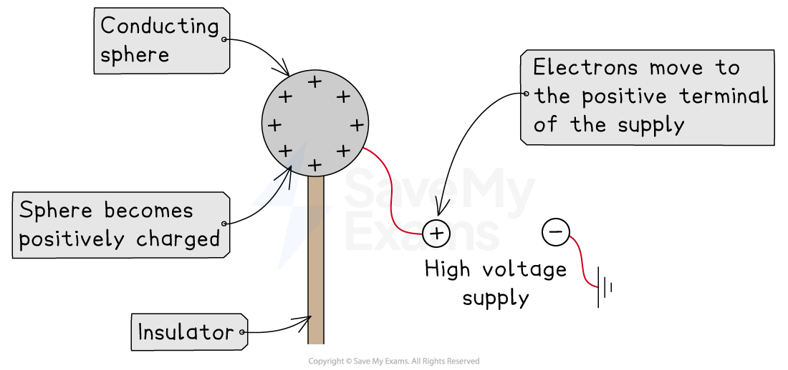
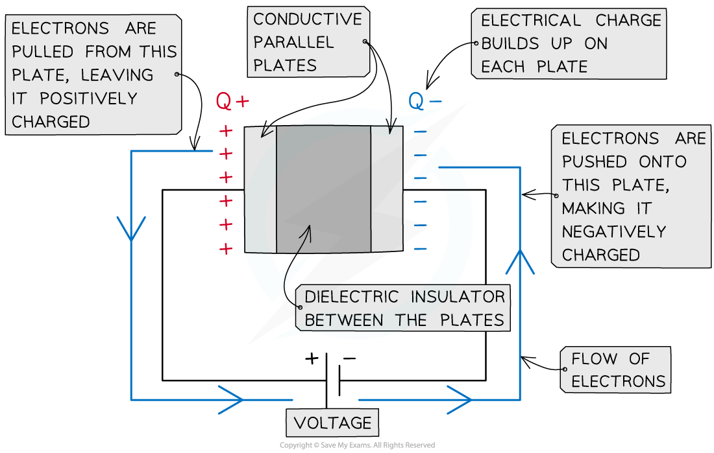
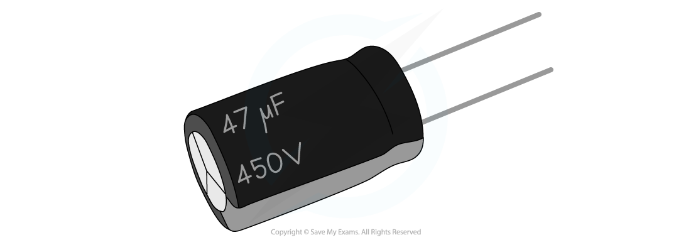

# Capacitance

## Defining Capacitance

> **Spec point** — `spcpt_SZFD8fCqmYNHKwnv`

## Defining capacitance

- Capacitors are electrical devices used to **store energy**

  - In electronic circuits, they are commonly used as a backup store of energy in case of power failure

- The circuit symbol for a *parallel plate* capacitor is two parallel lines

#### Capacitor circuit symbol

***The circuit symbol for a capacitor consists of two parallel lines perpendicular to the wires on either side  ***

- Capacitors possess **capacitance**, which is defined as: **The charge stored per unit potential**
- The greater the **capacitance**, the greater the **charge stored** on the capacitor

- Capacitors come in different forms, such as:

  - isolated spherical conductors
  - parallel plates

### Isolated spherical conductors

- An isolated spherical conductor can **store charge** on its **surface**, which means it can act as a capacitor
- When the conducting sphere is connected to a high-voltage supply:

  - electrons move on to, or off of, the surface of the sphere
  - the remaining charges are of the same type, so they repel
  - the surface is conducting, allowing them to move and become evenly distributed

- As the **potential difference** of the supply increases, the **charge **on the conductor also increases
- The **capacitance **of the sphere is equal to the ratio of the charge to the potential

#### Capacitance of an isolated spherical conductor

***Conducting spheres act like capacitors due to their ability to store charge on their surfaces***

### Parallel plate capacitors

- A parallel plate capacitor is made up of **two conducting metal plates** connected to a voltage supply

  - The **negative terminal** of the voltage supply **pushes electrons onto one plate**, making it negatively charged
  - The **electrons** are **repelled** from the opposite plate, making it positively charged
  - There is a *dielectric* between the plates which ensures charge does not flow freely between the plates

#### Capacitance of a parallel plate capacitor

***A parallel plate capacitor is made up of two conductive plates with opposite charges building up on each plate***

> **Exam Hint**
> The ‘charge stored’ by a capacitor refers to the magnitude of the charge stored **on** each plate in a parallel plate capacitor or **on** the **surface** of a spherical conductor. The capacitor itself **does not** store charge.

## Calculating Capacitance

> **Spec point** — `spcpt_XfVZhsZrKwJWYH8S`

## Calculating capacitance

- The capacitance of a capacitor is defined by the equation:

$C=\frac{Q}{V}$

- Where:

  - *C* = capacitance (F)
  - *Q* = charge (C)
  - *V* = *potential difference* (V)

- The unit of capacitance is the **farad (F)**, where one farad is equivalent to one coulomb per volt

  - In practice, 1 F, or 1 C V–1, is a very large unit
  - As a result, capacitance values are often quoted in microfarads (μF), nanofarads (nF) or picofarads (pF)

#### A typical capacitor

***A capacitor of capacitance 47 μF might typically be used in a simple circuit***

- For a *parallel plate* conductor, *Q* is the charge on the plates and *V* is the potential difference across the capacitor

  - **Note: **The charge *Q* is **not** the charge of the capacitor itself, it is the charge stored **on** the plates

- This capacitance equation shows that an object’s capacitance is the **ratio of the charge on an object to its potential**

#### Capacitance of a spherical conductor

- The capacitance of an isolated *spherical conductor* is equal to the charge per unit potential at the **surface** of the sphere

  - This is because the charge on the surface of a spherical conductor can be considered as a *point charge* at its centre

- The potential *V* of an isolated point charge is given by:

$V=\frac{Q}{4πε_{0}R}$

- Where:

  - *R* = radius of the sphere (m)
  - *ε**0* = *permittivity of free space*

- Combining these equations gives an expression for the capacitance of an isolated spherical conductor:

$V=\frac{Q}{4πε_{0}R}=\frac{Q}{C}$

***C***** = 4π*****ε******0******R***

- **Note:** The charge Q is **not** the charge of the capacitor itself, it is the charge stored **on** the surface of the spherical conductor

> **Worked Example**
> A parallel plate capacitor has a capacitance of 1 nF and is connected to a voltage supply of 0.3 kV.
> 
> Calculate the charge on the plates.
> 
> **Answer:**
> 
> **Step 1: Write down the known quantities**
> 
> - Capacitance, *C* = 1 nF = 1 × 10–9 F
> - Potential difference, *V* = 0.3 kV = 0.3 × 103 V
> 
> **Step 2: Write out the equation for capacitance**
> 
> $C=\frac{Q}{V}$
> 
> **Step 3: Rearrange for charge *****Q***
> 
> *Q* = *CV*
> 
> **Step 4: Substitute in values**
> 
> *Q* = (1 × 10–9) × (0.3 × 103) = 3 × 10–7 C = 300 nC

> **Worked Example**
> Lightning can be simulated in a laboratory using an isolated metal sphere to investigate electrical discharge.
> 
> A spherical conductor with a radius of 75 cm is charged to a potential of 1.5 MV.
> 
> Calculate the capacitance of the sphere, in pF.
> 
> **Answer:**
> 
> **Step 1: List the known quantities**
> 
> - Radius of sphere, *R* = 75 cm = 75 × 10−2 m
> - Permittivity of free space, *ε**0* = 8.85 × 10−12 F m−1
> 
> **Step 2: Write out the equation for the capacitance of a charged spherical conductor**
> 
> *C* = 4π*ε**0**R*
> 
> **Step 3: Calculate the capacitance**
> 
> *C* = 4π × (8.85 × 10−12) × (75 × 10−2)
> 
> *C* = 8.34 × 10−11 F = 83 pF (2 s.f.)

> **Exam Hint**
> The letter ‘C’ is used both as the symbol for capacitance as well as the unit of charge (coulombs). Take care not to confuse the two!
