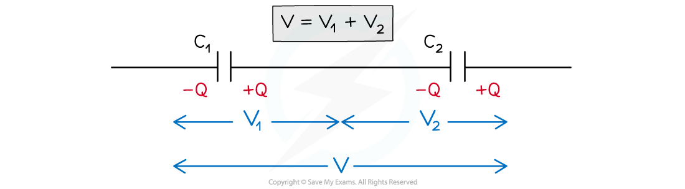
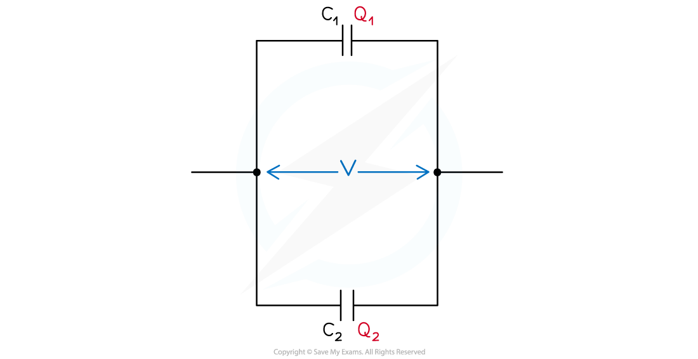

# Capacitors in Series & Parallel

## Derivation of C = Q/V

> **Spec point** — `spcpt_CS48t4xBXQQqHgcr`

## Capacitors in series & parallel

- The combined *capacitance* of capacitors in a circuit depends on whether they are connected in series or parallel

### Capacitors in series

- Consider two parallel plate capacitors *C**1** *and *C**2** *connected in series, with a *potential difference* (p.d) *V* across them

#### Potential difference of capacitors in series

***Capacitors connected in series have different p.d across them but have the same charge***

- In a series circuit, p.d. is **shared** between all the components in the circuit

  - Therefore, if the capacitors store the same charge on their plates but have different p.d.s, the p.d across *C**1* is *V**1* and across *C**2** *is *V**2*

- The total potential difference *V* is the sum of *V**1* and *V**2*

***V***** = *****V*****1**** + *****V*****2  **

- Rearranging the capacitance equation for the p.d. *V* means *V**1* and *V**2* can be written as:

$V_{1}=\frac{Q}{C_{1}}$ and $V_{2}=\frac{Q}{C_{2}}$

- Where the total p.d. *V* is defined by the total capacitance

$V=\frac{Q}{C_{\mathrm{total}}}$

- Substituting these into the equation *V* = *V*1 + *V*2 equals:

$\frac{Q}{C_{\mathrm{total}}}=\frac{Q}{C_{1}}+\frac{Q}{C_{2}}$

- Since the **current **is the **same** through all components in a series circuit, the **charge *****Q*** is the **same** through each capacitor and cancels out
- Therefore, the equation for the **combined capacitance** of capacitors in **series** is:

$\frac{1}{C_{\mathrm{total}}}=\frac{1}{C_{1}}+\frac{1}{C_{2}}+\frac{1}{C_{3}}.....$

### Capacitors in parallel

- Consider **two parallel plate capacitors** *C**1* and *C**2* connected in parallel, each with p.d, *V*

#### Potential difference of capacitors in parallel

***Capacitors connected in parallel have the same p.d across them, but different charge***

- Since the current is **split** across each junction in a parallel circuit, the charge stored on each capacitor is **different**

  - Therefore, the charge on capacitor *C**1* is *Q**1* and on *C**2* is *Q**2*

- The total charge *Q* is the sum of *Q**1* and *Q**2*

***Q***** = *****Q*****1**** + *****Q*****2**

- Rearranging the capacitance equation for the charge *Q* means *Q**1* and *Q**2* can be written as:

***Q*****1**** = *****C*****1*****V ***and** *****Q*****2**** = *****C*****2*****V***

- Where the **total charge** *Q* is defined by the **total capacitance**:

***Q***** = *****C*****total*****V***

- Substituting these into the *Q* = *Q*1 + *Q*2 equals:

***C*****total*****V***** = *****C*****1*****V***** + *****C*****2*****V***** = (*****C*****1 ****+ *****C*****2****) *****V***

- Since the p.d is the **same** across all components in each branch of a parallel circuit, the p.d *V* cancels out
- Therefore, the equation for the combined capacitance of capacitors in **parallel** is:

***C*****total**** = *****C*****1 ****+ *****C*****2**** + *****C*****3**** ...**

> **Exam Hint**
> Make sure you learn the equation for the combined capacitance of capacitors in both series and parallel circuits. Both the combined capacitance equations look similar to the equations for combined resistance in series and parallel circuits. However, take note that they are the** opposite way **around to each other!
