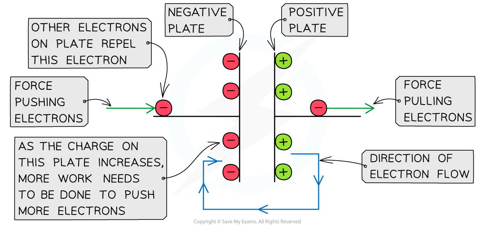
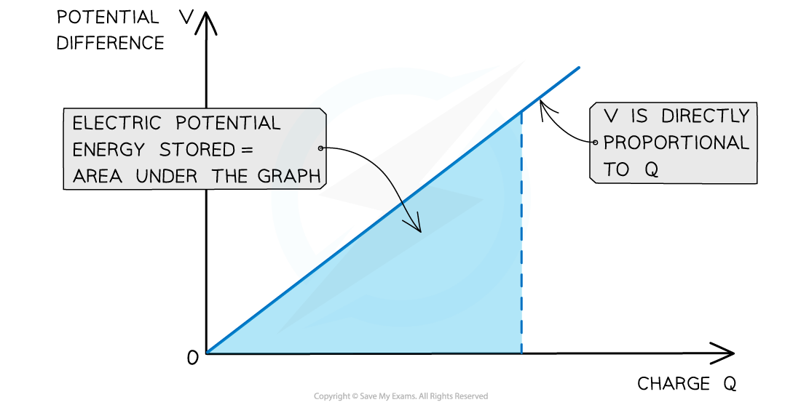

# Area Under a Potential–Charge Graph

## Area Under a Potential–Charge Graph

> **Spec point** — `spcpt_TgJ9sJ9jxndgbGh5`

## Area under a potential–charge graph

- When **charging a capacitor**, the power supply transfers electrons onto one plate, giving it a negative charge, and transfers electrons away from the other plate, giving it a positive charge

  - It therefore does **work** on the electrons, which increases their **electric potential energy**

- At first, a small amount of charge is pushed onto the negative plate, then gradually, this builds up

  - Adding more electrons to the plate is relatively easy at first since there is little repulsion

- As the **charge of the negative plate increases** i.e. becomes more negatively charged, the electric repulsion between the electrons increases

  - This means a **greater amount of work** must be done to increase the charge on the negative plate

#### Charging a capacitor

***As the charge on the negative plate builds up, more work needs to be done to add more charge***

- The relationship between the potential difference and charge on a capacitor is: **The potential difference V across the capacitor increases as the amount of charge Q increases**
- In other words, the charge *Q* on the capacitor is **directly proportional** to its potential difference *V*

  - The **graph** of charge against potential difference is therefore a **straight-line** graph through the **origin**

- Therefore, the **electric potential energy stored** in the capacitor can be determined from the** area under the potential-charge graph**

#### Graph of potential difference against charge

***The electric potential energy stored in the capacitor is the area under the potential-charge graph***

> **Worked Example**
> The variation of the potential *V* of a charged isolated metal sphere with surface charge *Q* is shown on the graph below.
> 
> 
> 
> Using the graph, determine the electric potential energy stored on the sphere when charged to a potential of 100 kV.
> 
> **Answer: **
> 
> **Step 1: Determine the charge on the sphere at the potential of 100 kV**
> 
> 
> 
> - From the graph, the charge on the sphere at 100 kV is** 1.8 μC**
> 
> **Step 2: Calculate the electric potential energy stored**
> 
> - The electric potential energy stored is equal to the area under the graph up to 100 kV
> - Using the area of a triangle:
> 
> $\mathrm{Area}=\frac{1}{2}\times\mathrm{base}\times\mathrm{height}$
> 
> - Substituting the values into the equation gives:
> 
> $\mathrm{Area}=\frac{1}{2}\times1.8\mathrm{μC}\times100\mathrm{kV}$
> 
> $\mathrm{EPE}=\frac{1}{2}\times(1.8\times10^{-6})\times(100\times10^{3})=0.09J$

> **Exam Hint**
> Remember to always check the **units** of the charge–potential difference graphs. The charges can often be in µC or the potential difference in kV! The units must be in C and V to get a work done in J.
