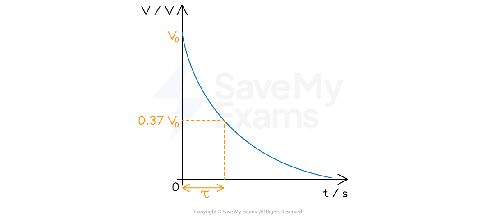

# Capacitor Discharge Equations

## The Time Constant

> **Spec point** — `spcpt_RQYhGSt3Y2MWV8YR`

## The time constant

- The time constant of a capacitor discharging through a resistor is a measure of **how long** it takes for the capacitor to **discharge**
- The time constant is defined as:

**The time taken for the charge, current or voltage of a discharging capacitor to decrease to 37% of its original value**

- This is represented by the Greek letter tau ($τ$) and measured in units of **seconds **(s)

  - It is a useful way of **comparing** the **rate of change** of similar quantities e.g. charge, current or p.d.

- The time constant is defined by the equation:

$τ$ = *RC*

- Where:

  - $τ$ = time constant (s)
  - *R *= resistance of the resistor (Ω)
  - *C* = *capacitance* of the capacitor (F)
- For example, to find the time constant from a voltage-time graph, calculate 0.37*V**0* and determine the corresponding time for that value

#### Time constant on a capacitor discharge graph

***The time constant shown on a discharging capacitor for potential difference***

> **Worked Example**
> A capacitor of 7 nF is discharged through a resistor of resistance *R*. The time constant of the discharge is 5.6 × 10-3 s.
> 
> Calculate the value of *R*.
> 
> **Answer:**
> 
> **Step 1: Write out the known quantities**
> 
> - Capacitance, *C* = 7 nF = 7 × 10-9 F
> - Time constant, $τ$ = 5.6 × 10-3 s
> 
> **Step 2: Write down the time constant equation**
> 
> $τ$ = *RC*
> 
> **Step 3: Rearrange for resistance *****R***
> 
> $R=\frac{τ}{C}$
> 
> **Step 4: Substitute in values and calculate *****R***
> 
> $R=\frac{5.6\times10^{-3}}{7\times10^{-9}}=8\times10^{5}Ω=800\mathrm{kΩ}$

## Using the Capacitor Discharge Equation

> **Spec point** — `spcpt_cmmp7hwN56pJ53gH`

## Using the capacitor discharge equation

- The *time constant* is used in the exponential decay equations for the current, charge or potential difference (p.d.) for a capacitor discharging through a resistor

  - These can be used to determine the amount of current, charge or p.d. left after a certain amount of time when a capacitor is discharging

- All capacitor discharge equations are of the form:

$X=X_{0}e^{-(\frac{t}{RC})}$

- Where:

  - *X *= current, charge or potential difference
  - *X**0* = initial current, charge or potential difference before discharge
  - *e* = the exponential function
  - *t* = time (s)
  - *RC* = resistance (Ω) × capacitance (F) = the time constant $τ$ (s)

- This equation shows that

  - the greater the time constant $τ$, the **slower **the current, charge or p.d. falls during discharge
  - the greater the **initial** current, charge or p.d., the greater the initial **rate** of discharge, but the time taken to fall to a given fraction of *X*0 depends only on the time constant *RC*

- The current at any time is directly proportional to the p.d across the capacitor and the charge across the *parallel plates*
- The *exponential decay* of current on a discharging capacitor is defined by the equation:

$I=I_{0}e^{(-\frac{t}{RC})}$

- Where:

  - *I* = current (A)
  - *I*0 = initial current before discharge (A)

- The equation for the exponential decay of charge on a discharging capacitor is defined by the equation:

$Q=Q_{0}e^{(-\frac{t}{RC})}$

- Where:

  - *Q* = charge on the capacitor plates (C)
  - *Q*0 = initial charge on the capacitor plates (C)

- The equation for the exponential decay of p.d. on a discharging capacitor is defined by the equation:

$V=V_{0}e^{(-\frac{t}{RC})}$

- Where:

  - *V* = potential difference on the capacitor plates (V)
  - *V*0 = initial potential difference on the capacitor plates (V)

### The exponential function

- The symbol *e* represents the **exponential constant**, a number which is approximately equal to *e* = 2.718...

  - On a calculator, it is shown by the button ex

- The inverse function of *e**x* is ln(*y*), known as the natural logarithmic function

  - This is because, if *e**x** *= *y*, then *x* = ln(*y*)
- The 0.37 in the definition of the **time constant** arises as a result of the exponential constant, the true definition is:

**The time taken for the charge of a capacitor to decrease to **$\frac{1}{e}$** of its original value**

- Where $\frac{1}{e}$ = 0.3679

> **Worked Example**
> The initial current through a circuit with a capacitor of 620 μF is 0.6 A. The capacitor is connected across the terminals of a 450 Ω resistor.
> 
> Calculate the time taken for the current to fall to 0.4 A.
> 
> **Answer: **
> 
> **Step 1: Write out the known quantities**
> 
> - Initial current before discharge, *I*0 = 0.6 A
> - Current, *I* = 0.4 A
> - Resistance, *R* = 450 Ω
> - Capacitance, *C* = 620 μF = 620 × 10-6 F
> 
> **Step 2: Write down the equation for the exponential decay of current**
> 
> $I=I_{0}e^{(-\frac{t}{RC})}$
> 
> **Step 3: Calculate the time constant**
> 
> $τ$ = *RC*
> 
> $τ$ = 450 × (620 × 10-6) = 0.279 s
> 
> **Step 4: Substitute into the current equation**
> 
> $0.4=0.6\timese^{-\frac{t}{0.279}}$
> 
> **Step 5: Rearrange for the time *****t***
> 
> $\frac{0.4}{0.6}=e^{-\frac{t}{0.279}}$
> 
> - The exponential can be removed by taking the natural log of both sides:
> 
> $\mathrm{ln}(\frac{0.4}{0.6})=-\frac{t}{0.279}$
> 
> $t=-0.279\times\mathrm{ln}(\frac{0.4}{0.6})=0.1131=0.1s$

> **Exam Hint**
> Make sure you’re confident in rearranging equations with natural logs (ln) and the exponential function (e). To refresh your knowledge of this, have a look at the AS Maths revision notes on Exponentials & Logarithms
