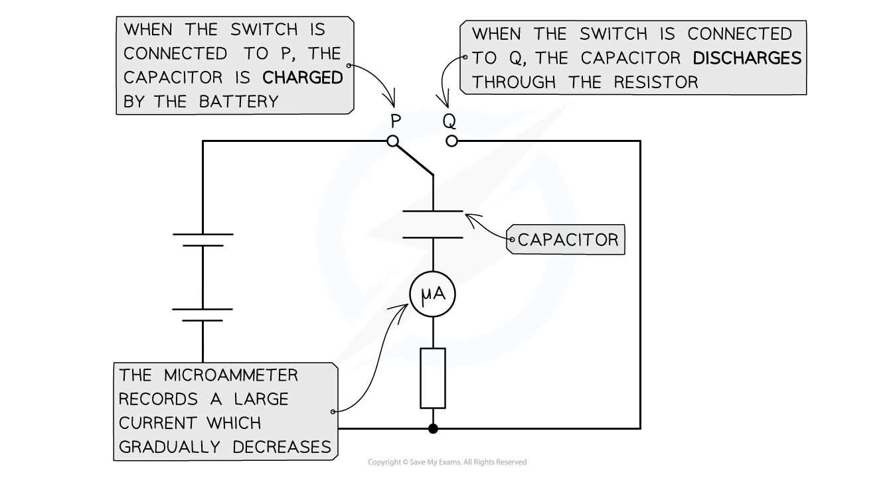
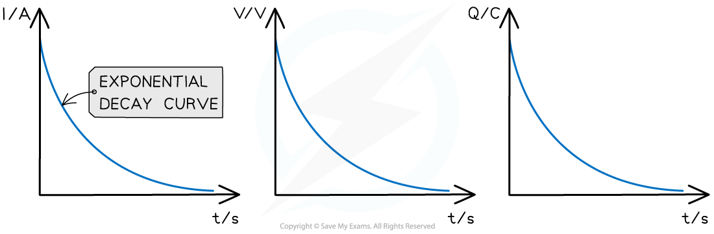

# Capacitor Discharge Graphs

## Capacitor Discharge Graphs

> **Spec point** — `spcpt_NfxhCKptJNX5KHpk`

## Capacitor discharge graphs

- Capacitors are **discharged** through a resistor

  - The electrons flow from the **negative** plate to the **positive **plate until there are **equal numbers** on each plate

- At the **start** of the discharge, the **current** is **large** (but in the opposite direction to when it was charging) and gradually falls to **zero**

#### Capacitor charging and discharging circuit

***The capacitor charges when connected to terminal P and discharges when connected to terminal Q***

- As a capacitor discharges, the current, p.d. and charge all decrease **exponentially**

  - This means the rate at which the current, p.d. or charge decreases is proportional to the amount of current, p.d or charge it has left

- The graphs of the variation with time of current, p.d. and charge are all identical and represent an ***exponential decay***

  - The initial value starts on the y-axis and then decreases exponentially

- The rate at which a capacitor discharges depends on the **resistance** of the circuit

  - If the resistance is **high**, the current will decrease and charge will flow from the capacitor plates more **slowly**, meaning the capacitor will take longer to discharge
  - If the resistance is** low**, the current will increase and the charge will flow from the capacitor plates **quickly**, meaning the capacitor will discharge faster

#### Graphs of current, potential difference and charge against time

***Exponential decay graphs of the variation of current, p.d. and charge with time for a capacitor discharging through a resistor***
