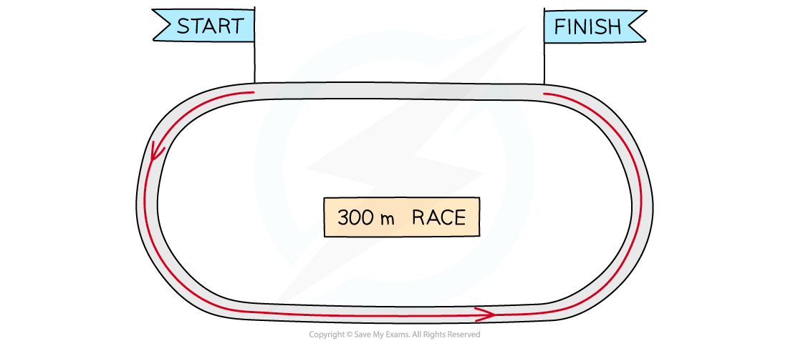
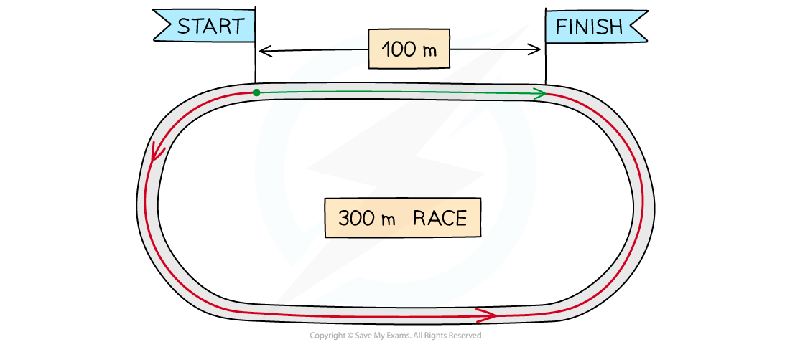

# Displacement, Velocity & Acceleration

## Defining Displacement, Velocity & Acceleration

> **Spec point** — `spcpt_7qt3D5SyqV9S6sgd`

## Defining displacement, velocity & acceleration

### Distance and displacement

#### Distance

- **Distance** is a measure of how far an object travels
- It is a ***scalar*** quantity with **magnitude **only

#### Total running distance

***The athletes run a total distance of 300 m***

- Consider some athletes running a 300 m race on a 400 m track
- The **distance** travelled by the athletes is **300 m**

#### Displacement

- **Displacement** is a measure of how far something is from its starting position, along with its direction

  - In other words, it is the **change** in position

- It is a ***vector*** quantity with both **magnitude **and **direction**

#### Total distance vs total displacement

***The athletes run a total distance of 300 m, but end up 100 m from where they started***

- Consider the same 300 m race again

  - The athletes have still run a total **distance** of **300 m** (this is indicated by the arrow in red)
  - However, their **displacement** at the end of the race is **100 m to the right** (this is indicated by the arrow in green)
  - If they had run the full 400 m, their final displacement would be **zero**

- Distance is a scalar quantity because... **It describes how far an object has travelled overall, but not the direction it has travelled in**
- Displacement is a vector quantity because... **It describes how far an object is from where it started and in what direction**

### Speed and velocity

#### Speed

- The **speed** of an object is the distance it travels every second
- Speed is a **scalar** quantity with **magnitude **only
- The **average speed** of an object is given by the equation:

$\mathrm{average} \mathrm{speed}=\frac{\mathrm{total} \mathrm{distance}}{\mathrm{time} \mathrm{taken}}$

- The SI units for speed are **meters per second** **(m s****−1****) **but speed can often be measured in alternative units e.g. km h−1 or mph, when it is more appropriate for the situation

#### Velocity

- The **velocity** of a moving object is similar to its speed and also describes the direction of the velocity

- Velocity is defined as: **The rate of change of displacement**
- Velocity is, therefore, a ***vector*** quantity because it describes both **magnitude** and **direction**
- Velocity is the **speed** in a given **direction**

- The average velocity $v_{avg}$ of an object can be calculated using

$v_{avg}=\frac{\Deltax}{\Deltat}$

- Where:

  - $\Deltax$ = total displacement, or change in position, measured in (m)
  - $\Deltat$ = total time taken, measured in (s)

- If the initial velocity *u* and final velocity *v* are known, the average velocity can also be calculated using:

$v_{a v g} = \frac{( u + v )}{2}$

> **Exam Hint**
> Velocity is speed in a given direction, but average velocity is not average speed in a given direction. This is because speed uses distance, and velocity uses displacement, and the magnitudes of these values can be very different for the same motion.

### Acceleration

- Acceleration is defined as: **The** **rate of change of velocity**
- Acceleration is a ***vector*** quantity and is measured in metres per second squared (m s–2)

  - It describes how much an object's velocity **changes** every **second**

- The **average acceleration** of an object can be calculated using:

$\mathrm{average} \mathrm{acceleration}=\frac{\mathrm{change} \mathrm{in} \mathrm{velocity}}{\mathrm{time} \mathrm{taken}}$

$a=\frac{\Deltav}{\Deltat}$

- Where:

  - $a$ = average acceleration, measured in m s–2
  - $\Deltav$ = change in velocity, measured in m s–1
  - $\Deltat$ = total time taken, measured in s

- The **change in velocity** is the **difference** between the initial and final velocity, as written below:

**change in velocity = final velocity − initial velocity**

$\Delta v = ( v - u )$

> **Worked Example**
> A professor walks around her garden following the path ABCDA.
> 
> 
> 
> Calculate, at the end of their walk
> 
> (a) the distance the professor travels.
> 
> (b) the displacement of the professor.
> 
> **Answer:**
> 
> **(a)** The distance the professor travels is:
> 
> - The total distance of each side of the rectangle
> 
> 15 + 9 + 15 + 9 = 48 km
> 
> **(b)** The displacement of the professor is:
> 
> - The displacement is how far the professor is from their **original** position
> - As they travel back to point A, the total displacement = **0 km**
