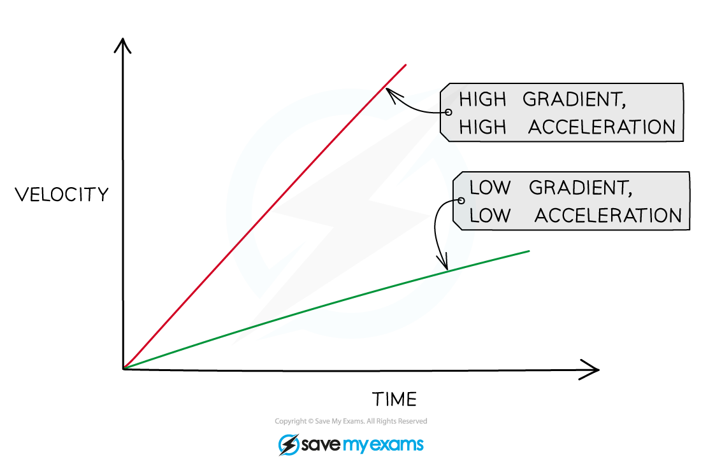

# Gradient of a Velocity-Time Graph

## Gradient of a Velocity-Time Graph

> **Spec point** — `spcpt_xTnCQkMyyP3VskYS`

## Gradient of a velocity-time graph

- **Acceleration** is any change in the velocity of an object in a given time

$a c c e l e r a t i o n = \frac{ c h a n g e i n v e l o c i t y}{t i m e} = \frac{( v - u ) }{t} = \frac{\Delta v }{\Delta t}$

- Where:

  - *v* = final velocity (m s–1)
  - *u =* initial velocity (m s–1)
  - Δ*v* = change in velocity (m s–1)
  - Δ*t* = change in time (s)

- As velocity is a vector quantity, this means that if the **speed** of an object **changes**, or its **direction** **changes**, then it is **accelerating**

  - An object that slows down tends to be described as ‘**decelerating**’
- The gradient of a velocity-time graph is equal to the **acceleration**

#### Acceleration on a velocity-time graph

***The larger the gradient, the larger the acceleration represented on a velocity-time graph***

> **Worked Example**
> What does the velocity-time graph look like for this acceleration-time graph?
> 
> 
> 
> **Answer:**
> 
> **Step 1: Consider how velocity is represented on the acceleration-time graph**
> 
> - Acceleration is the gradient of a velocity-time graph
> 
> **Step 2: Consider the velocity at each section of the acceleration-time graph**
> 
> - When the acceleration increases, the gradient of the velocity-time graph increases
> - When acceleration reaches a maximum, this is the maximum gradient of the velocity-time graph
> - When the acceleration decreases, the gradient of the velocity-time graph decreases
> 
> 

> **Exam Hint**
> A summary of the areas under the graph and gradients for the different motion graphs are:
> 
> **Gradient:**
> 
> - The gradient of a **displacement**-time graph is the **velocity**
> - The gradient of a **velocity**-time graph is the **acceleration**
> 
> **Area under the graph:**
> 
> - The area under a **velocity**-time graph is the **displacement**
> - The area under an **acceleration**-time graph is the **velocity**
