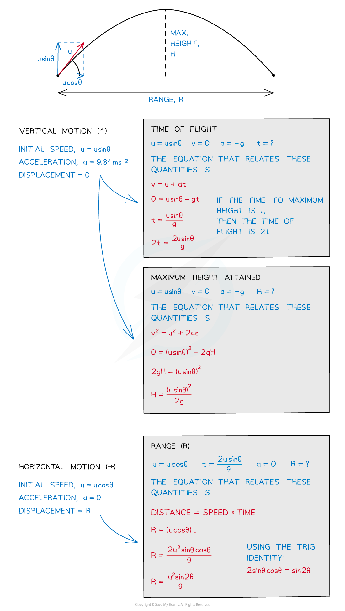

# Projectile Motion

## Projectile Motion

> **Spec point** — `spcpt_6cm5kKfgJrwNxXcv`

## Projectile motion

- The trajectory of an object undergoing projectile motion consists of a **vertical** component and a **horizontal** component

  - The vertical and horizontal components of the motion are completely **independent **of one another
  - Therefore, they need to be evaluated **separately**
- Some key terms to know, and how to calculate them, are:

  - **Time of flight:** how long the projectile is in the air
  - **Maximum height attained:** the height at which the projectile is momentarily at rest vertically
  - **Range:** the horizontal distance travelled by the projectile

### Projectile motion calculation example

***How to find the time of flight, maximum height and range***

- **Remember: **the only force acting on the projectile, after it has been released, is **gravity**
- There are three possible scenarios for projectile motion:

  - **Vertical** projection
  - **Horizontal** projection
  - **Projection** at an **angle**
- Let’s consider each in turn:

> **Worked Example**
> A science museum designed an experiment to show the fall of a feather in a vertical glass vacuum tube.
> 
> The time of fall from rest is 0.5 s.
> 
> 
> 
> What is the length of the tube, L?
> 
> **Answer:**
> 
> **Step 1: List the known quantities**
> 
> - Acceleration, *a* = 9.81 m s–2
> - Initial velocity, *u* = 0
> - Time, *t* = 0.5 s
> - Displacement,* s* = L = ?
> 
> **Step 2: State the relevant equation of motion**
> 
> - The equation linking *a*, *u, *t* *and *s* is
> 
> $s=ut+\frac{1}{2}at^{2}$
> 
> **Step 3: Substitute in the values**
> 
> $L=\frac{1}{2}gt^{2}$
> 
> `L space equals space 1 half space cross times space 9.81 space cross times space open parentheses 0.5 close parentheses squared space equals space 1.2 space straight m`

> **Worked Example**
> A motorcycle stunt-rider moving horizontally takes off from a point 1.25 m above the ground, landing 10 m away as shown.
> 
> 
> 
> What was the speed at take-off?
> 
> **Answer:**
> 
> **Step 1: List the known quantities for the vertical motion**
> 
> - Displacement, *s* = 1.25 m
> - Acceleration, *a* = 9.81 m s–2
> - Initial velocity, *u* = 0
> - Time, *t* = ?
> 
> **Step 2: State the relevant equation for the vertical motion**
> 
> $s=ut+\frac{1}{2}at^{2}$
> 
> **Step 3: Rearrange for the time, *****t***
> 
> $s=\frac{1}{2}gt^{2}$
> 
> $t=\sqrt{\frac{2s}{g}}$
> 
> **Step 4: Substitute the values**
> 
> $t=\sqrt{\frac{2\times1.25}{9.81}}=0.5s$
> 
> **Step 5: List the known quantities for the horizontal motion**
> 
> - Displacement, *s* = 10 m
> - Acceleration, *a = *0
> - Time, *t *= 0.5 s
> - Initial velocity, *u* = ?
> 
> **Step 6: Calculate the initial velocity, *****u***
> 
> $\text{velocity}=\frac{\text{displacement}}{\text{time}}$
> 
> $u=\frac{10}{0.5}=20ms^{-1}$

> **Worked Example**
> A ball is thrown from a point P with an initial velocity *u* of 12 m s-1 at 50° to the horizontal.
> 
> What is the value of the maximum height at Q?
> 
> 
> 
> **Answer:**
> 
> **Step 1: List the known quantities**
> 
> - Initial velocity, *u* = 12sin(50) m s–1
> - Acceleration, *a* = –9.81 m s–2
> - Final velocity, *v* = 0
> - Vertical displacement, *s* = H = ?
> 
> **Step 2: State the relevant equation of motion**
> 
> $v^{2}=u^{2}+2as$
> 
> **Step 3: Rearrange for the displacement, *****s***
> 
> $2as=v^{2}-u^{2}$
> 
> $s=\frac{v^{2}-u^{2}}{2a}$
> 
> **Step 4: Substitute in the values**
> 
> `s space equals space fraction numerator open parentheses 12 sin open parentheses 50 close parentheses close parentheses squared space over denominator 19.62 end fraction space equals space 4.3 space straight m`

> **Exam Hint**
> In the last question, the final velocity can be set to zero because we are only concerned with the object's motion up until it reaches point Q. This is a mathematical trick that simplifies the calculation.
> 
> Make sure you don’t make these common mistakes:
> 
> - Forgetting that acceleration is −*g* throughout when upwards is positive
> - Confusing the direction of sin θ and cos θ
> - Not converting units (mm, cm, km etc.) to metres
> 
> You must be confident with resolving velocity (velocity, displacement) into their horizontal and vertical components. Revise this in the [Scalars and Vectors topic.](https://www.savemyexams.com/a-level/physics/cie/25/revision-notes/1-physical-quantities-and-units/1-4-scalars-and-vectors/scalars-and-vectors/)
