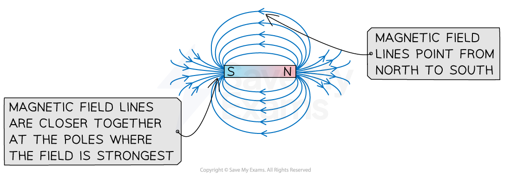
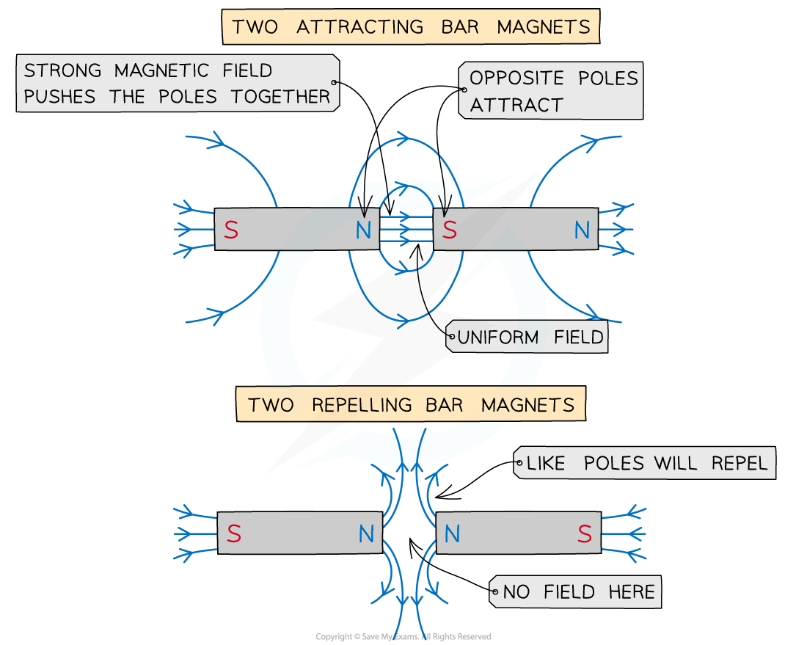
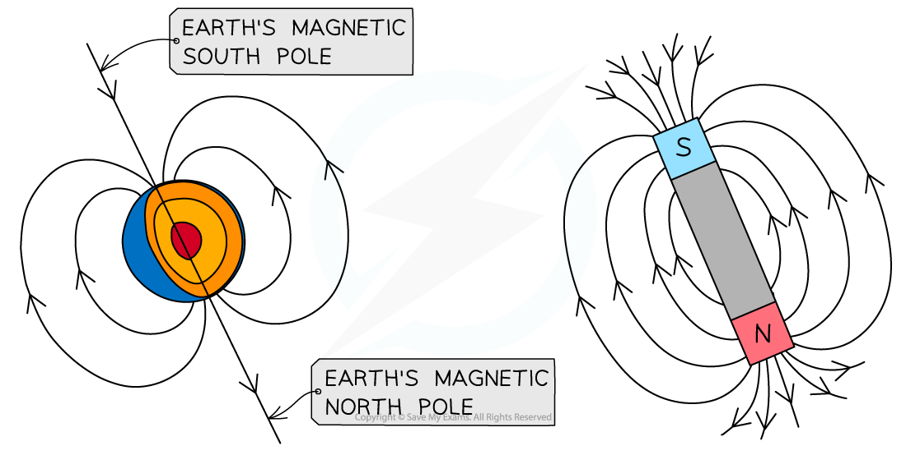

# Representing Magnetic Fields

## Magnetic Field Definition

> **Spec point** — `spcpt_2jHZ3jtfGjRfpR5c`

## Magnetic field definition

- A magnetic field is a **field of force** that is created either by:

  - **moving** electric charge
  - **permanent** magnets

- Permanent magnets are materials that produce a magnetic field
- A stationary charge will **not **produce a magnetic field
- A magnetic field is sometimes referred to as a **B**-**field**
- A magnetic field is created around a **current-carrying wire** due to the movement of electrons
- Although magnetic fields are invisible, they can be observed by the force that pulls on magnetic materials, such as iron or the movement of a needle in a plotting compass

## Representing Magnetic Fields

> **Spec point** — `spcpt_8GNpG9kT8QJ9GNhZ`

## Representing magnetic fields

- Like with electric fields, field lines are used to represent the **direction **and **magnitude **of a magnetic field
- In a magnetic field, field lines are always directed from the **north **pole to the **south **pole

***The magnetic field lines around a bar magnet show the field is strongest at the two poles***

- The simplest representation of magnetic field lines can be seen around **bar magnets**

  - These can be mapped using iron filings or plotting compasses

- **The key aspects of drawing magnetic field lines are:**

  - Arrows point **out** of a north pole and **into** a south pole
  - The direction of the field line shows the direction of the force that a free magnetic north pole would experience at that point
  - The field lines are **stronger** the **closer** the lines are together
  - The field lines are **weaker** the **further apart** the lines are
  - Magnetic field lines **never** cross

### Magnetic field between two bar magnets

- When two bar magnets are pushed together, they either attract or repel each other:

  - Two **like **poles (north and north or south and south) **repel** each other
  - Two **opposite **poles (north and south) **attract **each other

***Two opposite poles attract each other and two like poles repel each other***

### Uniform magnetic fields

- In a **uniform **magnetic field, the strength of the magnetic field is the same at all points
- This is represented by equally spaced parallel lines, just like electric fields

***A uniform magnetic field has equally spaced field lines and is created when two opposite poles are held close together***

### The Earth's magnetic field

- On Earth, in the absence of any magnet or magnetic materials, a magnetic compass will always point north
- This is because the north pole of the compass is attracted to the Earth's magnetic south pole (which is the geographic north pole)

***The Earth's magnetic field acts in a similar way to a bar magnet. A compass points to the Earth's magnetic south pole which is the geographic north pole***
