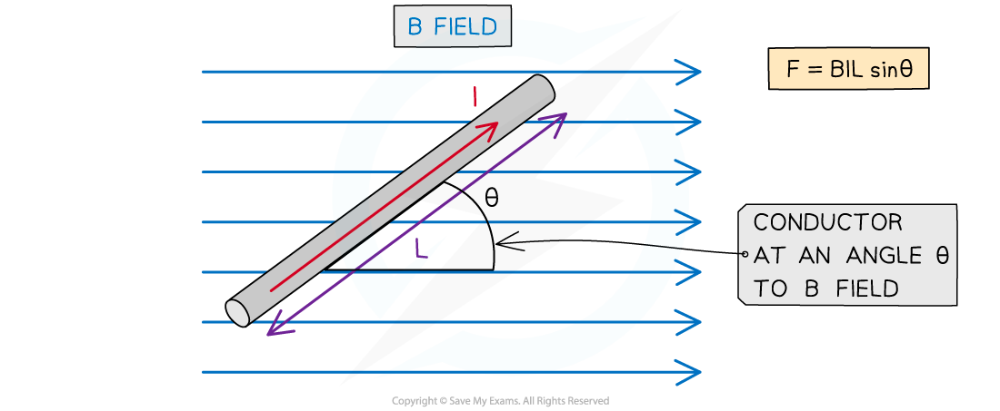
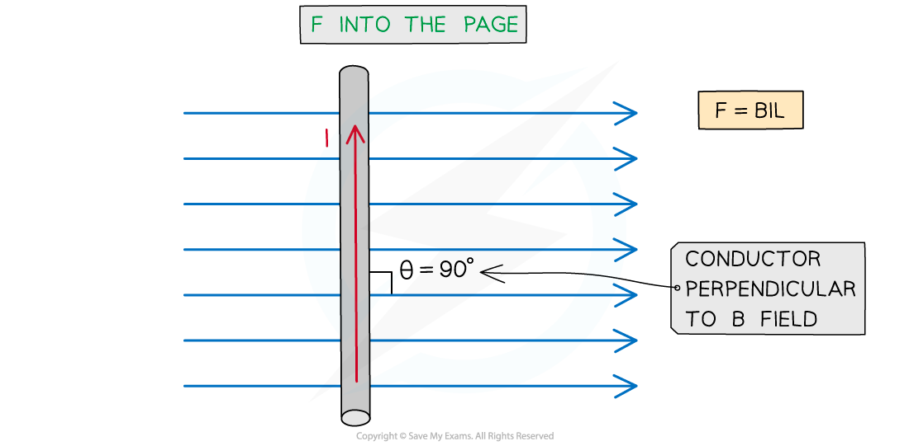

# Force on a Current-Carrying Conductor

## Calculating Magnetic Force on a Current-Carrying Conductor

> **Spec point** — `spcpt_893zyS5yCdTvfZ6Q`

## Calculating magnetic force on a current-carrying conductor

- The force *F* on a conductor carrying current *I* at an angle *θ* to a magnetic field with flux density *B* is defined by the equation

$F=BIL\mathrm{sin}θ$

- Where:

  - *F* = force on a current-carrying conductor in a B field (N)
  - *B* = magnetic flux density of applied B field (T)
  - *I* = current in the conductor (A)
  - *L* = length of the conductor (m)
  - *θ* = angle between the conductor and applied B field (degrees)

- This equation shows that the force on the conductor can be increased by:

  - increasing the strength of the magnetic field
  - increasing the current flowing through the conductor
  - increasing the length of the conductor in the field

- **Note**: The length *L* represents the length of the conductor that is **within** the field

#### Magnetic force on a current-carrying conductor

***The magnitude of the force on a current-carrying conductor depends on the angle of the conductor to the external B field***

- A current-carrying conductor (e.g. a wire) will experience the **maximum **magnetic force if the current through it is **perpendicular **to the direction of the magnetic field lines

  - It experiences no force if it is parallel to magnetic field lines

- The **maximum** force occurs when sin *θ* = 1

  - This means θ = 90° and the conductor is **perpendicular **to the B field

- The equation for the magnetic force becomes:

$F=BIL$

- The **minimum** force, i.e. *F* = 0 N, is when sin *θ* = 0°

  - This means *θ* = 0° and the conductor is **parallel** to the B field

- It is important to note that a current-carrying conductor will experience **no** force if the current in the conductor is parallel to the field

  - This is because the *F*, *B* and *I* must be **perpendicular** to each other

> **Worked Example**
> A current of 0.87 A flows in a wire of length 1.4 m placed at 30° to a magnetic field of flux density 80 mT.
> 
> Calculate the magnitude of the force on the wire.
> 
> **Answer:**
> 
> **Step 1: Write down the known quantities**
> 
> - Magnetic flux density, *B* = 80 mT = 80 × 10-3 T
> - Current,*I* = 0.87 A
> - Length of wire*, L* = 1.4 m
> - Angle between the wire and the magnetic field, *θ =* 30°
> 
> **Step 2:** **Write down the equation for force on a current-carrying conductor**
> 
> $F = B I L \sin ( \\theta )$
> 
> **Step 3: Substitute in values and calculate**
> 
> $F = ( 80 \times 10^{- 3} ) \times 0.87 \times 1.4 \times \sin ( 30 ) = 0.049 \mathrm{N} ( 2 \mathrm{s} . \mathrm{f} . )$

> **Exam Hint**
> Remember that the direction of current flow is the flow of **positive** charge (positive to negative), and this is in the **opposite direction** to the flow of electrons
