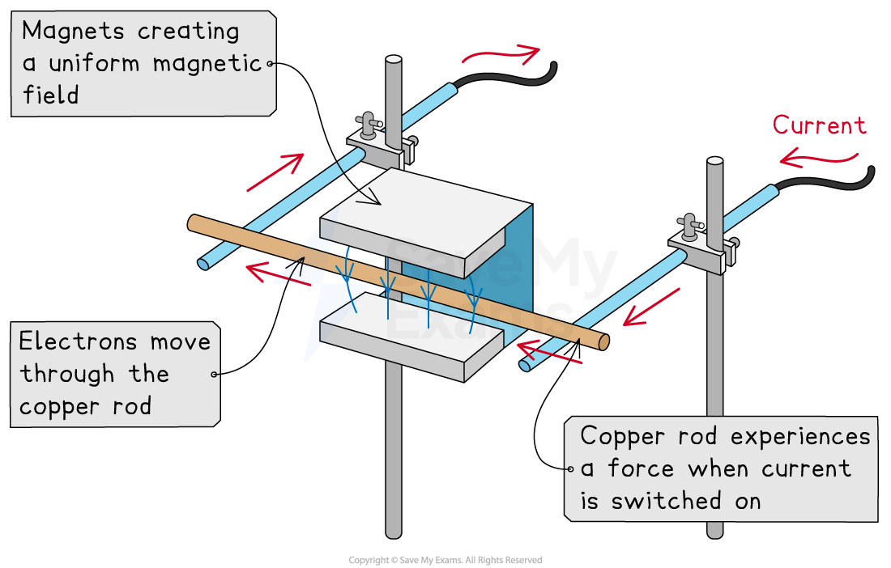

# Magnetic Flux Density

## Force on a Current-Carrying Conductor

> **Spec point** — `spcpt_QQy7zzGmRXM7JY5W`

## Force on a current-carrying conductor

- A current-carrying conductor produces its own *magnetic field*

  - When interacting with an external magnetic field, it will experience a **force**

- The force due to a magnetic field can be observed by

  - placing a copper rod in a uniform magnetic field
  - connecting the copper rod to a circuit

- When current is passed through the copper rod, it experiences a **force**

  - This causes it to accelerate in the direction of the force

#### Observing the force on a current-carrying conductor

***A copper rod moves within a magnetic field when current is passed through it***

## Magnetic Flux Density Definition

> **Spec point** — `spcpt_bV52cRBYJbNVV3F6`

## Magnetic flux density definition

- The strength of a magnetic field can be described by the density of its field lines

  - The higher the flux density, the **stronger** the magnetic field i.e. regions where field lines are **closer **together
  - The lower the flux density, the **weaker **the magnetic field i.e. regions where field lines are **further **apart

- This is described by the magnetic flux density *B* of a field, which is defined as: **The force exerted per unit current per unit length on a straight current-carrying conductor placed perpendicular to the magnetic field**
- Magnetic flux density is measured in **teslas **(T)
- One tesla, 1 T, is defined as: **The flux density that causes a force of 1 N on a 1 m wire carrying a current of 1 A at right angles to the field**
- To put this into perspective, the Earth's magnetic flux density is around 0.032 mT and an ordinary fridge magnet is around 5 mT
