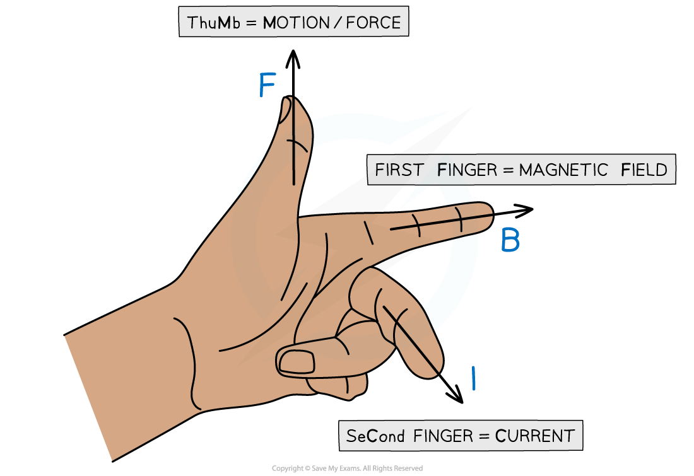
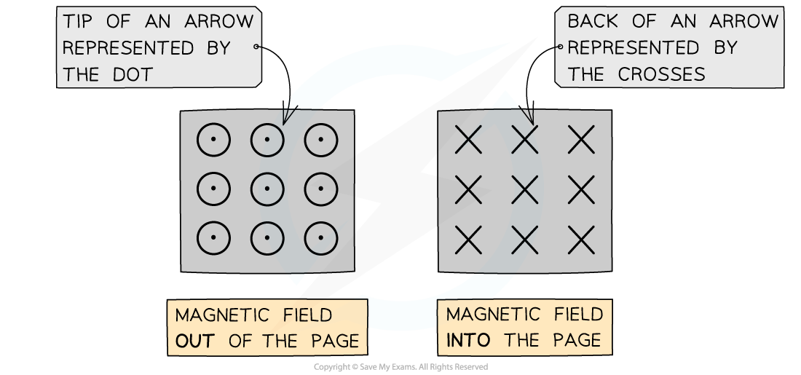

# Fleming's Left-Hand Rule

## Fleming's Left-Hand Rule

> **Spec point** — `spcpt_6zdT7rBqG7Wj8mbP`

## Fleming's left-hand rule

- When a current-carrying conductor is placed in a magnetic field, the force, B-field and current are all mutually **perpendicular **to each other

  - Their directions can be determined using **Fleming’s left-hand rule**

- To use Fleming's left-hand rule, point the thumb, first finger and second finger at right angles to each other

  - The **thumb** points in the direction of **motion** or **force *****F***** **of the conductor
  - The **first** finger points in the direction of the applied **magnetic field *****B***
  - The **second** finger points in the direction of the flow of conventional **current *****I***** **(from positive to negative)

#### Fleming's left-hand rule

***Fleming’s left-hand rule allows us to visualise the 3D arrangement of the force, magnetic field and current***

### Representing magnetic fields in 3D

- When solving problems in three-dimensional space, the current, force or magnetic field could be directed into or out of the page
- When the magnetic field is directed into or out of the page, the following symbols are used:

  - **Dots **(sometimes with a circle around them) represent the magnetic field directed **out** of the plane of the page
  - **Crosses **represent the magnetic field directed **into** the plane of the page

***When the magnetic field is directed into or out of the page, we represent this with crosses or dots, respectively***

- The way to remember this is by imagining an arrow used in archery or darts:

  - If the arrow is approaching **head-on**, such as out of a page, only the very tip of the arrow can be seen (a dot)
  - When the arrow is **receding away**, such as into a page, only the cross of the feathers at the back can be seen (a cross)

> **Worked Example**
> State the direction of the current flowing in the wire in the diagram below.
> 
> 
> 
> **Answer:**
> 
> - Using Fleming’s left-hand rule:
> 
>   - Magnetic field,* B* = into the page
>   - Force,* F* = vertically downwards
>   - Current, *I* = from right to left
> 
> 

> **Exam Hint**
> Don’t be afraid to use Fleming’s left-hand rule during an exam. Although, it is best to do it subtly in order not to give the answer away to other students!
