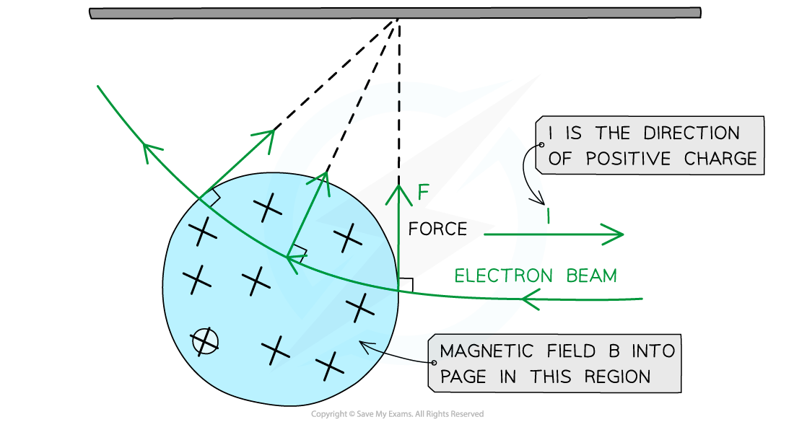
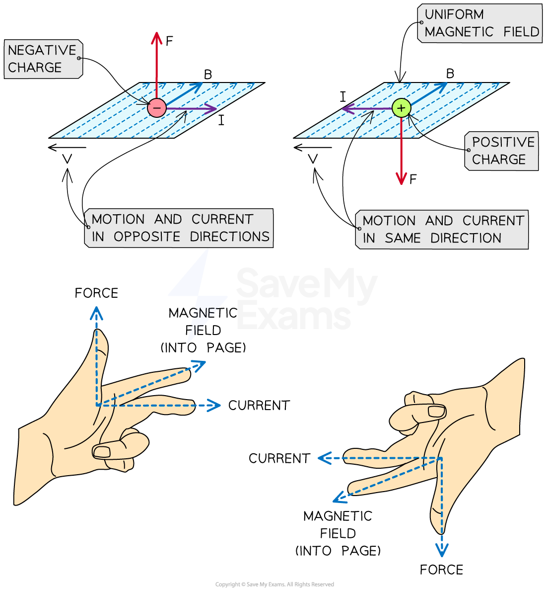
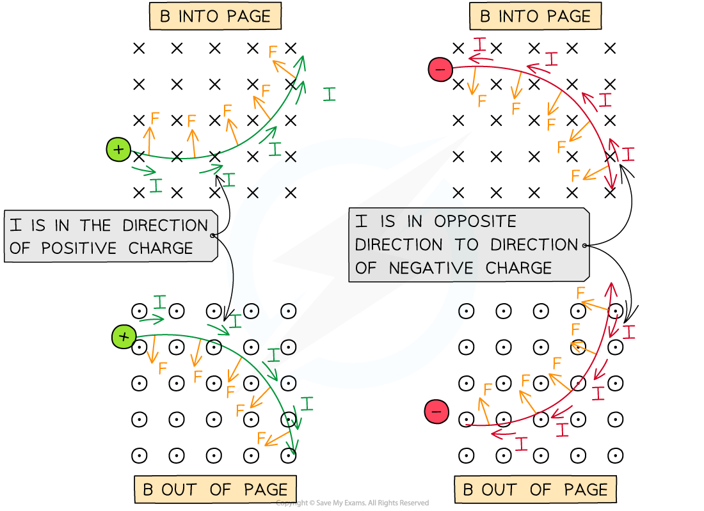

# Force on a Moving Charge

## Calculating Magnetic Force on a Moving Charge

> **Spec point** — `spcpt_sX6gTXtQcCt5dWvm`

## Calculating magnetic force on a moving charge

- A moving charge produces its own *magnetic field*

  - When interacting with an applied magnetic field, it will experience a **force**

- The force *F* on an isolated particle with charge *Q* moving with speed *v* at an angle *θ* to a magnetic field with flux density *B* is defined by the equation

$F=BQv\mathrm{sin}θ$

- Where:

  - *F* = magnetic force on the particle (N)
  - *B* = *magnetic flux density* (T)
  - *Q* = charge of the particle (C)
  - *v* = speed of the particle (m s−1)
  - *θ* = angle between charge’s velocity and magnetic field (degrees)

- Current is taken as the rate of flow of **positive** charge (i.e. **conventional **current)

  - This means that the direction of the current for a flow of negative charge (e.g. a beam of electrons) is in the opposite direction to its motion

- As with a current-carrying conductor, the **maximum **force on a charged particle occurs when it travels **perpendicular **to the field

  - This is when *θ* = 90°, so sin *θ* = 1

- The equation for the magnetic force becomes:

$F=BQv$

- *F*,*B* and *v* are mutually perpendicular, therefore:

  - if the direction of the particle's motion changes, the magnitude of the force will also change
  - if the particle travels **parallel** to a magnetic field, it will experience **no **magnetic force

#### Path of a moving charged particle in a magnetic field

***The force on an isolated moving charge is perpendicular to its motion and the magnetic field B***

- From the diagram above, when a beam of electrons enters a magnetic field which is directed **into **the page:

  - electrons are negatively charged, so current *I* is directed to the **right** (as motion *v* is directed to the **left**)
  - using *Fleming’s left-hand rule*, the force on an electron will be directed **upwards**

### Direction of force on a moving charge

- The direction of the magnetic force on a charged particle depends on

  - the direction of flow of the **current**
  - the direction of the **magnetic field**

- This can be found using **Fleming's left-hand rule**
- The second finger represents the **current** flow or the flow of **positive **charge

  - For a **positive **charge, the current points in the **same **direction as its velocity
  - For a **negative **charge, the current points in the **opposite **direction to its velocity

***Fleming’s left-hand rule allows us to determine the direction of the force on a charged particle***

- From the diagram above, when a **positive** charge enters a magnetic field from left to right, using Fleming's left-hand rule:

  - the first finger (**field**) points **into **the page
  - the second finger (**current**) points to the **right**
  - the thumb (**force**) points **upwards**

- When a charged particle moves in a uniform magnetic field, the force acts perpendicular to the field and the particle's velocity

  - As a result, it follows a **circular** path

***The direction of the magnetic force F on positive and negative particles in a B field in and out of the page***

> **Worked Example**
> An electron moves in a uniform magnetic field of flux density 0.2 T at a velocity of 5.3 × 107 m s−1.
> 
> Calculate the force on the electron when it moves perpendicular to the field.
> 
> **Answer:**
> 
> **Step 1:** **Write out the known quantities**
> 
> - Velocity of the electron, *v* = 5.3 × 107 m s−1
> - Charge of an electron, *Q* = 1.60 × 10−19 C
> - Magnetic flux density, *B* = 0.2 T
> 
> **Step 2: Write down the equation for the magnetic force on an isolated particle**
> 
> $F=BQv\mathrm{sin}θ$
> 
> - The electron moves perpendicular (*θ* = 90°) to the field, so sin *θ* = 1
> 
> $F=BQv$
> 
> **Step 3: Substitute in values, and calculate the force on the electron**
> 
> *F* = (0.2) × (1.60 × 10−19) × (5.3 × 107) = 1.7 × 10−12 N (2 s.f.)

> **Exam Hint**
> Remember not to mix this up with F = BIL!
> 
> - **F = BIL** is for a current carrying conductor
> - **F = BQv** is for an isolated moving charge (which may be inside a conductor)
> 
> Remember not to get this mixed up with Fleming's right-hand rule. That is used for a generator (or dynamo), where a current is **induced** in the **conductor**. Fleming's left-hand rule is sometimes referred to as the 'Fleming's left-hand rule for motors'.
