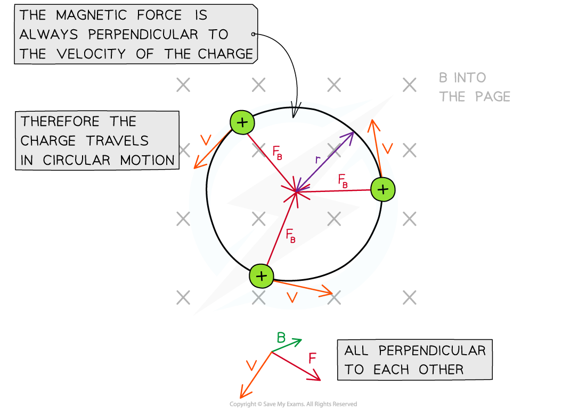

# Motion of a Charged Particle in a Magnetic Field

## Motion of a Charged Particle in a Uniform Magnetic Field

> **Spec point** — `spcpt_G6S34CPt4BgzfXDh`

## Motion of a charged particle in a uniform magnetic field

- When a charged particle enters a uniform *magnetic field*, it travels in a **circular** path
- This is because the direction of the *magnetic force* *F* will always be

  - perpendicular to the particle's velocity *v*
  - directed towards the centre of the path, resulting in circular motion

#### Circular motion of a charge in a magnetic field

***In a magnetic field, a charged particle travels in a circular path as the force, velocity and field are all perpendicular***

- The magnetic force *F* provides the *centripetal force* on the particle
- The equation for centripetal force is:

$F=\frac{mv^{2}}{r}$

- Equating this to the magnetic force on a moving charged particle gives the expression:

$\frac{mv^{2}}{r}=BQv$

- Rearranging for the radius *r* gives an expression for the **radius **of the path of a charged particle in a perpendicular magnetic field:

$r=\frac{mv}{BQ}$

- Where:

  - *r* = radius of the path (m)
  - *m* = mass of the particle (kg)
  - *v* = linear velocity of the particle (m s−1)
  - *B* = magnetic field strength (T)
  - *Q* = charge of the particle (C)

- This equation shows that:

  - Faster moving particles with speed *v* move in larger circles (larger *r*):  $r\proptov$
  - Particles with greater mass *m* move in larger circles:  $r\proptom$
  - Particles with greater charge *q* move in smaller circles:  $r\propto\frac{1}{q}$
  - Particles moving in a strong magnetic field *B* move in smaller circles:  $r\propto\frac{1}{B}$

- The centripetal acceleration is in the** same direction** as the magnetic (centripetal) force
- This can be found using Newton's second law:

$F=ma$

> **Worked Example**
> An electron travels at right angles to a uniform magnetic field of flux density 6.2 mT. The speed of the electron is 3.0 × 106 m s-1 and its charge-to-mass ratio is 1.8 × 1011 C kg-1.
> 
> Calculate the radius of the circular path of the electron.
> 
> **Answer:**
> 
> **Step 1: Write down the known quantities**
> 
> - Charge-to-mass ratio: $\frac{q}{m}=1.8\times10^{11}C\mathrm{kg}^{-1}$
> - Magnetic flux density,* B *= 6.2 mT
> - Electron speed,* v *= 3.0 × 106 m s-1
> 
> **Step 2: Write down the equation for the radius of a charged particle in a perpendicular magnetic field**
> 
> $r=\frac{mv}{Bq}$
> 
> **Step 3: Substitute in values**
> 
> $\frac{m}{q}=\frac{1}{1.8\times10^{11}}$
> 
> $r = \frac{( 3.0 \times 10^{6 ) }{( 1.8 \times 10^{11} ) ( 6.2 \times 10^{-3} } )} = 2.688 \times 10^{- 3} \mathrm{m} = 2.7 \text{mm} ( 2 \mathrm{s} . \mathrm{f} )$
