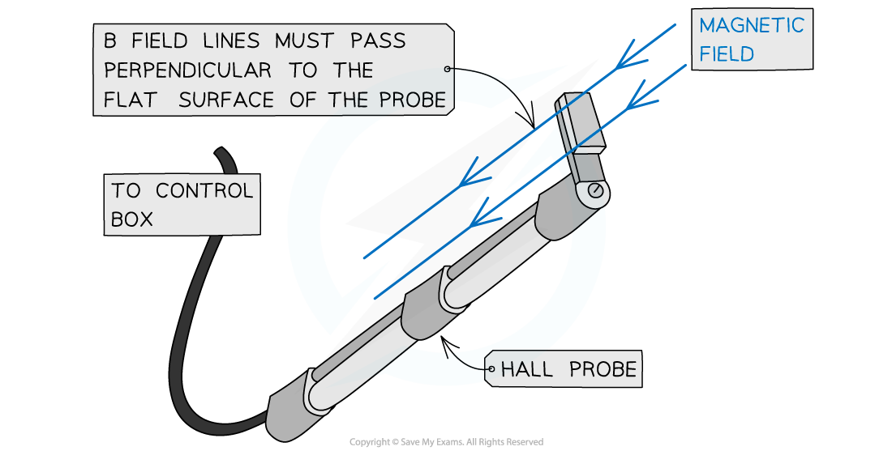
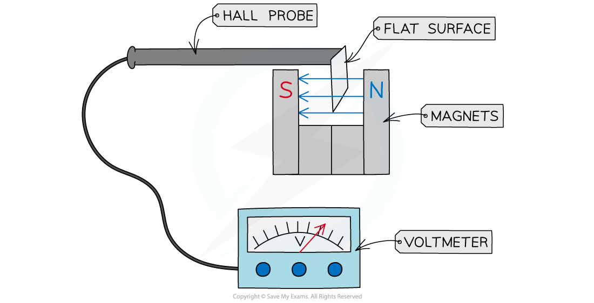

# Using a Hall Probe

## Measuring Magnetic Flux Density using a Hall Probe

> **Spec point** — `spcpt_BfCwxTG63Ssw5Kf4`

## Measuring magnetic flux density using a Hall probe

- A Hall probe can be used to measure the *magnetic flux density* between two magnets based on the Hall effect
- It consists of a cylinder with a flat surface at the end

#### Hall probe

***A Hall probe consists of a flat surface and is held so the magnetic field lines are perpendicular to it***

- To measure the magnetic flux density between two magnets, the flat surface of the probe must be directed between the magnets

  - This is to ensure the *magnetic field* lines pass completely perpendicular to this surface

### Hall probe in a magnetic field

***The Hall probe creates a Hall voltage when placed in a magnetic field***

- The probe is connected to a voltmeter to measure the *Hall voltage*
- If the probe is not held in the correct orientation (perpendicular to the field lines), the voltmeter reading will be reduced
- Since the Hall voltage is directly proportional to the magnetic flux density, the flux density of the magnets can be obtained
- A Hall probe is sensitive enough to measure even the Earth’s magnetic flux density

> **Worked Example**
> A Hall probe is placed near one end of a solenoid, as shown in the diagram.
> 
> 
> 
> The Hall probe is rotated about the axis XY.
> 
> State and explain why the magnitude of the Hall voltage varies.
> 
> **Answer:**
> 
> - The Hall voltage depends on the angle between the magnetic field and the plane of the probe
> - The Hall voltage reaches a **maximum** when the field is **perpendicular** to the probe
> - The Hall voltage is **zero** when the field is **parallel **to the probe
