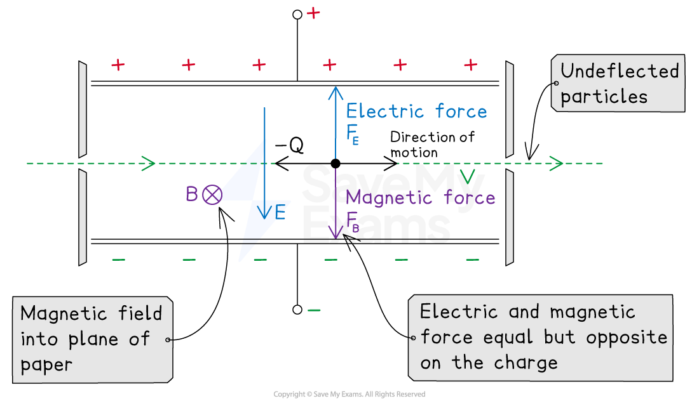

# Velocity Selection

## Velocity Selection

> **Spec point** — `spcpt_G53DGdgSRnbKbtrh`

## Velocity selection

- A velocity selector is defined as: **A device consisting of perpendicular electric and magnetic fields where charged particles with a specific velocity can be filtered**
- Velocity selectors are used in devices, such as mass spectrometers, to produce a beam of charged particles all travelling at the **same velocity**
- A velocity selector consists of two oppositely charged parallel plates situated in a vacuum chamber

  - The plates provide a uniform electric field with strength *E* between them

- There is also a uniform *magnetic field* with flux density *B* applied perpendicular to the electric field

  - If a beam of charged particles enters between the plates, they may all have the same charge *Q* but travel at different speeds

#### Velocity selector

***The particles travelling at the desired speed v will travel through undeflected due to the equal and opposite electric and magnetic forces on them***

- The electric force **does not** depend on the velocity: $F_{E}=EQ$
- However, the *magnetic force* **does** depend on the velocity: $F_{B}=BQv$

  - The magnetic force will be greater for particles which are travelling faster

- To select particles travelling at exactly the desired speed *v,* the electric and magnetic force must therefore be **equal**, but in **opposite** directions

$F_{E}=F_{B}$

- The resultant force on the particles at speed *v* will be zero, so they will remain undeflected and pass straight through between the plates
- By equating the electric and magnetic force equations:

$EQ=BQv$

- The charge *Q* will cancel out on both sides to give the selected velocity *v* equation:

$v=\frac{E}{B}$

- Therefore, the speed *v* in which a particle will remain undeflected is found by the **ratio of the electric and magnetic field strength**

  - If a particle has a speed greater or less than *v*, the magnetic force will deflect it and collide with one of the charged plates
  - This would remove the particles in the beam that are not exactly at speed *v*
- **Note:** the gravitational force on the charged particles will be negligible compared to the electric and magnetic forces and therefore can be ignored in these calculations

> **Worked Example**
> A positive ion travels between two charged plates towards a slit S
> 
> (a) State the direction of the electric and magnetic fields on the ion
> 
> (b) Calculate the speed of the ion emerging from slit S when the magnetic flux density is 0.50 T and the electric field strength is 2.8 kV m-1
> 
> (c) Which plate will the ion be deflected towards if the speed was greater than the speed in part (b)
> 
> **Answer:**
> 
> **Part (a)**
> 
> **Step 1: Determine the direction of E field**
> 
> - Electric field lines point from the positive to negative to charge
> - Therefore, it must be directed **vertically upwards**
> 
> **Step 2: Determine the direction of B field**
> 
> - Using *Fleming’s left-hand rule*:
> 
>   - The charge, or current I, is directed to the right
>   - B is out of the page
>   - Therefore, the force F is **vertically downwards**
> 
> **Part (b)**
> 
> - Electric field strength, *E* = 2.8 kV m-1 = 2.8 × 103 V m-1
> - Magnetic flux density, *B* = 0.50 T
> 
> $v=\frac{E}{B}=\frac{2.8\times10^{3}}{0.50}=5600ms^{-1}$
> 
> **Part (c)**
> 
> - If the speed increases, the magnetic force must be greater because FB ∝ v
> - Since the magnetic force would direct the ion downwards in the direction of the field, the ion will be deflected towards the positive plate
