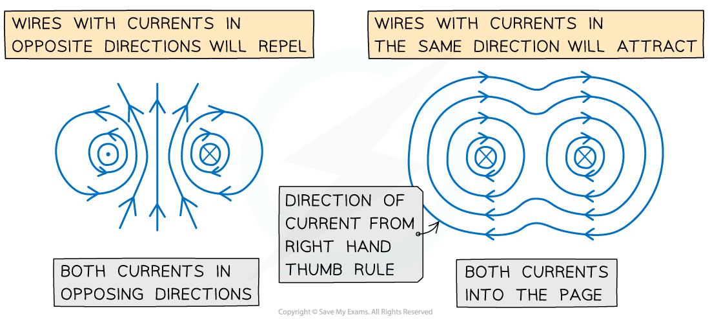

# Forces Between Current-Carrying Conductors

## Origin of the Forces Between Current-Carrying Conductors

> **Spec point** — `spcpt_5NJsYyNQNgN3TY8q`

## Origin of the forces between current-carrying conductors

- A current-carrying conductor, such as a wire, produces a *magnetic field* around it
- The direction of the field depends on the direction of the current through the wire

  - This is determined by the** right-hand grip rule**

- Parallel current-carrying conductors will therefore either attract or repel each other

  - If the currents are in the **same** direction in both conductors, the magnetic field lines between the conductors cancel out – the conductors will **attract** each other
  - If the currents are in the **opposite** direction in both conductors, the magnetic field lines between the conductors push each other apart – the conductors will **repel** each other

#### Magnetic field lines around two current-carrying wires

***Both wires will attract if their currents are in the same direction and repel if in opposite directions***

- When the conductors **attract**, the direction of the *magnetic forces* will be **towards** each other
- When the conductors **repel**, the direction of the magnetic forces will be **away** from each other
- The magnitude of each force depend on the amount of current and length of the wire

> **Worked Example**
> Two long, straight, current-carrying conductors, WX and YZ, are held at a close distance, as shown in diagram 1.
> 
> 
> 
> The conductors each carry the same magnitude current in the same direction. A plan view from above the conductors is shown in diagram 2.
> 
> 
> 
> On diagram 2, draw arrows, one in each case, to show the direction of:
> 
> - The magnetic field at X due to the current in wire YZ (label this arrow BYZ)
> - The force at X as a result of the magnetic field due to the current in the wire YZ (label this arrow FYZ)
> - The magnetic field at Y due to the current in wire WX (label this arrow BWX)
> - The force at Y as a result of the magnetic field due to the current in the wire WX (label this arrow FWX)
> 
> **Answer:**
> 
> 
> 
> - Newton’s third law states: When two bodies interact, the force on one body is **equal but opposite** in direction to the force on the other body
> - Therefore, the forces on the wires act in equal but opposite directions
