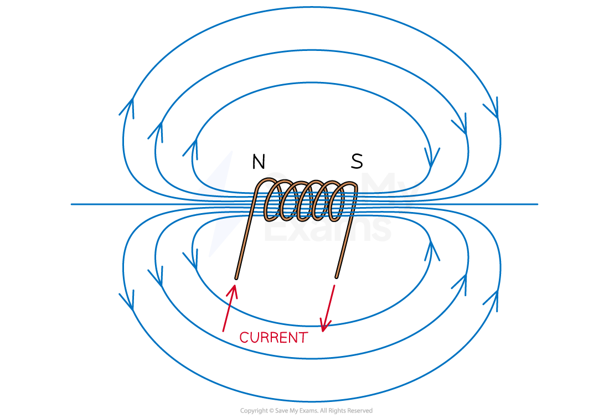
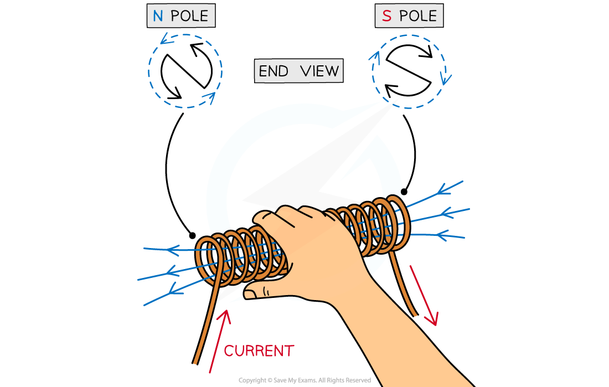
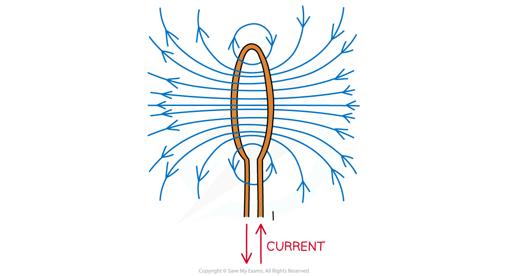

# Magnetic Fields in Wires, Coils & Solenoids

## Magnetic Fields in Wires, Coils & Solenoids

> **Spec point** — `spcpt_XC28YTrjTB5d4Qnq`

## Magnetic fields in wires, coils & solenoids

- *Magnetic fields* are formed wherever a current flow, such as in:

  - long straight wires
  - long solenoids
  - flat circular coils

### Magnetic field around a current-carrying wire

- Magnetic field lines in a current-carrying wire are circular rings, centred on the wire
- The field lines are closer together near the wire, where the field is strongest
- The field lines become further apart with distance from the wire as the field becomes weaker
- Reversing the current reverses the direction of the field

***The direction of the field around a current-carrying wire can be determined using the right-hand grip rule***

- The field lines are clockwise or anticlockwise around the wire, depending on the direction of the current
- The direction of the magnetic field can be determined using the** right-hand grip rule**

  - This is determined by pointing the **right-hand** thumb in the direction of the current in the wire and curling the fingers onto the palm
  - The direction of the curled fingers represents the direction of the magnetic field around the wire
  - For example, if the current is travelling vertically upwards, the magnetic field lines will be directed anticlockwise, as seen from directly above the wire

- **Note:** the direction of the current is taken to be the conventional current i.e. from **positive** to **negative**, **not** the direction of electron flow

### Magnetic field around a solenoid

- As seen from a current-carrying wire, an electric current produces a magnetic field
- An electromagnet utilises this by using a coil of wire called a** ***solenoid*

  - This increases the magnetic flux density by adding more **turns **of wire into a smaller region of space
- One end of the solenoid becomes a north pole and the other becomes the south pole

***The magnetic field lines around a solenoid are similar to a bar magnet***

- As a result, the field lines around a solenoid are similar to a bar magnet

  - The field lines **emerge** from the **north** pole
  - The field lines **return** to the **south** pole

- The poles of the solenoid can be determined using the **right-hand grip rule**

  - The curled fingers represent the direction of the current flow around the coil
  - The thumb points in the direction of the field inside the coil, towards the **north pole**

***In a solenoid, the north pole forms at the end where the current flows anti-clockwise, and the south pole at the end where the current flows clockwise***

### Magnetic field around a flat circular coil

- A flat circular coil is equivalent to one of the coils of a solenoid
- The field lines emerge through one side of the circle (north pole) and enter through the other (south pole)
- As with a solenoid, the direction of the magnetic field depends on the direction of the current

  - This can be determined using the **right-hand grip rule**
  - It is easier to find the direction of the magnetic field on the straight part of the circular coil to determine which direction the field lines are passing through

***Magnetic field lines of many individual circular coils can be combined to make a solenoid***

> **Worked Example**
> The current in a long, straight vertical wire is in the direction XY, as shown in the diagram.
> 
> 
> 
> Sketch the pattern of the magnetic flux in the horizontal plane ABCD due to the current-carrying wire. Draw at least four flux lines.
> 
> **Answer:**
> 
> 
> 
> - Concentric circles
> - Increasing separation between each circle
> - Arrows drawn in an anticlockwise direction

> **Exam Hint**
> Remember to draw the arrows showing the direction of the field lines on every single field line you draw. Also, ensure that in a uniform magnetic field, the field lines are equally spaced.

## Factors Affecting Magnetic Field Strength

> **Spec point** — `spcpt_Mjp98FNqKrf5YDRY`

## Factors affecting magnetic field strength

- The strength of the magnetic field of a solenoid can be increased by:

  - adding a core made from a** ferrous** (iron-rich) material e.g. an iron rod
  - adding **more turns** in the coil

- When current flows through the solenoid with an iron core, it becomes magnetised, creating an even stronger field

  - The addition of an iron core can strengthen the magnetic field up to a several hundred times more

- When more turns are added in the coil, this concentrates the magnetic field lines, causing the magnetic field strength to increase
