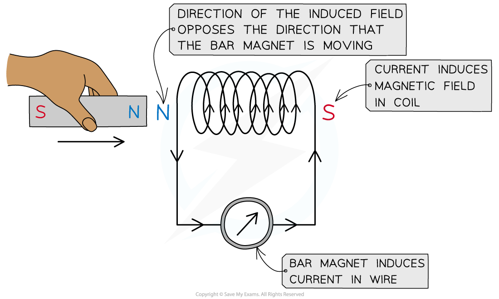

# Faraday's & Lenz's Laws

## Faraday's & Lenz's Laws

> **Spec point** — `spcpt_4DsfR7bJvwK6Qrfd`

## Faraday's & Lenz's laws

- Faraday’s law tells us the magnitude of the induced e.m.f. in *electromagnetic induction* and is defined as:

**The magnitude of the induced e.m.f. is directly proportional to the rate of change in magnetic flux linkage**

- Faraday's law of induction is defined by the equation:

$ε=N\frac{\DeltaΦ}{\Deltat}$

- Where:

  - *ε* = induced *e.m.f* (V)
  - *N* = number of turns of coil
  - Δ*Φ* = change in *magnetic flux* (Wb)
  - Δ*t *= time interval (s)
- Lenz’s Law gives the **direction** of the induced e.m.f. as defined by Faraday’s law:

**The induced e.m.f acts in such a direction to produce effects which oppose the change causing it**

- Lenz’s law, combined with Faraday’s law, can be written as:

$ε=-N\frac{\DeltaΦ}{\Deltat}$

- This equation shows:

  - When a bar magnet goes through a coil, an e.m.f. is induced within the coil due to a change in magnetic flux
  - A current is also induced, which means the coil now has its own magnetic field
  - The coil’s magnetic field acts in the **opposite direction **to the magnetic field of the bar magnet

- If a *direct current* (d.c.) power supply is replaced with an *alternating current* (a.c.) supply, the e.m.f. induced will also be alternating with the same frequency as the supply

### Experimental evidence for Lenz’s law

- To verify Lenz’s law, the only apparatus needed is:

  - a bar magnet
  - a coil of wire
  - a sensitive ammeter

- **Note:** a cell is **not** required
- A known pole (either north or south) of the bar magnet is pushed into the coil, which induces a magnetic field in the coil

  - Using the right-hand grip rule, the curled fingers indicate the direction of the **current**,** **and the thumb indicates the direction of the **induced magnetic field**

> **Exam Hint**
> Remember that the right-hand grip rule can be used differently for a current carrying wire and for a solenoid.
> 
> - For a current carrying **wire**:
> 
>   - The curled **fingers **indicate the direction of the magnetic **field**, $B$
>   - The **thumb **indicates the direction of conventional **current**, $I$
> - For a **solenoid**:
> 
>   - The curled **fingers **indicate the direction of the conventional **current**, $I$
>   - The **thumb **indicates the direction of the magnetic **field**, $B$

- The direction of the current is observed on the ammeter

  - Reversing the magnet direction would give an opposite deflection on the meter

- The induced field (in the coil) **repels** the bar magnet
- This is because of **Lenz’s law**:

  - The direction of the induced field in the coil pushes against the change creating it, i.e. the bar magnet

#### Demonstrating Lenz's law

***Lenz’s law can be verified using a coil connected in series with a sensitive ammeter and a bar magnet***

> **Worked Example**
> A small rectangular coil contains 350 turns of wire. The longer sides are 3.5 cm and the shorter sides are 1.4 cm.
> 
> 
> 
> The coil is held between the poles of a large magnet so that the coil can rotate about an axis through its centre.
> 
> The magnet produces a uniform magnetic field of flux density 80 mT between its poles. The coil is positioned horizontally and then turned through an angle of 40° in a time of 0.18 s.
> 
> Calculate the magnitude of the average e.m.f induced in the coil.
> 
> **Answer:**
> 
> **Step 1: Write down the known quantities**
> 
> - Magnetic flux density, *B* = 80 mT = 80 × 10-3 T
> - Area, *A* = 3.5 × 1.4 = (3.5 × 10-2) × (1.4 × 10-2) = 4.9 × 10-4 m2
> - Number of turns, *N* = 350
> - Time interval, Δ*t* = 0.18 s
> - Angle between coil and field lines = 40o
> - Therefore, the angle between the normal to the area and the field lines, *θ* = (90 − 40) = 50°
> 
> ** Step 2: Write out the equation for Faraday’s law:**
> 
> $ε=N\frac{\DeltaΦ}{\Deltat}$
> 
> **Step 3:** **Write out the equation for flux linkage**
> 
> $N \\Phi = B A N \cos ( \\theta )$
> 
> **Step 4: Substitute values into flux linkage equation:**
> 
> $N \\Phi = ( 80 \times 10^{- 3} ) \times ( 4.9 \times 10^{- 4} ) \times 350 \times \cos 50^{\circ} = 8.82 \times 10^{- 3} \text{Wb}$
> 
> **Step 5: Substitute flux linkage and time into Faraday’s law equation**
> 
> $ε=\frac{8.82\times10^{-3}}{0.18}=0.049=49\mathrm{mV}$
