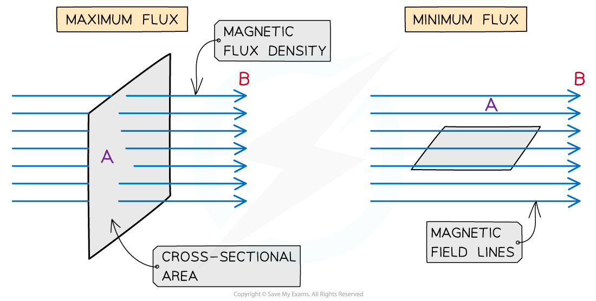
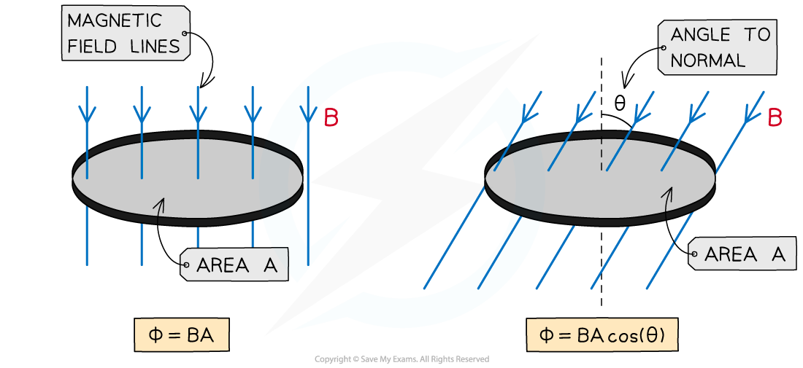

# Magnetic Flux

## Magnetic Flux Definition

> **Spec point** — `spcpt_WNGJp2ZSqSJZdFm4`

## Magnetic flux definition

- Electromagnetic induction is the process of inducing an ***e.m.f*** in a conductor when there is **relative movement** between a charge and a ***magnetic field***

  - This can be observed using a magnet and a coil or a solenoid

- This happens when a conductor **cuts** through magnetic field lines
- The amount of e.m.f induced is determined by the magnetic flux
- The amount of magnetic flux varies as the coil rotates within the field

  - The flux is the total magnetic field that passes through a given area
  - It is a maximum when the magnetic field lines are **perpendicular** to the plane of the area
  - It is 0 when the magnetic field lines are **parallel** to the plane of the area

- The **magnetic flux **is defined as:

**The product of the magnetic flux density and the cross-sectional area perpendicular to the direction of the magnetic flux density**

- In other words, magnetic flux is a measure of the **number of magnetic field lines** passing through a given** area**

#### Maximum and minimum magnetic flux

***The magnetic flux is maximum when the magnetic field lines and the area they are travelling through are perpendicular***

## Calculating Magnetic Flux

> **Spec point** — `spcpt_4ynGKGKJxKS48Dxc`

## Calculating magnetic flux

- *Magnetic flux* is defined by the symbol Φ (greek letter ‘phi’)
- It is measured in units of **Webers (Wb)**
- Magnetic flux can be calculated using the equation:

$Φ=BA$

- Where:

  - *Φ* = magnetic flux (Wb)
  - *B* = *magnetic flux density* (T)
  - *A* = cross-sectional area (m2)

- When the magnet field lines are not completely perpendicular to the area *A*, then the component of magnetic flux density *B* perpendicular to the area is taken
- The equation then becomes:

`capital phi space equals space B A cos open parentheses theta close parentheses`

- Where:

  - *θ* = angle between *magnetic field* lines and the line perpendicular to the plane of the area (often called the normal line) (degrees)

#### Increasing and decreasing magnetic flux

***The magnetic flux increases as the angle between the field lines and normal decreases***

- This means the magnetic flux is:

  - **maximum** = BA when cos(θ) =1 therefore **θ = 0****o**. The magnetic field lines are perpendicular to the plane of the area
  - **minimum** = 0 when cos(θ) = 0 therefore **θ = 90****o**. The magnetic fields lines are parallel to the plane of the area

- An e.m.f is induced in a circuit when the magnetic flux linkage changes with respect to time
- This means an e.m.f is induced when there is:

  - A changing magnetic flux density *B*
  - A changing cross-sectional area *A*
  - A change in angle *θ*

> **Worked Example**
> An aluminium window frame has a width of 40 cm and a length of 73 cm, as shown in the figure below
> 
> 
> 
> The frame is hinged along the vertical edge AC. When the window is closed, the frame is normal to the Earth’s magnetic field with magnetic flux density 1.8 × 10-5 T.
> 
> Calculate the magnetic flux through the window when it is closed.
> 
> **Answer:**
> 
> **Step 1: Write out the known quantities**
> 
> - Cross-sectional area, A = 40 cm × 73 cm = (40 × 10-2) × (73 × 10-2) = 0.292 m2
> - Magnetic flux density, B = 1.8 × 10-5 T
> 
> **Step 2: Write down the equation for magnetic flux**
> 
> $Φ=BA$
> 
> **Step 3: Substitute in values**
> 
> `capital phi space equals space open parentheses 1.8 space cross times space 10 to the power of negative 5 end exponent close parentheses space cross times space 0.292 space equals space 5.256 space cross times space 10 to the power of negative 6 end exponent space equals space 5.3 space cross times space 10 to the power of negative 6 end exponent space Wb`

> **Exam Hint**
> Consider carefully the value of θ, which is the angle between the field lines and the line **normal** (perpendicular) to the plane of the area through which the field lines pass. If it helps, drawing the normal on the area provided will help visualise the correct angle.
