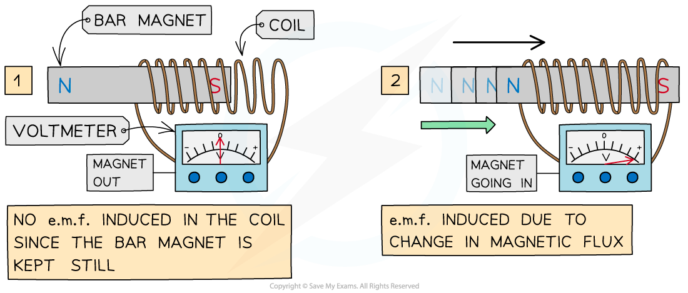
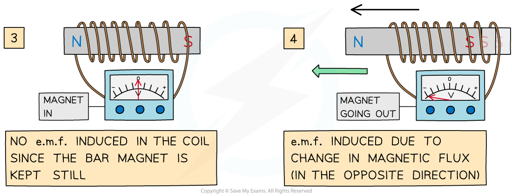
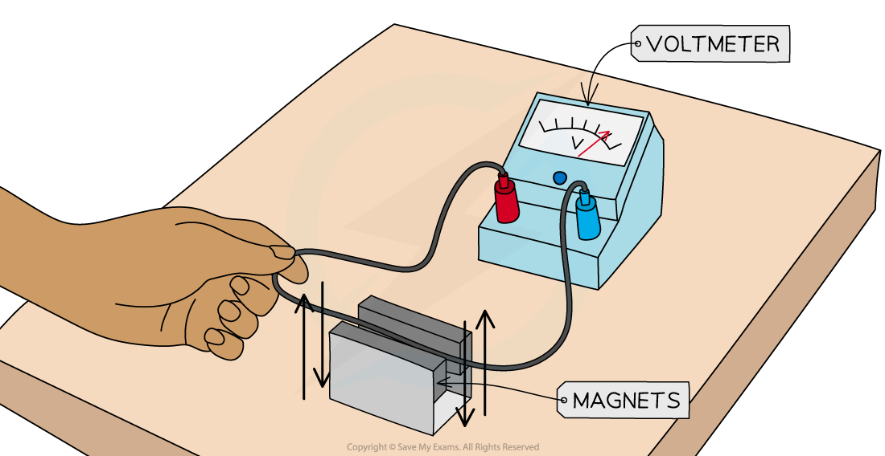

# Principles of Electromagnetic Induction

## Principles of Electromagnetic Induction

> **Spec point** — `spcpt_gNqqMV76k8t54M8k`

## Principles of electromagnetic induction

- Electromagnetic induction is a phenomenon which occurs when an *e.m.f.* is induced due to** relative movement** between a conductor and a magnetic field

- This could occur when:

  - a **conductor** moves relative to a *magnetic field*
  - a **magnetic field** varies relative to a conductor

- When a conductor cuts through magnetic field lines:

  - the free electrons in the conductor experience a **magnetic force**
  - this causes **work to be done** as charges in the conductor become **separated**
  - mechanical work is **transferred** to the charges as electric potential energy
  - a potential difference is created between the ends of the conductor, or in other words, an **e.m.f. is induced**

- The phenomenon of EM induction can be demonstrated using a magnet and a coil, or a wire and two magnets

### Experiment 1: Moving a magnet through a coil

- When a coil is connected to a sensitive voltmeter, a bar magnet can be moved in and out of the coil to induce an e.m.f

***A bar magnet is moved through a coil connected to a voltmeter to induce an e.m.f***

The expected results are...

1. **When the bar magnet is not moving, the voltmeter shows a zero reading**

  - When the bar magnet is stationary inside or outside the coil, the rate of change of flux is zero, so **no e.m.f. is induced**
2. **When the bar magnet begins to move inside the coil, there is a reading on the voltmeter**

  - As the bar magnet moves, its magnetic field lines ‘cut through’ the coil, generating a **change in magnetic flux **(ΔΦ)
  - This induces an **e.m.f.** within the coil, shown momentarily by the reading on the voltmeter
3. **When the bar magnet is taken back out of the coil, an e.m.f. is induced in the opposite direction**

  - As the magnet changes direction, the direction of the current changes
  - The voltmeter will momentarily show a reading with the opposite sign
4. **Increasing the speed of the magnet induces an e.m.f. with a higher magnitude**

- As the speed of the magnet increases, the rate of change of flux increases

***An e.m.f is induced only when the bar magnet is moving through the coil***

- Factors that will **increase **the magnitude of the induced e.m.f. are:

  - Moving the magnet **faster** through the coil
  - Adding more **turns** to the coil
  - Increasing the **strength** of the bar magnet

### Experiment 2: Moving a wire through a magnetic field

- When a long wire is connected to a voltmeter and moved between two magnets, an e.m.f. is induced

  - **Note:** there is no current flowing through the wire to start with

***A wire is moved between two magnets connected to a voltmeter to induce an e.m.f.***

The expected results are...

1. **When the wire is not moving, the voltmeter shows a zero reading**

  - When the wire is stationary inside or outside the magnet, the rate of change of flux is zero, so **no e.m.f. is induced**
2. **As the wire moves between the magnets, an e.m.f. is induced**

  - This is shown momentarily by the reading on the voltmeter
  - As the wire moves through the magnetic field, it ‘cuts through’ the magnetic field lines, generating a **change in magnetic flux**
3. **When the wire is moved back out of the field, an e.m.f. is induced in the opposite direction**

  - As the wire changes direction, the direction of the current changes
  - The voltmeter will momentarily show a reading with the opposite sign

- Factors that will increase the magnitude of the induced e.m.f. are:

  - Increasing the **length** of the wire in the field
  - Moving the wire between the magnets **faster**
  - Increasing the **strength** of the magnets
