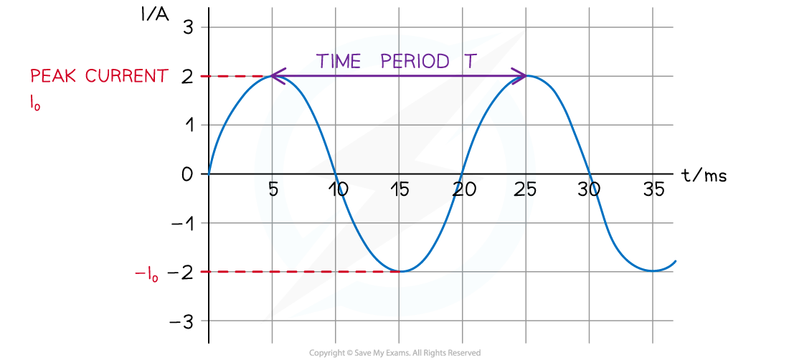

# Alternating Current & Voltage

## Properties of Alternating Current & Voltage

> **Spec point** — `spcpt_fvkGBrgChQGFyChh`

## Properties of alternating current & voltage

- An alternating current (a.c) is defined as: **A current which periodically varies from positive to negative and changes its magnitude continuously with time**
- This means the direction of an alternating current varies every **half-cycle**
- The variation of current, or p.d., with time can be described as a sine curve ie. **sinusoidal**

  - Therefore, the electrons in a wire carrying a.c. move back and forth with *simple harmonic motion*

- As with [SHM](https://www.savemyexams.com/a-level/physics/cie/25/revision-notes/17-oscillations/17-1-simple-harmonic-oscillations/describing-oscillations/), the time period of an alternating current is defined as:

$T=\frac{1}{f}$

- Where:

  - *T* = *time period* (s)
  - *f* = *frequency* (Hz)

- Peak current (*I*0), or peak voltage (*V*0), is defined as: **The maximum value of the alternating current or voltage**
- Peak current, or voltage, can be determined from the **amplitude** of the graph

#### Time period and peak current on a current-time graph

***Graph of alternating current against time with a time period of 20 ms and peak current of 2 A***

- Mains electricity is supplied as alternating current

  - Power stations produce alternating current
  - This is the type of current supplied when devices are plugged into sockets

> **Worked Example**
> The variation with time *t* of the output voltage *V* of an alternating voltage supply is shown in the graph below.
> 
> 
> 
> Use the graph to calculate the frequency of the supply.
> 
> **Answer:**
> 
> **Step 1: Write down the period-frequency relation**
> 
> $f=\frac{1}{T}$
> 
> **Step 2: Calculate the time period from the graph**
> 
> - The time period is the time taken for one complete cycle
> - From the graph, this is equal to 0.2 ms
> - **Therefore, **the time period is
> 
> *T* = 0.2 ms = 0.2 × 10-3 s
> 
> **Step 3: Substitute into frequency equation**
> 
> $f=\frac{1}{0.2\times10^{-3}}=5000\mathrm{Hz}=5\mathrm{kHz}$

> **Exam Hint**
> Remember to double check the units on the alternating current and voltage graphs. These are often shown in the range of milli-seconds (ms) instead of seconds (s) on the x axis.

## Using Sinusoidal Representations

> **Spec point** — `spcpt_TmQMhMcDtVRPwzTF`

## Using sinusoidal representations

- The equation representing alternating current which gives the value of the current *I* at any time *t* is:

$I = I_{0} \sin ( \\omega t )$

- Where:

  - *I* = current (A)
  - *I*0 = *peak current* (A)
  - ⍵ = angular frequency of the supply (rad s-1)
  - *t* = time (s)

- **Note: **this a sine function since the alternative current graph is *sinusoidal*
- A similar equation can be used for representing alternating voltage:

$V = V_{0} \sin ( \\omega t )$

- Where:

  - *V *= voltage (V)
  - *V*0 = *peak voltage* (V)

- Recall the relation between the equation for angular frequency ⍵:

$ω=\frac{2π}{T}=2πf$

- Where:

  - *f* = frequency of the supply (Hz)

> **Worked Example**
> An alternating current *I *varies with time *t *as shown in the graph below.
> 
> 
> 
> Using the graph and the equation for alternating current, calculate the value of the current at a time 0.48 s.
> 
> **Answer:**
> 
> **Step 1: Write out the equation for alternating current**
> 
> $I = I_{0} \sin ( \\omega t )$
> 
> **Step 2: Write out the equation for angular frequency**
> 
> $ω=\frac{2π}{T}$
> 
> **Step 3:** **Measure the time period *****T***** and peak current***** I*****0**** from the graph**
> 
> - The time period is the time taken for one full cycle, *T* = 0.10 s
> - Peak current (amplitude),* I*0 = 17 A
> 
> **Step 4: Substitute values into alternating current equation at time***** t***
> 
> - Using the time given in the question, *t* = 0.48 s
> 
> $I = I_{0} \sin ( \\omega t ) = I_{0} \sin ( \frac{2 \pi t}{T} )$
> 
> $I = 17 \sin ( \frac{2 \pi ( 0.48 )}{0.1} ) = - 16.168 = - 16 \mathrm{A} ( 2 \mathrm{s} . \mathrm{f} )$

> **Exam Hint**
> These equations are written as  $x = x_{0} \sin ( \\omega t )$, the *x* is replaced with *I* or *V,* depending on the question.
> 
> Remember to check that your calculator is in **radians** mode when using any of these equations. This is because the angular frequency *⍵* is measured in rad s-1.
> 
> Current can also be positive or negative, depending on its **direction**. This is why the answer in the worked example is negative. At *t* = 0.48 s the current will be in the negative direction. The mark schemes in the exams are normally not too picky about this, but the size of the current (16 A in the worked example) is what will get the mark.
