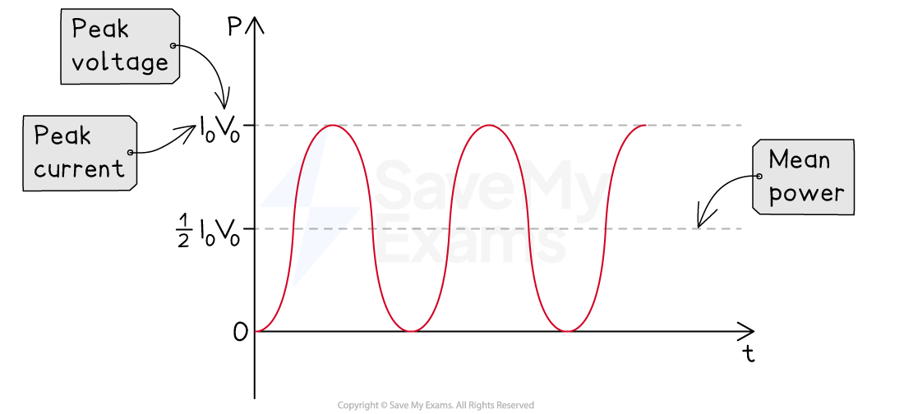

# Mean Power

## Mean Power

> **Spec point** — `spcpt_9xxFm4Np4FFvTVSd`

## Mean power

- In mains electricity, current and voltage are varying all the time
- This also means the **power** varies constantly, recall the equations for power:

$P=IV=I^{2}R=\frac{V^{2}}{R}$

- Where:

  - I = ***direct*** current (A)
  - V = **direct **voltage (V)
  - R = resistance (Ω)
- The *r.m.s* values means equations used for direct current and voltage can now be applied to *alternating current*  and voltage
- These are also used to determine an **average** current or voltage for alternating supplies
- Recall the equation for *peak current*:

$I_{0}=\sqrt{2}I_{r.m.s}$

- The peak (maximum) power and the mean (average) power are given by:

`P subscript m e a n end subscript space equals space open parentheses I subscript r. m. s end subscript close parentheses squared R`

$P_{peak}=I_{0}^{2}R$

- Peak power can be written in terms of r.m.s current as

`P subscript p e a k end subscript space equals space open parentheses square root of 2 I subscript r. m. s end subscript close parentheses squared R`

- Therefore, peak power is related to mean power by:

`2 open parentheses I subscript r. m. s end subscript close parentheses squared R space equals space 2 P subscript m e a n end subscript`

$P_{mean}=\frac{P_{peak}}{2}$

- Therefore, it can be concluded that: **The mean power in a resistive load is half the maximum power for a sinusoidal alternating current or voltage**

### Mean power on a graph

***Mean power is exactly half the maximum power***

> **Worked Example**
> An alternating voltage supplied across a resistor of 40 Ω has a peak voltage *V**0** *of 240 V.
> 
> Calculate the mean power of this supply.
> 
> **Answer:**
> 
> **Step 1: Write down the known quantities**
> 
> - Resistance, *R* = 40 Ω
> - Peak voltage, *V**0** *= 240 V
> 
> **Step 2: Write out the equation for the peak power and calculate**
> 
> $P=\frac{V_{0}^{2}}{R}$
> 
> `P space equals space fraction numerator open parentheses 240 close parentheses squared space over denominator 40 end fraction space equals space 1440 space straight W`
> 
> **Step 3:** **Calculate the mean power**
> 
> - The mean power is **half** of the maximum (peak) power
> 
> $\mathrm{Mean} \mathrm{power}=\frac{1440}{2}=720W$

> **Exam Hint**
> You do not need to remember the derivation for the mean power, but it is useful to know where it comes from. However, makes sure you remember its definition and know how to apply it in questions.
