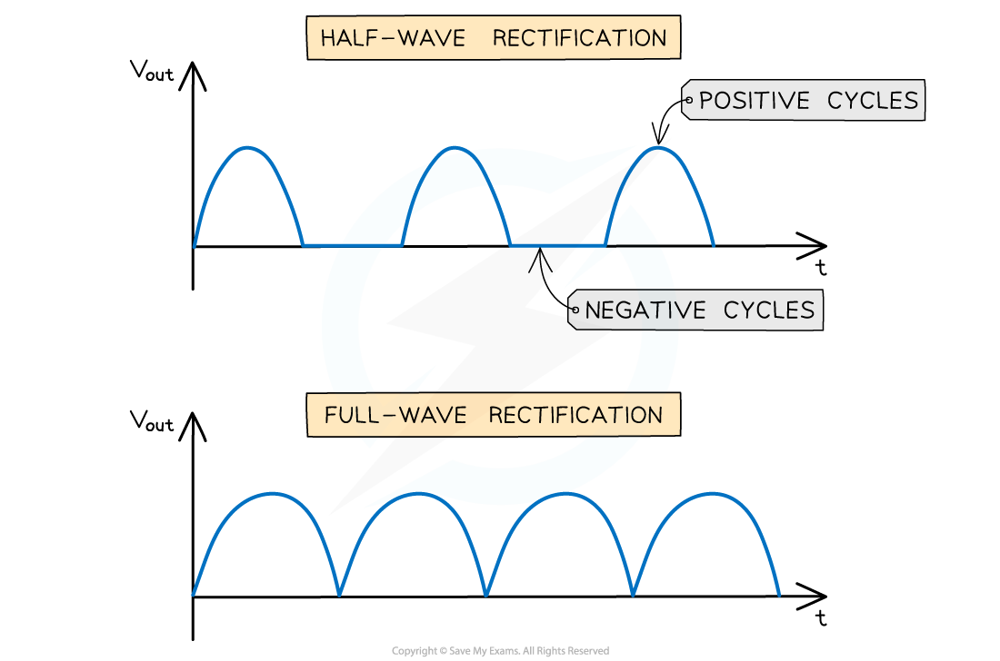
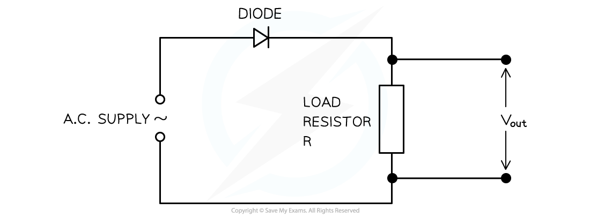
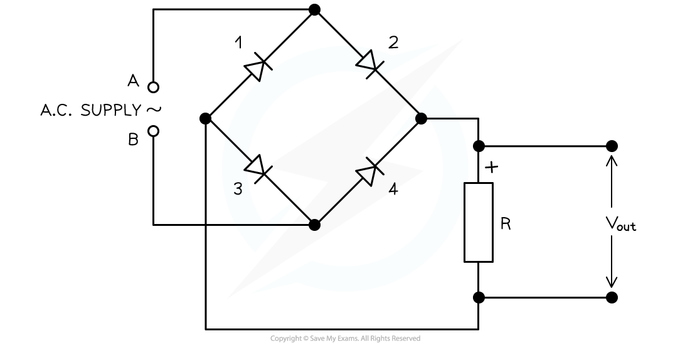

# Rectification

## Rectification Graphs

> **Spec point** — `spcpt_Trq6kwQwtwSy3rx3`

## Rectification graphs

- Rectification is defined as: **The process of converting *****alternating current*** ** and voltage into *****direct current*** ** and voltage**
- Rectification is used in electronic equipment which requires a direct current

  - For example, mains voltage must be rectified from the alternating voltage produced at power stations

### Types of rectification

- There are two types of rectification:

  - Half-wave rectification
  - Full-wave rectification

- For **half-wave** rectification:

  - The graph of the output voltage *V**out** *against time is a sine curve with the positive cycles and a flat line (*V**out** *= 0) on the negative cycle
  - This is because the *diode* only conducts in the positive direction
- For** full-wave** rectification:

  - The graph of the output voltage *V**out** *against time is a sine curve where the positive cycles and the negative cycles are both curved ‘bumps’

#### Half and full wave rectification

***The difference between the graphs of full-wave and half-wave rectification***

## Half-Wave Rectification

> **Spec point** — `spcpt_GZnvzHQTQHyZgb6D`

## Half-wave rectification

- Half-wave rectification consists of a single **diode**

  - An alternating input voltage is connected to a circuit with a load resistor and diode in series
- The diode will only conduct during the positive cycles of the input alternating voltage

  - Hence there is only current in the load resistor during these positive cycles
- The output voltage *V**out** *across the resistor will fluctuate against time in the same way as the input alternating voltage **except** there are no negative cycles

#### Circuit diagram for half-wave rectification

***Half-wave rectification requires a single diode and the graph is represented by only the positive cycles***

- This type of rectification means **half** of the time the **voltage** is **zero**

  - So, the power available from a half-wave rectified supply is reduced

## Full-Wave Rectification

> **Spec point** — `spcpt_q22QZfCjrt3qnBBB`

## Full-wave rectification

- Full-wave rectification requires a bridge rectifier circuit

  - This consists of **four** diodes connected across an input alternating voltage supply
- The output voltage *V**out** *is taken across a load resistor
- During the **positive** cycles of the input voltage, one terminal if the voltage supply is positive and the other negative

  - Two diodes opposite each other that are in forward bias will conduct
  - The other two in reverse bias will not conduct
  - A current will flow in the load resistor with the positive terminal at the top of the resistor
- During the **negative** cycles of the input voltage, the positive and negative terminals of the input alternating voltage supply will swap

  - The two diodes that were forward bias will now be in reverse bias and not conduct
  - The other two in reverse bias will now be in forward bias and will conduct
  - The current in the load resistor will still flow in the same direction as before

#### Circuit diagram for full-wave rectification

***When A is positive and B is negative, diodes 2 and 3 will conduct and 1 and 4 will not. When A is negative and B is positive, diodes 1 and 4 will conduct and diodes 2 and 3 will not. The current in the load resistor R will flow downwards***

- In both the positive and negative cycles, the current in the load resistor is the **same**
- Each diode pair is the same as in half-wave rectification

  - Since there are two pairs, this equates to full-wave rectification overall
- The main advantage of full-wave rectification compared to half-wave rectification is that there is **more** **power** available

  - Therefore, a greater power is supplied on every half cycle

> **Worked Example**
> A bridge rectifier consists of four ideal diodes A, B, C and D as connected in the figure shown below:
> 
> 
> 
> An alternating supply is applied between the terminal X and Y.
> 
> State which diodes are conducting when terminal X of the supply is positive.
> 
> **Answer:**
> 
> - Draw the path of the current direction with diodes in **forward bias**
> - Remember that conventional current flow is from **positive to negative** and only travels through the paths with diodes in **forward bias**
> 
> 
> 
> - Therefore, the answer is: diodes A and C
