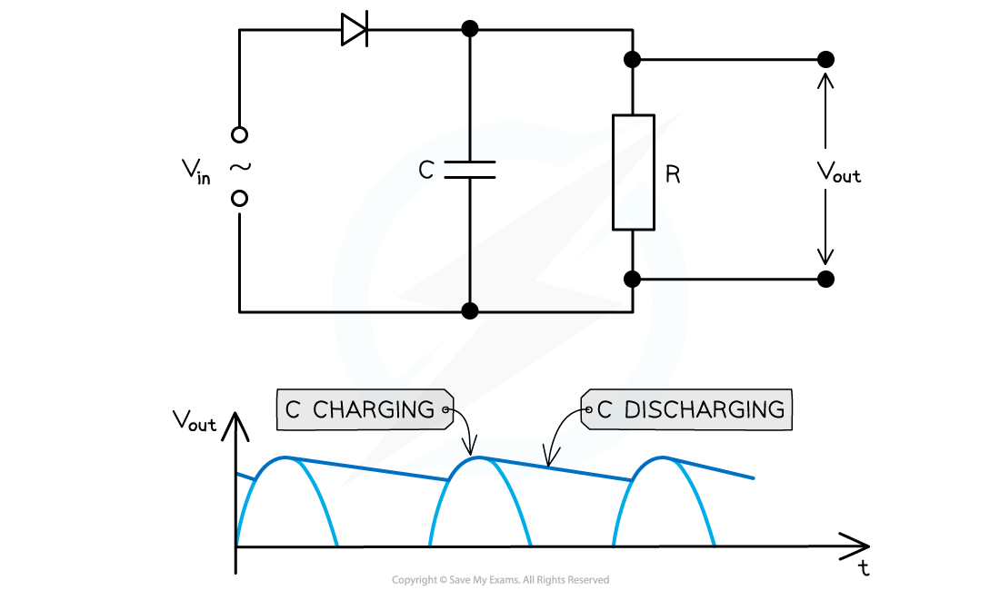
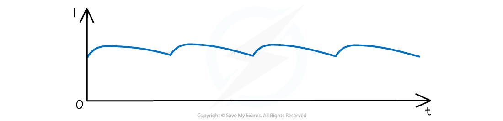

# Smoothing

## Smoothing

> **Spec point** — `spcpt_FPH53Z4SKP7nXFzp`

## Smoothing

- In *rectification*, to produce a steady *direct current*  or voltage from an *alternating current*  or voltage, a **smoothing capacitor** is necessary
- Smoothing is defined as: **The reduction in the variation of the output voltage or current**
- This works in the following ways:

  - A single capacitor with *capacitance* *C* is connected in parallel with a load resistor of resistance R
  - The capacitor **charges** up from the input voltage and maintains the voltage at a high level
  - It **discharges** gradually through the resistor when the rectified voltage drops but the voltage then **rises** again and the capacitor **charges** up again

#### Smoothing capacitor circuit diagram

***A smoothing capacitor connected in parallel with the load resistor. The capacitor charges as the output voltage increases and discharges as it decreases***

- The resulting graph of a smoothed output voltage *V**out** *or output current,* I*out against time is a ‘ripple’ shape

#### A smoothed out current-time graph

***A smooth, rectified current graph creates a ‘rippling’ shape against time***

- The amount of smoothing is controlled by the capacitance C of the capacitor and the resistance R of the load resistor

  - The less the rippling effect, the smoother the rectified current and voltage output
- The slower the capacitor discharges, the more the smoothing that occurs ie. smaller ripples
- This can be achieved by using:

  - A capacitor with **greater** capacitance *C*
  - A resistor with larger resistance *R*
- Recall that the product RC is the ***time constant*** τ of a resistor
- This means that the time constant of the capacitor must be **greater than the time interval **between the adjacent peaks of the output signal

> **Worked Example**
> The graph below shows the output voltage from a half-wave rectifier. The load resistor has a resistance of 2.6 kΩ. A student wishes to smooth the output voltage by placing a capacitor in parallel across the load resistor.
> 
> 
> 
> Suggest if a capacitor of 60 pF or 800 µF would be suitable for this task.
> 
> **Answer:**
> 
> **Step 1: Calculate the time constant with the 60 pF capacitor**
> 
> - Resistance, *R* = 2.6 kΩ = 2.6 × 103 Ω
> 
> $\mathrm{Time} \mathrm{constant}=τ=RC$
> 
> $\\tau = ( 2.6 \times 10^{3} ) \times ( 60 \times 10^{- 12} ) = 1.56 \times 10^{- 7} = 156 \text{ns}$
> 
> **Step 2:** **Compare the time constant of 60 pF capacitor with the interval between adjacent peaks of the output signal**
> 
> - The time interval between adjacent peaks is **80 ms**
> - The time constant of 156 ns is** too small** and the 60 pF capacitor will discharge far too quickly
> - There would be **no smoothing **of the output voltages
> 
>   - Therefore, the 60 pF capacitor is **not suitable**
> 
> **Step 3: Calculate the time constant with the 800 µF capacitor**
> 
> $\\tau = ( 2.6 \times 10^{3} ) \times ( 800 \times 10^{- 6} ) = 2.08 \mathrm{s}$
> 
> **Step 4: Compare the time constant of 800 µF capacitor with the interval between adjacent peaks of the output signal**
> 
> - The time constant of 2.08 s is much **larger** than 80 ms
> - The capacitor will **not** discharge completely between the positive cycles of the half-wave rectified signal
> - Therefore, the **800 µF capacitor** would be suitable for the smoothing task
