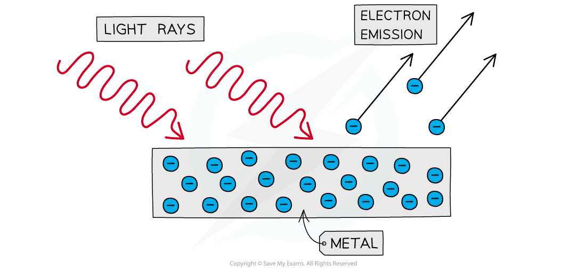

# The Photoelectric Effect: Basics

## The Photoelectric Effect: Basics

> **Spec point** — `spcpt_kWyZyjm6Y3vyj3Yx`

## The photoelectric effect: basics

### The photoelectric effect

- The** photoelectric effect** is the phenomenon in which electrons are emitted from the surface of a metal **upon the absorption of electromagnetic radiation**
- Electrons removed from a metal in this manner are known as **photoelectrons**
- The emission of photoelectrons is known as **photoelectric emission**
- The photoelectric effect provides important evidence that light is** *****quantised***

  - Each photon has energy *hf*, and each electron can absorb only a **single photon**
  - An electron is emitted only if *hf* is at least the work function $Φ$, so there is a minimum (**threshold**) frequency $f_{0}=\frac{Φ}{h}$, whatever the intensity

#### The photoelectric effect

***Photoelectrons are emitted from the surface of metal when light shines onto it***

> **Exam Hint**
> Make sure to brush up on common misconceptions:
> 
> - The electrons are already in the metal, they are not produced in any way by the incoming light rays
> - Each electron can absorb only one photon
