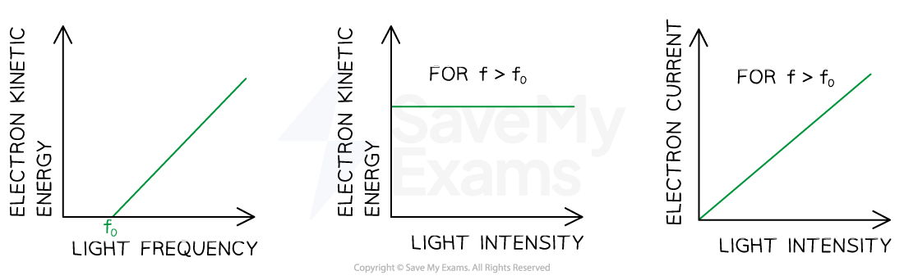

# The Work Function

## The Photoelectric Equation

> **Spec point** — `spcpt_VVwV7zkHh2vyNWYD`

## The photoelectric equation

- Since energy is always conserved, the energy of an incident photon is equal to:

**The threshold energy + the kinetic energy of the photoelectron**

- The energy within a photon is equal to ***hf***
- This energy is transferred to the electron to release it from a material (the work function) and gives the emitted photoelectron the remaining amount as kinetic energy
- This equation is known as the **photoelectric equation**:

$E=hf=Φ+\frac{1}{2}mv^{2}_{max}$

- Where:

  - *h* = *Planck's constant* (J s)
  - *f *= the frequency of the incident radiation (Hz)
  - *hf* = energy of a single photon (J)
  - *Φ* = the work function of the material (J)
  - *½mv**2**max*= the maximum kinetic energy of the photoelectrons (J)
  
    - This is always written as *E*k max

*** ***

- This equation demonstrates:

  - If the incident photons do **not** have a high enough frequency (*f*) and energy to overcome the work function (*Φ*), then no electrons will be emitted
  - Above energy* hf*0 = *Φ*, where *f*0 = threshold frequency, photoelectric emission can occur
  - *E*kmax depends only on the **frequency** of the incident photon, and not the **intensity** of the radiation
  - The majority of photoelectrons will have kinetic energies **less** than Ekmax

### Graphical representation of work function

- The photoelectric equation can be rearranged into the straight-line equation:

$y=mx+c$

- Comparing this to the photoelectric equation:

$E_{kmax}=hf-Φ$

- * *A graph of maximum kinetic energy *E*kmax against frequency *f* can be obtained

#### Graph of kinetic energy against frequency

***The graph of maximum kinetic energy of photoelectrons against photon frequency is straight line with an x-intercept***

- The key elements of the graph are:

  - The** work function** *Φ i*s the** y-intercept**
  - The **threshold frequency*** f**0* is the **x-intercept**
  - The **gradient** is equal to **Planck's constant** *h*
  - There are **no** electrons emitted **below** the threshold frequency f0

> **Worked Example**
> The graph below shows how the maximum kinetic energy *E**k* of electrons emitted from the surface of sodium metal varies with the frequency *f* of the incident radiation.
> 
> 
> 
> Calculate the work function of sodium in eV.
> 
> **Answer:**
> 
> **Step 1: Write out the photoelectric equation and rearrange it to fit the equation of a** **straight line**
> 
> $E=hf=Φ+E_{kmax}$
> 
> $E_{kmax}=hf-Φ$
> 
> $y=mx+c$
> 
> **Step 2:** **Identify the threshold frequency from the x-axis of the graph**
> 
> - When *E*k = 0, *f* = *f*0
> - Therefore, the threshold frequency is *f*0 = 4 × 1014 Hz
> 
> **Step 3: Calculate the work function**
> 
> - From the graph at *f*0, *E*k = 0
> 
> `capital phi space equals space h f subscript 0 space equals space open parentheses 6.63 space cross times space 10 to the power of negative 34 end exponent close parentheses space cross times space open parentheses 4 space cross times space 10 to the power of 14 close parentheses space equals space 2.652 space cross times space 10 to the power of negative 19 end exponent space straight J`
> 
> **Step 4: Convert the work function into eV**
> 
> - 1 eV = 1.6 × 10-19 J   ** **
> 
> $E=\frac{2.652\times10^{-19}}{1.6\times10^{-19}}=1.66\mathrm{eV}$**            **

> **Exam Hint**
> You must recognise how to compare linear equations to the straight-line equation *y* = *mx* + *c*. This is very common in A-level Physics!

## Intensity & Photoelectric Current

> **Spec point** — `spcpt_tsTXxnJGZXJdMGRS`

## Intensity & photoelectric current

### Kinetic energy & intensity

- The **kinetic energy** of the photoelectrons is **independent of the intensity** of the incident radiation
- This is because **each electron can only absorb one photon**
- Kinetic energy is only dependent on the **frequency** of the incident radiation
- Intensity is the rate of energy transferred per unit area and is related to the number of photons striking the metal plate
- Increasing the number of photons striking the metal will not increase the kinetic energy of the electrons; it will increase the **number** of photoelectrons emitted

### Why the kinetic energy is a maximum

- Each electron in the metal acquires the same amount of energy from the photons in the incident radiation for any given frequency
- However, the energy required to remove an electron from the metal varies because some electrons are on the surface whilst others are deeper in the metal

  - The photoelectrons with the maximum kinetic energy will be those on the **surface** of the metal since they do not require much energy to leave the metal
  - The photoelectrons with lower kinetic energy are those deeper within the metal since some of the energy absorbed from the photon is used to approach the metal surface (and overcome the work function)
  - There is less kinetic energy available for these photoelectrons once they have left the metal

### Photoelectric current

- Current is defined as the flow of charge, in this case, photoelectrons
- The photoelectric current is a measure of the number of photoelectrons **emitted **per second

  - The value of the photoelectric current is calculated by the number of electrons emitted multiplied by the charge on one electron
- **Photoelectric current** is **proportional** to the **intensity** of the radiation incident on the surface of the metal
- This is because intensity is proportional to the number of photons striking the metal per second
- Since each photoelectron absorbs a single photon, the photoelectric current must be proportional to the intensity of the incident radiation

***Sketch graphs showing the trends in the variation of electron KE with the frequency and intensity of the incident light and the variation of photocurrent with the intensity of the incident light***

> **Exam Hint**
> If you change the **frequency** of the incident light whilst keeping the **number of photons** emitted from the light source **constant**, then the **photoelectric current** will remain **constant**
> 
> This is because changing the frequency will change the energy of the emitted photons, but the number of photons will remain the same
> 
> If you change the **frequency** of the incident light whilst keeping the **intensity constant**, then the **photoelectric current** will **change**
> 
> This is because** intensity** is **power** per unit **area** which is equal to the rate of energy transfer per unit area
> 
> $I=\frac{P}{A}=\frac{E}{tA}$
> 
> The **energy transferred** comes from the **photons**, where the energy of a single photon is ***hf***
> 
> $I=\frac{hf}{tA}$
> 
> So to account for ***n*** number of photons:
> 
> $I=\frac{nhf}{tA}$
> 
> If the frequency,*** f***,  is increased and the intensity, $I$, remains constant, then the number of photons, ***n***, must decrease
> 
> Planck's constant, ***h***, and the area, ***A***, of the metal plate do not change
> 
> This is because at **higher frequencies**, each photon has a **higher energy**, so **fewer photons** are required to **maintain** the **intensity**
