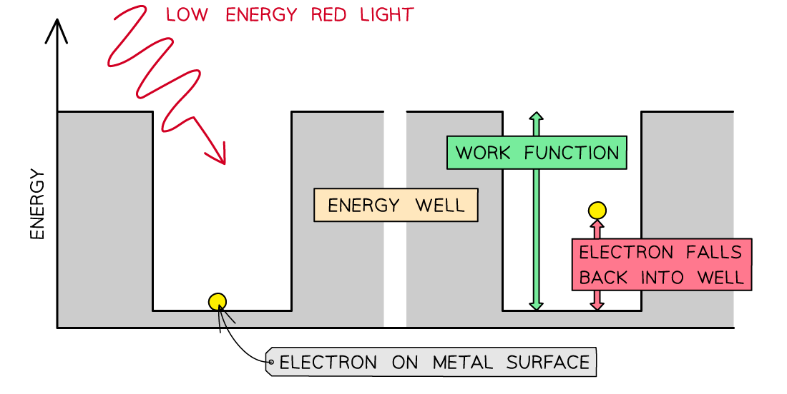
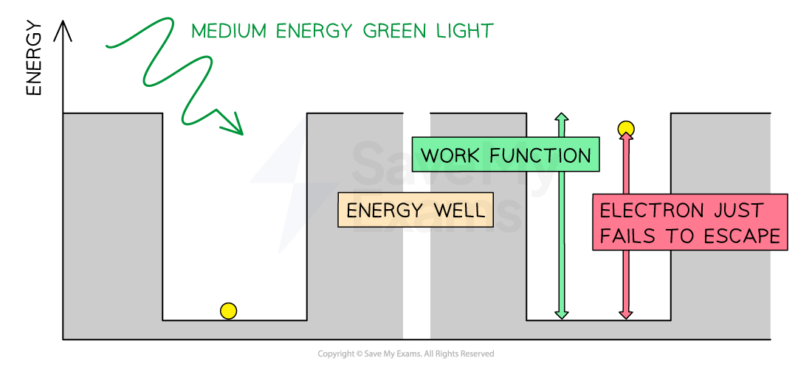
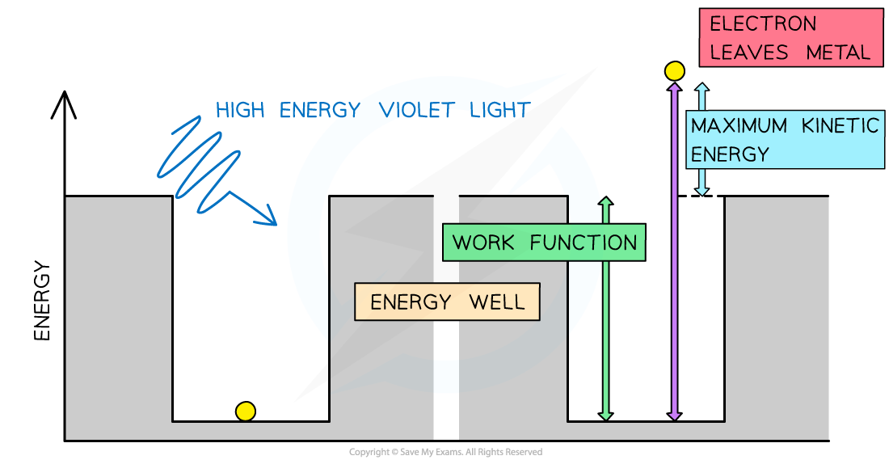
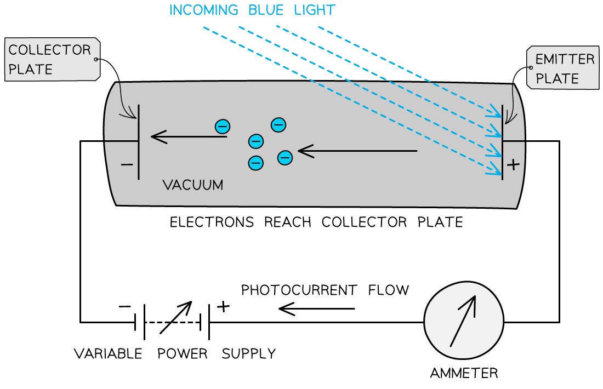

# Threshold Frequency

## Threshold Frequency & Wavelength

> **Spec point** — `spcpt_4xXvQZJ8BD6zQZ3c`

## Threshold frequency & wavelength

### Threshold frequency

- The **threshold frequency** is defined as: **The minimum frequency of incident electromagnetic radiation required to remove a photoelectron from the surface of a metal**

### Threshold wavelength

- The **threshold wavelength**, related to threshold frequency by *the wave equation*, is defined as: **The longest wavelength of incident electromagnetic radiation that would remove a photoelectron from the surface of a metal**
- Threshold frequency and wavelength are properties of a material and vary from metal to metal

#### Threshold frequencies and wavelengths for different metals

| **Metal** | **Threshold Frequency (*****f*****0****) / Hz** | **Threshold Wavelength *****(λ*****0****) / nm** |
|---|---|---|
| Sodium | 4.40 × 1014 | 682 |
| Potassium | 5.56 × 1014 | 540 |
| Zinc | 1.02 × 1015 | 294 |
| Iron | 1.04 × 1015 | 289 |
| Copper | 1.13 × 1015 | 266 |
| Gold | 1.23 × 1015 | 244 |
| Silver | 9.71 × 1015 | 30.9 |

> **Exam Hint**
> A useful analogy for threshold frequency is a fairground coconut shy:
> 
> - One person is throwing table tennis balls at the coconuts, and another person has a pistol
> - No matter how many of the table tennis balls are thrown at the coconut it will still stay firmly in place – this represents the **low frequency quanta**
> - However, a single shot from the pistol will knock off the coconut immediately – this represents the **high frequency quanta**
> 
> 

## Photoelectric Emission

> **Spec point** — `spcpt_7gWTFpQg2Pr2sXnf`

## Photoelectric emission

- The work function *Φ*, or threshold energy, of a material, is defined as: **The minimum energy required to release a photoelectron from the surface of a material**
- It is therefore in units of **J**
- The higher the work function, the harder it is to release an electron from the surface of the metal
- Consider the electrons in a metal as trapped inside an ‘energy well’ where the energy between the surface and the top of the well is equal to the work function *Φ*
- A single electron can absorb only one photon
- Therefore, an electron can only escape the surface of the metal if it absorbs a photon which has an energy equal to Φ or higher

***In the photoelectric effect, a single photon may cause a surface electron to be released if it has sufficient energy***

- Different metals have different threshold frequencies, and hence **different** **work** **functions**
- Using the well analogy:

  - A **more** tightly bound electron requires **more** energy to reach the top of the well
  - A **less **tightly bound electron requires **less** energy to reach the top of the well

- Alkali metals, such as sodium and potassium, have threshold frequencies in the **visible light region**

  - This is because the attractive forces between the surface electrons and positive metal ions are relatively weak
- Transition metals, such as manganese and iron, have threshold frequencies in the **ultraviolet region**

  - This frequency is much higher than light in the visible light region
  - This is because the attractive forces between the surface electrons and positive metal ions are much stronger

#### Stopping potential

- Stopping potential, *V**s*, is defined as: **The potential difference required to stop photoelectron emission from occurring**
- The photons arriving at the metal plate cause photoelectrons to be emitted

  - This is called the **emitter plate**
- The electrons that cross the gap are collected at the other metal plate

  - This is called the **collector plate**

***This set up can be used to determine the maximum kinetic energy of the emitted photoelectrons***

- The flow of electrons across the gap results in an electromotive force (e.m.f.) between the plates that causes a current to flow around the rest of the circuit

  - Effectively, it becomes a photoelectric cell, producing a **photoelectric current**

- If the e.m.f. of the variable power supply is initially zero, the circuit operates **only** on the photoelectric current
- As the supply is turned up, the emitter plate becomes more **positive** (because it is connected to the positive terminal of the supply)
- As a result, electrons leaving the emitter plate are attracted back towards it

  - This is because the potential difference (p.d.) across the tube **opposes** the motion of the electrons between the plates

- If any electrons escape with enough kinetic energy, they can overcome this attraction and cross to the collector plate

  - And if they don't have enough energy, they can't cross the gap

- By increasing the e.m.f. of the supply, eventually, a p.d. will be reached at which no electrons can cross the gap – this is the **stopping potential**, *V**s*
- At this point, the energy needed to cross the gap is equal to the maximum kinetic energy $E_{kmax}$ of the electrons

$V_{s}=\frac{W}{Q}=\frac{E}{Q}=\frac{E_{kmax}}{e}$

- Therefore, the **maximum kinetic energy** of the photoelectrons is:

$E_{kmax}=eV_{s}$

- Where:

  - $E_{kmax}$ = maximum kinetic energy of photoelectrons (i.e. surface electrons)
  - *e* = charge on an electron
  - *V**s* = stopping potential

#### Intensity and stopping potential

- Increasing the **intensity **of the incident radiation on the plate increases:

  - the **number of photons** incident on the metal plate
  - the number of photoelectrons** **emitted from the plate, i.e. the **photoelectric current**

- For a given potential difference, increasing the intensity increases the photoelectric current but the stopping potential remains the **same**

  - This shows that the **intensity** does **not **affect the **kinetic energy** of the photoelectrons

- The **maximum kinetic energy** of the photons (and photoelectrons) depends only on:

  - the frequency (or wavelength) of the incident photons
  - the work function of the metal

- However, if the frequency or wavelength is changed whilst keeping the intensity constant, the photoelectric current will **not** be constant
- For example, **increasing **the frequency of the incident radiation whilst keeping the intensity **constant **will cause the photoelectric current to **decrease**
- This is because:

  - increasing the frequency of a source means the energy of each photon increases
  - keeping intensity the same means the energy transferred per unit area in a given time is constant
  - so, a higher frequency source must emit **fewer **photons per unit area in a given time than a lower frequency source (of the same intensity)
  - if there are fewer photons incident on a given area each second, the number of electrons emitted each second must **decrease**

***The stopping potential remains constant even at different intensities, which shows that intensity does not affect the kinetic energy of the photoelectrons***

> **Exam Hint**
> It is important to note that the stopping voltage actually holds a negative value, but since we use it to determine the maximum kinetic energy of the emitted electrons, its sign is not important in calculations; it's acceptable to just quote its magnitude.
