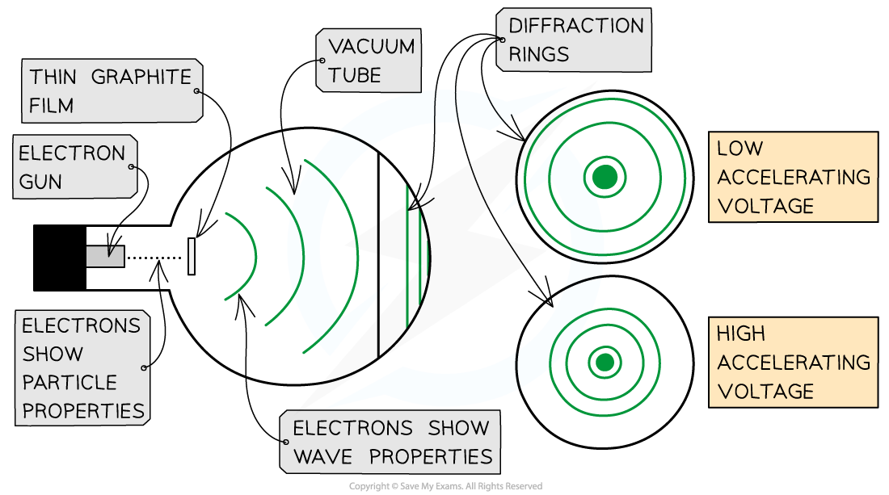
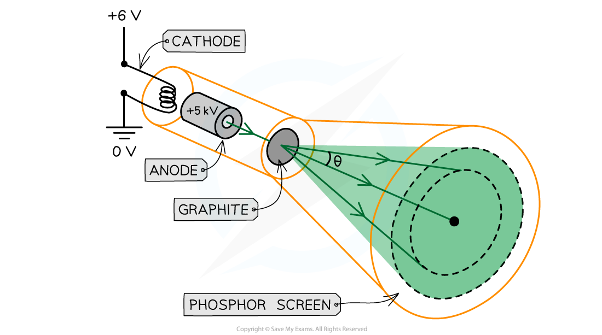

# Wave-Particle Duality

## Wave-Particle Duality

> **Spec point** — `spcpt_xrm5sHYVX4Pv6zSF`

## Wave-particle duality

- Light waves can behave like particles, i.e. photons, **and** waves
- This phenomenon is called the wave-particle nature of light or **wave-particle duality**
- Light interacts with **matter**, such as electrons, **as a particle**

  - The evidence for this is provided by the ***photoelectric effect***
- Light propagates through space as a **wave**

  - The evidence for this comes from the diffraction and interference of light in ***Young’s Double Slit experiment***
  - **Diffraction** occurs when waves pass through a gap or around an obstacle and the waves spread out

#### Light as a particle

- Einstein proposed that light can be described as a quanta of energy that behave as particles, called photons
- The photon model of light explains that:

  - Electromagnetic waves carry energy in *discrete* packets called photons
  - The energy of the photons are quantised according to the equation *E = hf*
  - In the photoelectric effect, each electron can absorb only a single photon - this means only the frequencies of light above the *threshold frequency*  will emit a photoelectron

- The wave theory of light does not support a threshold frequency

  - The wave theory suggests any frequency of light can give rise to photoelectric emission if the exposure time is long enough
  - This is because the wave theory suggests the energy absorbed by each electron will increase gradually with each wave
  - Furthermore, the kinetic energy of the emitted electrons should increase with radiation intensity
  - However, in the photoelectric effect none of this is observed
- If the frequency is above the threshold and the intensity of the light is increased, **more photoelectrons are emitted per second**
- Although the wave theory provided good explanations for phenomena such as interference and diffraction, it failed to explain the photoelectric effect

#### Comparison of wave theory and particulate nature of light

| **The wave theory of light suggests...** | **This is wrong because...** |
|---|---|
| Any frequency of light can give rise to photoelectric emission if the exposure time is long enough | Photoelectrons will be released immediately if the frequency is above the threshold for that metal |
| The energy absorbed by each electron will increase gradually with each wave | Energy is absorbed instantaneously - photoelectron are either emitted or not emitted after exposure to light |
| The kinetic energy of the emitted electrons should increase with radiation intensity | If the intensity of the light is increased, more photoelectron are emitted per second |

## Wave-Particle Duality: Electron Diffraction

> **Spec point** — `spcpt_23GxpxDcPkhw5KWX`

## Wave-particle duality: electron diffraction

### Electron diffraction

- Louis de Broglie discovered that **matter**, such as electrons, can behave as a **wave**
- **Experiments** show that a **diffraction pattern** is produced when a beam of electrons is directed at a thin graphite film
- Diffraction is a property of waves, and cannot be explained by describing electrons as particles

#### Electron diffraction through a vacuum tube

***Electrons accelerated through a high potential difference demonstrate wave-particle duality ***

- In order to observe the diffraction of electrons, they must be focused through a gap similar to their wavelength, such as an atomic lattice
- Graphite film is ideal for this purpose because of its *crystalline* structure

  - The gaps between neighbouring planes of the atoms in the crystals act as slits, allowing the electron waves to spread out and create a diffraction pattern
- The diffraction pattern is observed on the screen as a series of *concentric rings*

  - This phenomenon is similar to the diffraction pattern produced when light passes through a diffraction grating
  - If the electrons acted as particles, a pattern would not be observed, instead the particles would be distributed uniformly across the screen
- It is observed that:

  - a larger accelerating voltage reduces the diameter of a given ring
  - a lower accelerating voltage increases the diameter of the rings

### Investigating electron diffraction

- Electron diffraction tubes can be used to investigate the wave properties of electrons
- The electrons are accelerated in an *electron gun* to a high potential, such as 5000 V, and are then directed through a thin film of graphite
- The electrons diffract from the gaps between carbon atoms and produce a circular pattern on a *fluorescent screen* made from phosphor

#### Electrons accelerated through a high potential

***Electrons are accelerated from the cathode (negative terminal) to the anode (positive terminal) before they are diffracted through a graphite film***

- Increasing the voltage between the anode and the cathode causes the energy, and hence speed, of the electrons to increase
- The kinetic energy of the electrons is proportional to the voltage across the anode-cathode:

$E_{k}=\frac{1}{2}mv^{2}=eV$

- Where:

  - *E*k = kinetic energy (J)
  - *m* = mass (kg)
  - *v* = velocity (m s–1)
  - *e* = charge of an electron (1.60 × 10–19 C)
  - *V* = potential difference (V)
