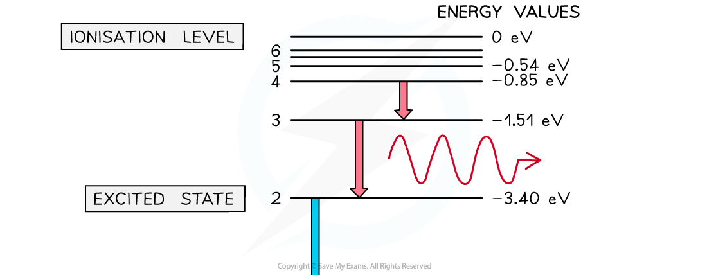
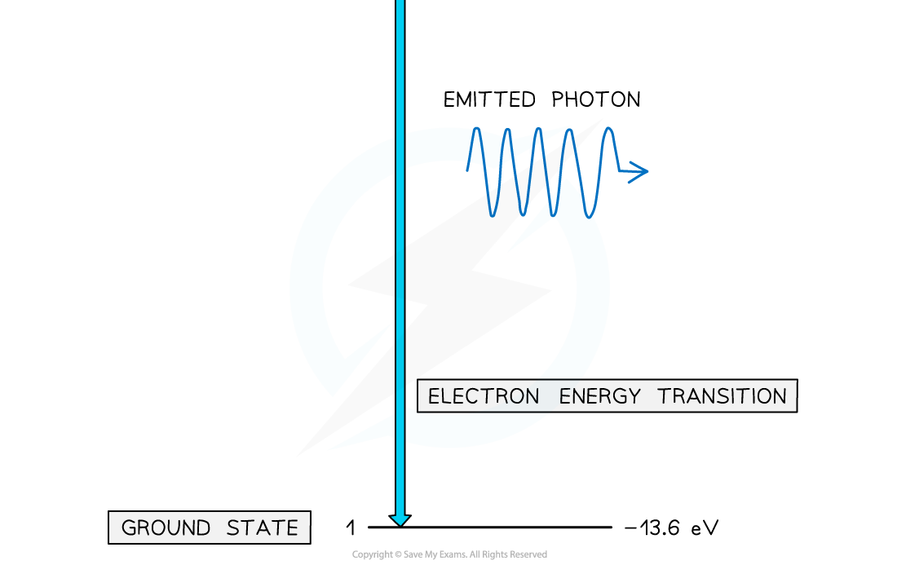

# Atomic Energy Levels

## Atomic Energy Levels

> **Spec point** — `spcpt_BpFfWxB3RH5FX8J3`

## Atomic energy levels

- Electrons in an atom can have only certain specific (discrete) energies

  - These energies are called **electron energy levels**
- They can be represented as a series of stacked horizontal lines increasing in energy
- Normally, electrons occupy the lowest energy level available, this is known as the **ground state**
- Electrons can gain energy and move up the energy levels if they absorb energy by:

  - Collisions with other atoms or electrons
  - Absorbing a photon
  - A physical source, such as heat
- This is known as **excitation**, and when electrons move up an energy level, they are said to be in an **excited state**
- If the electron gains enough energy to be removed from the atom entirely, this is known as **ionisation**
- When an electron returns to a lower energy state from a higher excited state, it releases energy in the form of a photon

#### Electron energy levels in atomic hydrogen

***Photons are emitted when an electron moves from a higher energy state to a lower energy state***
