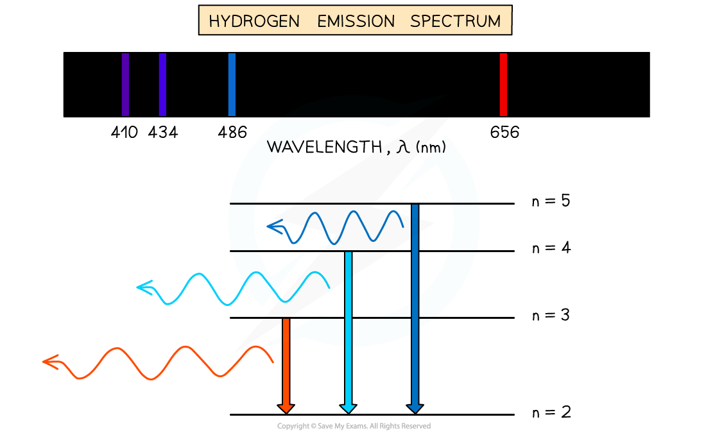
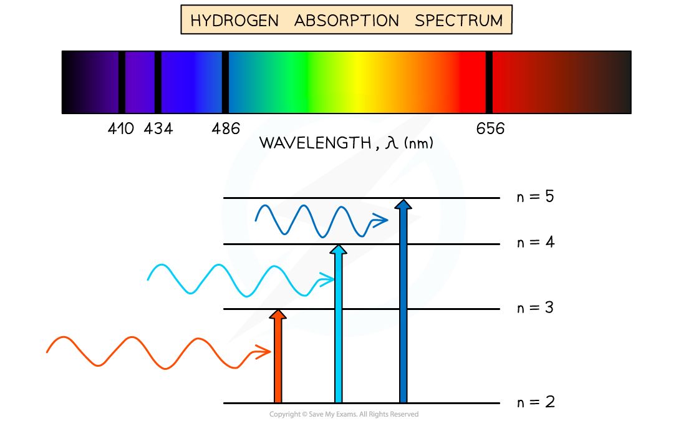

# Line Spectra

## Line Spectra

> **Spec point** — `spcpt_nrSX9SmwsZV4yX63`

## Line spectra

- **Line spectra **are a phenomenon which occurs when **excited **atoms **emit light** of certain wavelengths which correspond to different colours
- The emitted light can be observed as a series of coloured lines with dark spaces in between

  - These series of coloured lines are called **line** **or atomic spectra**
- Each element produces a unique set of spectral lines
- No two elements emit the same set of spectral lines, therefore, elements can be identified by their line spectrum
- There are two types of line spectra: **emission spectra** and **absorption spectra**

### Emission spectra

- When an electron transitions from a **higher **energy level to a **lower **energy level, this results in the **emission** of a photon
- Each transition corresponds to a different wavelength of light and this corresponds to a line in the spectrum
- The resulting emission spectrum contains a set of discrete wavelengths, represented by **coloured lines** on a **black background**
- Each emitted photon has a wavelength which is associated with a discrete change in energy, according to the equation:

$\DeltaE=hf=\frac{hc}{λ}$

- Where:

  - Δ*E *= change in energy level (J)
  - *h* = *Planck’s constant* (J s)
  - *f* = frequency of photon (Hz)
  - *c* = *the speed of light* (m s-1)
  - *λ* = wavelength of the photon (m)
- Therefore, this is evidence to show that electrons in atoms can only transition between **discrete energy levels**

#### Hydrogen emission spectrum

***The colours on the emission spectrum refer to photons emitted from de-exciting from one level to another***

### Absorption spectra

- An atom can be raised to an excited state by the absorption of a photon
- When white light passes through a **cool, low-pressure gas** it is found that light of certain wavelengths are missing

  - This type of spectrum is called an** absorption spectrum**
- An absorption spectrum consists of a *continuous spectrum* containing all the colours with **dark lines** at certain wavelengths
- These dark lines correspond exactly to the differences in energy levels in an atom
- When these electrons return to lower levels, the photons are emitted in all directions, rather than in the original direction of the white light

  - Therefore, some wavelengths appear to be missing
- The wavelengths missing from an absorption spectrum are the same as their corresponding emission spectra of the same element

#### Hydrogen absorption spectrum

***The dark lines on the absorption spectrum refer to photons absorbed from exciting from one level to another***
