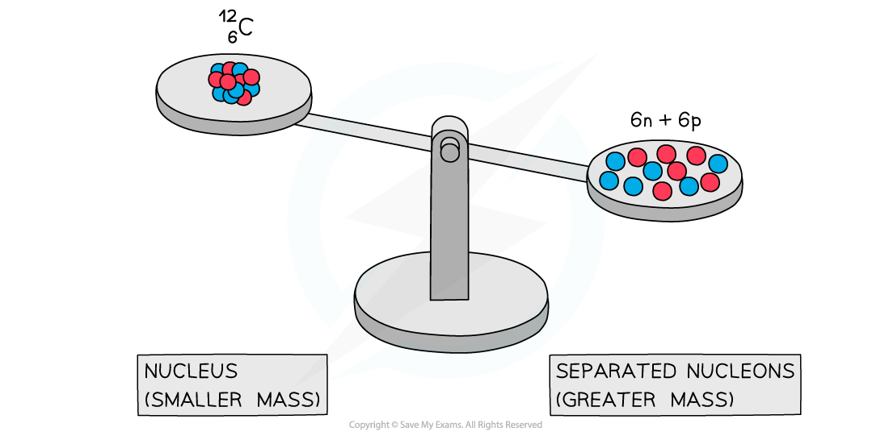

# Mass Defect & Binding Energy

## Mass Defect & Binding Energy

> **Spec point** — `spcpt_sdpMh9FgMBcQwW3x`

## Mass defect & binding energy

### Mass defect

- Experiments into nuclear structure have found that the total mass of a nucleus is **less** than the sum of the masses of its constituent nucleons
- This difference in mass is known as the **mass defect**
- Mass defect is defined as:

**The difference between the mass of a nucleus and the sum of the individual masses of its protons and neutrons**

- The mass defect $\Deltam$ of a nucleus can be calculated using:

$\Delta m = Z m_{p + ( A - Z ) m_{n} - m_{t} o t a l}$

- Where:

  - Z = proton number
  - A = nucleon number
  - *m*p = mass of a proton (kg)
  - *m*n = mass of a neutron (kg)
  - *m*total = measured mass of the nucleus (kg)

#### Mass defect of carbon-12

***A system of separated nucleons has a greater mass than a system of bound nucleons***

- Due to the equivalence of mass and energy, this decrease in mass implies that energy is released in the process
- Since nuclei are made up of neutrons and protons, there are forces of repulsion between the positive protons

  - Therefore, it takes energy, i.e. the binding energy, to hold nucleons together as a nucleus

### Binding energy

- Binding energy is defined as:

**The energy required to break a nucleus into its constituent protons and neutrons**

- Energy and mass are proportional, so the total energy of a nucleus is **less** than the sum of the energies of its constituent nucleons
- The formation of a nucleus from a system of isolated protons and neutrons is therefore an exothermic reaction

  - This means that it **releases energy**

- This energy can be calculated using the equation:

$E=\Deltamc^{2}$

- In a typical nucleus, binding energies are usually measured in **MeV**

  - This is considerably larger than the few eV associated with the binding energy of electrons in the atom

- Nuclear reactions involve changes in the nuclear binding energy whereas chemical reactions involve changes in the electron binding energy

  - This is why nuclear reactions produce **much more energy** than chemical reactions

> **Worked Example**
> Calculate the binding energy per nucleon, in MeV, for the radioactive isotope potassium-40 (`K _ 19 ^ 40`).
> 
> - Nuclear mass of potassium-40 = 39.953 548 u
> - Mass of one neutron = 1.008 665 u
> - Mass of one proton = 1.007 276 u
> 
> **Answer:**
> 
> **Step 1: Identify the number of protons and neutrons in potassium-40**
> 
> - Proton number, Z = 19
> - Neutron number, N = 40 – 19 = 21
> 
> **Step 2: Calculate the mass defect, ∆*****m***
> 
> - Proton mass,*m*p* *= 1.007 276 u
> - Neutron mass,*m*n* *= 1.008 665 u
> - Mass of K-40,*m*total* *= 39.953 548 u
> 
> $\Deltam=Zm_{p}+Nm_{n}-m_{total}$
> 
> ∆*m* = (19 × 1.007276) + (21 × 1.008665) – 39.953 548
> 
> ∆*m* = 0.36666 u
> 
> **Step 3: Convert from u to kg**
> 
> - 1 u = 1.661 × 10–27 kg
> 
> ∆*m* = 0.36666 × (1.661 × 10–27) = 6.090 × 10–28 kg
> 
> **Step 4: Write down the equation for mass-energy equivalence**
> 
> $E=\Deltamc^{2}$
> 
> - Where *c* = *speed of light*
> 
> **Step 5: Calculate the binding energy, *****E***
> 
> *E* = 6.090 × 10–28 × (3.0 × 108)2 = 5.48 × 10–11 J
> 
> **Step 6: Determine the binding energy per nucleon and convert J to MeV**
> 
> - Take the binding energy and divide it by the number of nucleons
> - 1 MeV = 1.6 × 10–13 J
> 
> binding energy per nucleon = $\frac{5.48\times10^{-11}}{40}$ = 1.37 × 10–12 J
> 
> binding energy per nucleon = $\frac{1.37\times10^{-12}}{1.6\times10^{-13}}$ = 8.56 MeV

> **Exam Hint**
> The terms binding energy and mass defect can cause students confusion, so be careful when using them in your explanations.
> 
> Avoid describing the binding energy as the energy stored in the nucleus – this is not correct – it is energy that must be put **into **the nucleus to separate **all** the nucleons**.**
> 
> The same goes for the term mass defect, make sure to only use this when all the nucleons are separated and not to describe the decrease in mass which occurs during radioactive decay.

## Binding Energy per Nucleon

> **Spec point** — `spcpt_v8RfyCzDM42J2vHF`

## Binding energy per nucleon

- In order to compare nuclear stability, it is more useful to look at the **binding energy per nucleon**
- The binding energy per nucleon is defined as:

**The binding energy of a nucleus divided by the number of nucleons in the nucleus**

- A higher binding energy per nucleon indicates a higher stability

  - In other words, more energy is required to separate the nucleons contained within a nucleus

#### Graph of binding energies for nuclei of different masses

***By plotting a graph of binding energy per nucleon against nucleon number, the stability of elements can be inferred***

### Key features of the graph

- At low values of A (nucleon number):

  - Nuclei have lower binding energies per nucleon than at large values of A, but they tend to be stable when N = Z (proton number)
  - This means light nuclei have weaker electrostatic forces and will undergo **fusion**
  - The gradient is **much steeper** compared to the gradient at large values of A
  - This means that fusion reactions release a greater binding energy than fission reactions

- At high values of A (nucleon number):

  - Nuclei have generally higher binding energies per nucleon, but this gradually decreases with A
  - This means the heaviest elements are the most unstable and will undergo **fission**
  - The gradient is **less steep **compared to the gradient at low values of A
  - This means that fission reactions release less binding energy than fusion reactions

- Iron (A = 56) has the highest binding energy per nucleon, which makes it the **most stable** of all the elements

- Helium (4He), carbon (12C) and oxygen (16O) do not fit the trend

  - Helium-4 is a particularly stable nucleus, hence it has a **high** binding energy per nucleon
  - Carbon-12 and oxygen-16 can be considered to be three and four helium nuclei, respectively, bound together

> **Worked Example**
> Determine the binding energy per nucleon of iron-56, `Fe presubscript 26 presuperscript 56`, in MeV.
> 
> - Mass of a neutron = 1.675 × 10-27 kg
> - Mass of a proton = 1.673 × 10-27 kg
> - Mass of an iron-56 nucleus = 9.288 × 10-26 kg
> 
> **Answer:**
> 
> **Step 1: Calculate the mass defect**
> 
> - Number of protons, Z = 26
> - Number of neutrons, A – Z = 56 – 26 = 30
> 
> Mass defect: $\Delta m = Z m_{p + ( A - Z ) m_{n} - m_{t} o t a l}$
> 
> ∆*m* = (26 × 1.673 × 10-27) + (30 × 1.675 × 10-27) – (9.288 × 10-26)
> 
> ∆*m* = 8.680 × 10-28 kg
> 
> **Step 2: Calculate the binding energy of the nucleus**
> 
> Binding energy:  $E=\Deltamc^{2}$
> 
> *E* = (8.680 × 10-28) × (3.00 × 108)2 = 7.812 × 10-11 J
> 
> **Step 3: Calculate the binding energy per nucleon**
> 
> Binding energy per nucleon = $\frac{E}{A}$
> 
> $\frac{E}{A}=\frac{7.812\times10^{-11}}{56}=1.395\times10^{-12}J$
> 
> **Step 4:** **Convert to MeV**
> 
> - J → eV: divide by 1.6 × 10-19
> - eV → MeV: divide by 106
> 
> Binding energy per nucleon =$\frac{1.395\times10^{-12}}{1.6\times10^{-19}}$
> 
> Binding energy per nucleon = $8718750\mathrm{eV}=8.7\mathrm{MeV}$ (2 s.f.)

> **Exam Hint**
> Checklist on what to include (and what not to include) in an exam question asking you to draw a graph of binding energy per nucleon against nucleon number:
> 
> - You will be expected to draw the best fit curve AND a cross to show the anomaly that is helium
> - Do not begin your curve at A = 0, this is not a nucleus!
> - Make sure to correctly label both axes AND units for binding energy per nucleon
> - You will be expected to include numbers on the axes, mainly at the peak to show the position of iron (56Fe)
