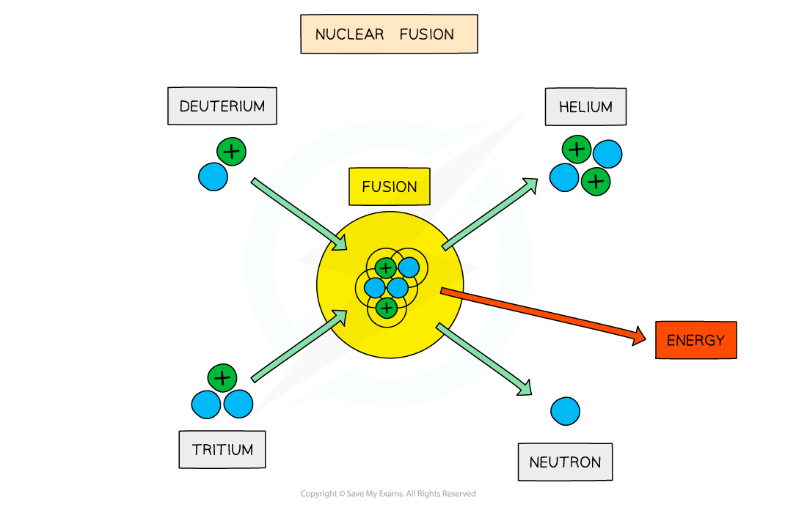

# Nuclear Fusion & Fission

## Nuclear Fusion & Fission

> **Spec point** — `spcpt_6Dgpqwd3m6NjnZn7`

## Nuclear fusion & fission

### Nuclear fusion

- Nuclear fusion is when:

**Two nuclei combine to form a single nucleus**

- Low mass nuclei, such as hydrogen and helium, can undergo fusion and release energy
- For example, when two hydrogen nuclei (protons) fuse, a *deuterium* nucleus is produced

  - A positron and an electron neutrino are also produced as one of the protons converts into a neutron through [beta-plus decay](https://www.savemyexams.com/a-level/physics/cie/25/revision-notes/11-particle-physics/11-1-atoms-nuclei-and-radiation/decay-equations/)

`H _ 1 ^ 1 + H _ 1 ^ 1 -> H _ 1 ^ 2 + e ^ + + nu _ e`

- In the centres of stars, four hydrogen nuclei `( H _ 1 ^ 1 )` fuse to produce a helium nucleus $( He_{2}^{4} )$, plus the release of energy

  - This provides fuel for the star to continue burning
- On Earth, research is focused on achieving the deuterium-tritium (D-T) reaction
- This involves fusing a *deuterium* nucleus and a *tritium* nucleus together to produce a helium nucleus and a neutron

`H _ 1 ^ 2 + H _ 1 ^ 3 -> He _ 2 ^ 4 + n _ 0 ^ 1`

#### Deuterium-tritium fusion

*The fusion of deuterium and tritium nuclei to form a helium nucleus and a neutron, with the release of energy*

- For two nuclei to fuse, both nuclei must have** high kinetic energy**
- This is because nuclei must be able to get close enough to fuse
- However, two forces acting within the nuclei make this difficult to achieve

  - **Electrostatic repulsion **
  
    - Protons inside the nuclei are positively charged, which means that they **electrostatically** repel one another
  - **Strong nuclear force**
  
    - The strong nuclear force, which binds nucleons together, acts at very short distances within nuclei
    - Therefore, nuclei must get very close together for the strong nuclear force to take effect
- It takes a great deal of energy to overcome the electrostatic force, hence, fusion can only be achieved in an **extremely hot** environment, such as the core of a star

### Nuclear fission

- Nuclear fission is when:

**A single large nucleus divides to form smaller nuclei**

- High mass nuclei (such as uranium) can undergo fission and release energy

#### Induced fission

*The fission of a target nucleus, such as uranium, to produce smaller daughter nuclei, with the release of energy*

- Fission must be **induced **by firing neutrons at a nucleus

  - When a neutron strikes a nucleus, it splits into two or more daughter nuclei
  - During fission, neutrons are ejected from the nucleus, which in turn can collide with other nuclei, triggering a cascade effect
  - This leads to a chain reaction, which lasts until all of the material has undergone fission, or the reaction is halted by a moderator
- Nuclear fission is the process which produces energy in nuclear power stations, where it is well controlled
- When nuclear fission is not controlled, the chain reaction can cascade to produce the effects of a nuclear bomb

> **Exam Hint**
> When an atom undergoes nuclear fission, take note that extra neutrons are ejected by the **nucleus **and not from the fission products

## Significance of Binding Energy per Nucleon

> **Spec point** — `spcpt_CfNnF5mBYt7mc76Q`

## Significance of binding energy per nucleon

- At low values of A:

  - attractive nuclear forces between nucleons dominate over repulsive electrostatic forces between protons
  - in the right conditions, nuclei undergo **fusion**

- In fusion, the mass of the nucleus that is created is slightly **less** than the total mass of the original nuclei

  - The mass defect is equal to the binding energy that is released since the nucleus that is formed is more stable

- At high values of A:

  - repulsive electrostatic forces between protons begin to dominate, and these forces tend to break apart the nucleus rather than hold it together
  - in the right conditions, nuclei undergo **fission**

- In fission, an unstable nucleus is converted into more stable nuclei with a smaller total mass

  - This difference in mass, the mass defect, is equal to the binding energy that is released
