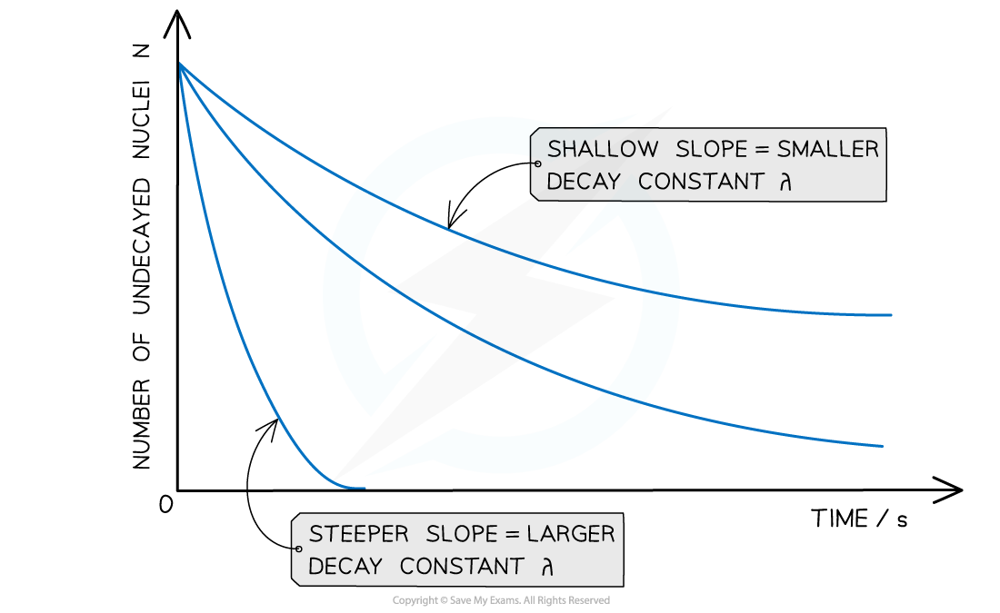

# Activity & The Decay Constant

## Activity & The Decay Constant

> **Spec point** — `spcpt_RHQ3WWvCTMzyrdBd`

## Activity & the decay constant

- Since radioactive decay is spontaneous and random, it is useful to consider the average number of nuclei which are expected to decay per unit time

  - This is known as the **average decay rate**
- As a result, each radioactive element can be assigned a **decay constant**
- The decay constant λ is defined as:

**The probability that an individual nucleus will decay per unit of time**

- When a sample is highly radioactive, this means the number of decays per unit time is very high

  - This suggests it has a high level of **activity**

- Activity, or the number of decays per unit time can be calculated using:

$A=\frac{\DeltaN}{\Deltat}=-λN$

- Where:

  - A = activity of the sample (Bq)
  - ΔN = number of decayed nuclei
  - Δt = time interval (s)
  - λ = decay constant (s-1)
  - N = number of nuclei remaining in a sample

- The activity of a sample is measured in **Becquerels** (Bq)

  - An activity of 1 Bq is equal to one decay per second, or 1 s-1
- This equation shows:

  - The greater the decay constant, the greater the activity of the sample
  - The activity depends on the number of undecayed nuclei remaining in the sample
  - The minus sign indicates that the number of nuclei remaining decreases with time - however, for calculations it can be omitted

> **Worked Example**
> Americium-241 is an artificially produced radioactive element that emits α-particles. A sample of americium-241 of mass 5.1 μg is found to have an activity of 5.9 × 105 Bq.
> 
> (a) Determine the number of nuclei in the sample of americium-241.
> 
> (b) Determine the decay constant of americium-241.
> 
> **Answer: **
> 
> **(a)**
> 
> **Step 1:** **Write down the known quantities**
> 
> - Mass = 5.1 μg = 5.1 × 10-6 g
> - Molecular mass of americium = 241
> - *N**A* = *Avogadro constant*
> 
> **Step 2:** **Write down the equation relating number of nuclei, mass and molecular mass**
> 
> $\mathrm{Number} \mathrm{of} \mathrm{nuclei}=\frac{\mathrm{mass}\timesN_{A}}{\mathrm{molecular} \mathrm{mass}}$
> 
> **Step 3: Calculate the number of nuclei**
> 
> $Number of \text{nuclei} = \frac{ ( 5.1 \times 10^{ - } 6 ) \times ( 6.02 \times 10^{23} ) }{241}$
> 
> **(b)**
> 
> **Step 1: Write the equation for activity**
> 
> Activity, A = λN
> 
> **Step 2: Rearrange for decay constant λ and calculate the answer**
> 
> $λ=\frac{A}{N}=\frac{5.9\times10^{5}}{1.27\times10^{16}}=4.65\times10^{-11}s^{-1}$

## The Exponential Nature of Radioactive Decay

> **Spec point** — `spcpt_wnCGqz6MdtrKNpjx`

## The exponential nature of radioactive decay

- In radioactive decay, the number of nuclei falls very rapidly, without ever reaching zero

  - Such a model is known as **exponential decay**

- The graph of the number of undecayed nuclei against time has a very distinctive shape

#### Graph of undecayed nuclei against time

***Radioactive decay follows an exponential pattern. The graph shows three different isotopes each with a different rate of decay***

- **The key features of this graph are:**

  - The steeper the slope, the larger the decay constant λ (and vice versa)
  - The decay curves always start on the y-axis at the initial number of undecayed nuclei (N0)

### Equations for radioactive decay

- The number of undecayed nuclei N can be represented in exponential form by the equation:

***N***** = *****N*****0****e****–*****λt***

- Where:

  - *N*0 = the initial number of undecayed nuclei (when *t* = 0)
  - *N *= number of undecayed nuclei at a certain time *t*
  - *λ* = decay constant (s-1)
  - *t* = time interval (s)

- The number of nuclei can be substituted for other quantities.
- For example, the activity *A* is directly proportional to *N*, so it can also be represented in exponential form by the equation:

***A***** = *****A*****0****e****–*****λt***

- Where:

  - *A* = activity at a certain time *t* (Bq)
  - *A**0* = initial activity (Bq)

- The received count rate C is related to the activity of the sample, hence it can also be represented in exponential form by the equation:

***C***** = *****C*****0****e****–*****λt***

- Where:

  - *C* = count rate at a certain time *t* (counts per minute or cpm)
  - *C**0* = initial count rate (counts per minute or cpm)

### The exponential function e

- The symbol e represents the exponential constant

  - It is approximately equal to e = 2.718

- On a calculator it is shown by the button ex
- The inverse function of ex is ln(y), known as the natural logarithmic function

  - This is because, if ex = y, then x = ln(y)

> **Worked Example**
> Strontium-90 decays with the emission of a β-particle to form Yttrium-90. The decay constant of Strontium-90 is 0.025 year-1.
> 
> Determine the activity of the sample after 5.0 years, expressing the answer as a fraction of the initial activity A0
> 
> **Answer:**
> 
> **Step 1: Write out the known quantities**
> 
> - Decay constant, λ = 0.025 year-1
> - Time interval, t = 5.0 years
> 
> Both quantities have the same unit, so there is no need for conversion
> 
> **Step 2: Write the equation for activity in exponential form**
> 
> *A* = *A*0e–*λt*
> 
> **Step 3: Rearrange the equation for the ratio between A and A****0**
> 
> $\frac{A}{A_{0}}=e^{-λt}$
> 
> **Step 4: Calculate the ratio A/A****0**
> 
> $\frac{A}{A} _{0} = e^{- ( 0.025 \times 5 )} = 0.88$
> 
> - Therefore, the activity of Strontium-90 decreases by a factor of 0.88, or 12%, after 5 years
